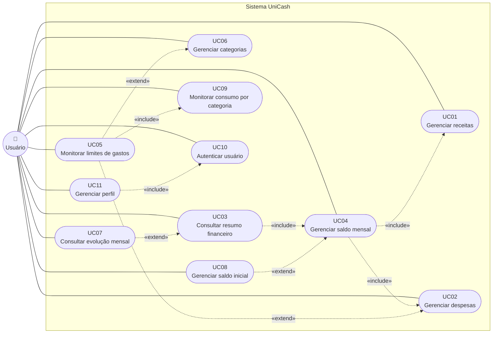

# Casos de Uso

## Visão geral

O diagrama a seguir apresenta o ator principal, os casos de uso do UniCash e os relacionamentos de inclusão e extensão entre eles.

## UC01 - Gerenciar receitas
 
- **Ator principal:** Usuário.
- **Valor:** manter o registro fiel das entradas de dinheiro, para que totais, saldo e indicadores reflitam a realidade.
- **Requisitos funcionais:** RF07, RF08 , RF09, RF10.
 
### Pré-condições
 
- A base local está disponível (RN06).
- O usuário abriu o aplicativo. A conexão só é necessária para sincronizar, não para operar localmente.
- Para editar ou excluir, existe ao menos uma receita registrada.
### Pós-condições
 
- **Sucesso:** a receita (com todas as suas ocorrências, quando há recorrência) fica gravada na base local; totais, saldo e indicadores refletem a alteração; sem conexão, o registro fica marcado como pendente de sincronização (RN06, RF62). Na exclusão, a receita deixa de aparecer e um marcador de exclusão é guardado para ser sincronizado (RN07).
- **Falha:** nenhum registro nem saldo é alterado (RN11, RNF05).
- **Consulta (B):** nenhum dado é alterado.
### Fluxo principal
 
1. O usuário acessa a área de receitas.
2. O sistema lista as receitas do mês corrente, da data mais recente para a mais antiga (RN12), mostrando data completa (dia, mês e ano), título e valor.
3. O usuário escolhe uma operação: **registrar** (A), **filtrar ou detalhar** (B), **editar** (C) ou **excluir** (D).
#### A - Registrar receita (RF07)
 
1. O usuário aciona "Nova receita".
2. O sistema apresenta o formulário com valor, data, título, descrição (opcional) e a opção de recorrência (RN19). Se o usuário indica recorrência, o sistema abre um formulário para informar o intervalo (um número) e a unidade (dias, meses ou anos) e, opcionalmente, a data de término (RN19).
3. O usuário preenche os campos e solicita o registro.
4. O sistema valida no aparelho, antes da gravação na base local: data, título e valor são obrigatórios (RN08); o valor respeita a RN09; título e descrição respeitam a RN10. Se houver recorrência, o intervalo deve ser maior que zero e a data de término, quando informada, deve ser igual ou posterior à data de início (RN19).
5. O sistema persiste a receita na base local e só então confirma o registro (RNF35). Se houver recorrência, as ocorrências são geradas conforme a periodicidade e cada uma é registrada individualmente (RN19).
6. O sistema recalcula totais, saldo e indicadores afetados.
7. Se houver conexão, o sistema sincroniza a receita com o servidor.
8. A nova receita aparece na lista.
#### B - Filtrar e detalhar (RF08)
 
1. O usuário informa uma data única ou um período.
2. O sistema valida o filtro (data inicial menor ou igual à final) e apresenta as receitas correspondentes (RN12).
3. O usuário seleciona uma receita e o sistema exibe todos os seus dados.
#### C - Editar receita (RF09)
 
1. O usuário seleciona a receita e aciona "Editar".
2. O sistema apresenta o formulário preenchido com os dados atuais.
3. O usuário altera um ou mais campos, qualquer um deles (RN20), inclusive a recorrência, e solicita o salvamento. Se a receita pertence a uma série recorrente, o sistema pergunta o alcance da alteração: só esta, esta e as próximas ou todas (FA08).
4. O sistema valida os dados (RN08, RN09, RN10) e, se houver recorrência, o intervalo e a data de término (RN19).
5. O sistema persiste a alteração localmente e recalcula todos os totais afetados, inclusive o mês de origem e o de destino quando a data muda de mês (RN07, RN12).
6. Se houver conexão, o sistema sincroniza a alteração.
7. O sistema confirma a edição.
#### D - Excluir receita (RF10)
 
1. O usuário seleciona a receita e aciona "Excluir".
2. Se a receita pertence a uma série recorrente, o sistema pergunta o alcance da exclusão: só esta, esta e as próximas ou todas (FA08). Em seguida, solicita confirmação explícita informando o alcance escolhido (RN11).
3. O usuário confirma.
4. O sistema exclui a receita e, na mesma operação, recalcula totais, saldo, indicadores e alertas (RN11).
5. Se houver conexão, o sistema sincroniza a exclusão.
6. O sistema informa que a receita foi excluída. A exclusão é definitiva (RN11).
### Fluxos alternativos
 
- **FA01 - Operação offline:** o sistema grava localmente, marca a alteração como pendente de sincronização e sincroniza quando a conexão voltar (RN06, RF62).
- **FA02 - Data futura:** o sistema aceita a data e contabiliza a receita no mês dessa data (RN12).
- **FA03 - Sem filtro:** o sistema mostra o mês corrente (RN12).
- **FA04 - Nenhum registro:** o sistema exibe "Nenhum registro" e sugere alterar o filtro.
- **FA05 - Cancelamento:** se o usuário desiste da edição ou não confirma a exclusão, nada é alterado.
- **FA06 - Edição que muda a data de mês:** o sistema recalcula o mês anterior e o novo mês (RN07, RN12).
- **FA07 - Receita recorrente:** o sistema gera as ocorrências conforme a periodicidade informada, respeitando a data de início e, quando informada, a de término; cada ocorrência entra individualmente nos totais, saldos e indicadores (RN19). Para recorrência sem data de término, o sistema gera as ocorrências até 12 meses à frente e completa a geração sempre que o aplicativo é aberto. Cada ocorrência tem identificador derivado da série e da data, de modo que a geração não duplica ocorrências, inclusive depois de restaurar os dados da nuvem (RN19, RNF26).
- **FA08 - Edição ou exclusão de receita recorrente:** o sistema pergunta o alcance da operação: **só esta** (altera ou exclui apenas a ocorrência selecionada), **esta e as próximas** (aplica a partir da ocorrência selecionada, inclusive) ou **todas** (aplica a toda a série). O sistema recalcula os totais, saldos e indicadores dos meses afetados na mesma operação (RN11, RN19). Cancelar a pergunta de alcance ou a confirmação não altera nada (FA05).
### Exceções
 
Cada exceção indica o passo em que ocorre e o ponto de retorno.
 
- **EX01 - Dados inválidos (A4 e C4):** o sistema não grava e mostra o motivo ao lado de cada campo inválido (RN08, RN09, RN10, RN19, RNF04, RNF14). **Retorno:** ao passo 3 do fluxo A ou C, com os dados digitados preservados. Mensagens:
  - data não informada: "Informe a data da receita."
  - título não informado ou só com espaços: "Informe o título da receita."
  - título com mais de 80 caracteres: "O título deve ter até 80 caracteres."
  - valor não informado: "Informe o valor da receita."
  - valor menor ou igual a zero ou com mais de duas casas decimais: "O valor deve ser maior que zero, com no máximo duas casas decimais."
  - valor acima do limite: "O valor máximo permitido é R$ 999.999.999,99."
  - descrição com mais de 255 caracteres: "A descrição deve ter até 255 caracteres."
  - intervalo da recorrência menor ou igual a zero: "O intervalo da recorrência deve ser maior que zero."
  - término anterior ao início: "A data de término deve ser igual ou posterior à data de início."
- **EX02 - Período inválido (B2):** a data inicial é posterior à final. O sistema não aplica o filtro e informa: "A data inicial deve ser anterior ou igual à data final." **Retorno:** ao passo 1 do fluxo B, com as datas digitadas preservadas.
- **EX03 - Falha na persistência local ou no recálculo (A5 e A6, C5, D4):** o sistema não confirma a operação, nenhum registro ou saldo permanece parcialmente alterado (RN11, RNF05) e informa: "Não foi possível salvar. Nenhuma alteração foi feita. Tente novamente." **Retorno:** ao passo 3 do fluxo A ou C, com os dados preservados; no fluxo D, à lista de receitas (passo 2 do fluxo principal).
- **EX04 - Falha na sincronização (A7, C6, D5):** a operação já está concluída na base local. O registro permanece pendente de sincronização e é reenviado quando houver conexão. **Retorno:** o fluxo segue normalmente no passo seguinte (A8, C7 ou D6).
- **EX05 - Conflito de sincronização (depois de A7, C6 ou D5):** aplica-se a RN07; em edição contra exclusão, a exclusão prevalece. **Retorno:** ao concluir a sincronização, a lista de receitas é atualizada (passo 2 do fluxo principal).
- **EX06 - Receita inexistente ou já excluída (B3, C1, D1):** o sistema informa: "Esta receita não está mais disponível." **Retorno:** à lista de receitas atualizada (passo 2 do fluxo principal).
- **EX07 - Acesso a receita de outro usuário (B3, C1, D1):** o sistema nega o acesso (RNF03) e informa: "Você não tem acesso a esta receita." **Retorno:** à lista de receitas (passo 2 do fluxo principal).
- **EX08 - Falha na leitura local (passo 2 do fluxo principal, B2, B3 e C2):** o sistema informa: "Não foi possível carregar as receitas. Tente novamente." e oferece a ação "Tentar novamente". **Retorno:** ao passo 1 do fluxo principal, ao tentar novamente.
### Requisitos e regras associados
 
- **Funcionais:** RF07, RF08, RF09, RF10. Relacionados: RF11, RF34, RF39 (recálculo), RF59, RF62.
- **Não funcionais específicos:** RNF03, RNF04, RNF05, RNF07, RNF08 , RNF14, RNF26 e RNF35, RNF27, RNF33, RNF36, RNF38.
- **Regras de negócio:** RN06, RN07, RN08, RN09, RN10, RN11, RN12, RN13, RN19, RN20.
----

## UC02 - Gerenciar despesas
 
- **Ator principal:** Usuário.
- **Valor:** registrar e classificar os gastos, base de todos os totais, limites e alertas.
- **Requisitos funcionais:** RF15, RF16, RF17, RF18.
 
### Pré-condições
 
- A base local está disponível (RN06).
- As categorias padrão existem: Casa, Alimentação, Mobilidade, Estudos, Saúde, Lazer e Reserva financeira (RN13). As categorias são gerenciadas no UC06.
- Para editar ou excluir uma despesa, existe ao menos uma despesa registrada.
### Pós-condições
 
- **Sucesso:** a despesa (com todas as ocorrências, quando há recorrência) fica gravada na base local; saldo, totais, limites, indicadores e alertas refletem a alteração; sem conexão, o registro fica pendente de sincronização (RN06, RF62). Na exclusão, um marcador de exclusão é guardado para ser sincronizado (RN07).
- **Falha:** nenhum registro, saldo, limite ou alerta é alterado (RN11, RNF05).
- **Consulta (B):** nenhum dado é alterado.
### Fluxo principal
 
1. O usuário acessa a área de despesas.
2. O sistema lista as despesas do mês corrente, da mais recente para a mais antiga (RN12), em tabela com data, título, valor e categoria.
3. O usuário escolhe uma operação: **registrar** (A), **filtrar ou detalhar** (B), **editar** (C) ou **excluir** (D).
#### A - Registrar despesa (RF15)
 
1. O usuário aciona "Nova despesa".
2. O sistema apresenta o formulário com valor, data, título, descrição (opcional), categoria (opcional) e classificações opcionais (fixa ou variável, essencial ou não essencial, RN13) e a opção de recorrência. Se o usuário indica recorrência, o sistema abre um formulário para informar o intervalo (um número) e a unidade (dias, meses ou anos) e, opcionalmente, a data de término (RN19).
3. O usuário preenche os campos e solicita o registro.
4. O sistema valida no aparelho, antes da gravação na base local (RN08, RN09, RN10) e, se houver recorrência, o intervalo (maior que zero) e a data de término (igual ou posterior ao início, RN19).
5. O sistema persiste a despesa localmente e só então confirma (RNF35). Se houver recorrência, as ocorrências são geradas conforme a periodicidade e cada uma é registrada individualmente (RN19).
6. O sistema recalcula totais, saldo, indicadores de limite e alertas afetados (UC04, UC05 e UC09).
7. Se houver conexão, o sistema sincroniza a despesa.
8. A nova despesa aparece na lista.
#### B - Filtrar e detalhar (RF16)
 
1. O usuário filtra por data única, período e/ou categoria.
2. O sistema valida o filtro e mostra os resultados ordenados (RN12).
3. O usuário seleciona uma despesa e o sistema exibe seus detalhes.
#### C - Editar despesa (RF17)
 
1. O usuário seleciona a despesa e aciona "Editar".
2. O sistema apresenta o formulário preenchido; o usuário altera os campos, qualquer um deles (RN20), e salva. Se a despesa pertence a uma série recorrente, o sistema pergunta o alcance da alteração: só esta, esta e as próximas ou todas (FA08).
3. O sistema valida no cliente e, na sincronização, nas Security Rules (RN08, RN09, RN10; RNF04) e, se houver recorrência, o intervalo (maior que zero) e a data de término (igual ou posterior ao início, RN19); persiste localmente e recalcula saldo, totais, limites e alertas dos meses e categorias de origem e destino (RN07, RN12).
4. Se houver conexão, sincroniza; o sistema confirma a edição.
#### D - Excluir despesa (RF18)
 
1. O usuário seleciona a despesa e aciona "Excluir".
2. Se a despesa pertence a uma série recorrente, o sistema pergunta o alcance da exclusão: só esta, esta e as próximas ou todas (FA08). Em seguida, solicita confirmação explícita informando o alcance escolhido (RN11); o usuário confirma.
3. O sistema exclui e recalcula saldo, totais, indicadores e alertas na mesma operação (RN11).
4. Se houver conexão, sincroniza; o sistema informa a exclusão, que é definitiva.
### Fluxos alternativos
 
- **FA01 - Sem categoria:** a despesa é registrada como "Sem categoria" e fica fora dos limites por categoria (RN13).
- **FA02 - Operação offline:** grava localmente e fica pendente de sincronização (RN06).
- **FA03 - Data futura:** contabilizada no mês da própria data (RN12).
- **FA04 - Filtro por categoria sem resultados:** o sistema exibe "Nenhum registro" e sugere alterar o filtro.
- **FA05 - Cancelamento:** edição descartada ou exclusão não confirmada não alteram nada.
- **FA06 - Mudança de categoria na edição:** o sistema recalcula o consumo da categoria antiga e da nova.
- **FA07 - Despesa recorrente:** o sistema gera as ocorrências conforme a periodicidade informada, respeitando a data de início e, quando informada, a de término; cada ocorrência entra individualmente nos totais, saldos, limites e alertas (RN19). Para recorrência sem data de término, o sistema gera as ocorrências até 12 meses à frente e completa a geração sempre que o aplicativo é aberto; o identificador de cada ocorrência é derivado da série e da data, para não duplicar ocorrências, inclusive depois de restaurar os dados da nuvem (RN19, RNF26).
- **FA08 - Edição ou exclusão de despesa recorrente:** o sistema pergunta o alcance da operação: **só esta**, **esta e as próximas** (a partir da ocorrência selecionada, inclusive) ou **todas** (toda a série). O sistema recalcula saldo, totais, indicadores, limites e alertas dos meses e categorias afetados na mesma operação (RN11, RN19). Cancelar a pergunta de alcance ou a confirmação não altera nada (FA05).
### Exceções
 
Cada exceção indica o passo em que ocorre e o ponto de retorno.
 
- **EX01 - Dados inválidos (A4 e C3):** o sistema não grava e mostra o motivo ao lado de cada campo inválido (RN08, RN09, RN10, RN19, RNF04, RNF14). **Retorno:** ao passo 3 do fluxo A ou ao passo 2 do fluxo C, com os dados digitados preservados. Mensagens:
  - data não informada: "Informe a data da despesa."
  - data inválida: "Informe uma data válida no formato DD/MM/AAAA."
  - título não informado ou só com espaços: "Informe o título da despesa."
  - título com mais de 80 caracteres: "O título deve ter até 80 caracteres."
  - valor não informado: "Informe o valor da despesa."
  - valor menor ou igual a zero ou com mais de duas casas decimais: "O valor deve ser maior que zero, com no máximo duas casas decimais."
  - valor acima do limite: "O valor máximo permitido é R$ 999.999.999,99."
  - descrição com mais de 255 caracteres: "A descrição deve ter até 255 caracteres."
  - intervalo da recorrência menor ou igual a zero: "O intervalo da recorrência deve ser maior que zero."
  - data de término inválida: "Informe a data de término no formato DD/MM/AAAA."
  - término anterior ao início: "A data de término deve ser igual ou posterior à data de início."
  - série com mais de 3.700 ocorrências até o término ou, quando ele estiver em branco, até o horizonte de 12 meses: "A recorrência gera ocorrências demais. Antecipe a data de término ou aumente o intervalo."
- **EX02 - Falha na gravação ou no recálculo (A5 e A6, C3, D3):** nenhuma alteração parcial permanece, nem na despesa, nem em saldo, indicadores ou alertas (RN11, RNF05). O sistema informa: "Não foi possível salvar. Nenhuma alteração foi feita. Tente novamente." **Retorno:** ao formulário, com os dados preservados; no fluxo D, à lista.
- **EX03 - Falha na sincronização (A7, C4, D4):** a operação já está concluída localmente e o registro permanece pendente de sincronização. **Retorno:** o fluxo segue no passo seguinte.
- **EX04 - Conflito de sincronização:** aplica-se a RN07; a exclusão prevalece sobre a edição. **Retorno:** ao concluir a sincronização, a lista é atualizada.
- **EX05 - Despesa inexistente ou já excluída (B3, C1, D1):** o sistema informa: "Esta despesa não está mais disponível." **Retorno:** à lista atualizada (passo 2 do fluxo principal).
- **EX06 - Acesso a dados de outro usuário (B3, C1, D1):** o sistema nega (RNF03) e informa: "Você não tem acesso a esta despesa." **Retorno:** à lista (passo 2 do fluxo principal).
- **EX07 - Período inválido (B2):** o sistema não aplica o filtro e informa: "A data inicial deve ser anterior ou igual à data final." **Retorno:** ao passo 1 do fluxo B, com as datas preservadas.
- **EX08 - Despesa registrada em outro dispositivo com categoria já excluída:** na sincronização a despesa é mantida e passa a constar como "Sem categoria" (RN07, RN13). **Retorno:** ao concluir a sincronização, a lista é atualizada.
- **EX09 - Falha na leitura local (passo 2 do fluxo principal, B2, B3 e C2):** o sistema informa: "Não foi possível carregar as despesas. Tente novamente." e oferece a ação "Tentar novamente". **Retorno:** ao passo 1 do fluxo principal, ao tentar novamente.
### Requisitos e regras associados
 
- **Funcionais:** RF15, RF16, RF17, RF18. Relacionados: RF19 (UC06), RF34, RF37, RF38, RF39, RF59, RF62.
- **Não funcionais específicos:** RNF03, RNF04, RNF05, RNF08, RNF14, RNF26, RNF27, RNF33, RNF35, RNF36, RNF38.
- **Regras de negócio:** RN06, RN07, RN08, RN09, RN10, RN11, RN12, RN13, RN19, RN20.
### Implementação técnica e evidências da UC02

A base principal é o SQLite. A tabela `despesas` guarda o identificador textual, o título, o valor em centavos inteiros, a data no formato `AAAA-MM-DD`, a descrição, a categoria e as classificações opcionais, o vínculo com a série e os campos de sincronização. A tabela `recorrencias` guarda as séries com `tipo = 'despesa'`. Cada ocorrência usa um identificador derivado da série e da data. O cadastro, a edição e a exclusão de ocorrências são gravados em transação local. As consultas por período e categoria excluem registros marcados como excluídos e calculam o total a partir da mesma lista retornada.

Com uma conta autenticada, o serviço envia pendências ao Firestore. Uma falha de rede interrompe a fila e as pendências permanecem no aparelho. Se as regras rejeitarem um registro por falta de permissão, ele permanece pendente e os demais podem ser processados. O Firestore guarda o marcador de exclusão no identificador da despesa, com apenas `excluido_em` e `atualizado_em`. Isso permite sincronizar uma despesa criada e excluída offline. Após a confirmação, o SQLite limpa os dados da despesa e mantém a chave para impedir que o registro reapareça na restauração ou na geração de novas ocorrências.

O seletor e o filtro usam provisoriamente as sete categorias padrão com identificadores fixos, como `casa` e `alimentacao`. Ao restaurar ou aplicar uma edição remota de despesa com categoria indisponível, o serviço registra `categoria_id = NULL` e o app exibe **Sem categoria**. A integração com o UC06 deve incluir o catálogo de categorias próprias e migrar os identificadores provisórios nas despesas e nas séries, tanto no SQLite quanto no Firestore. [UC06, issue #43](https://github.com/mdsreq-fga-unb/REQ-2026.2-T02-UniCash/issues/43)

O [PR #55](https://github.com/mdsreq-fga-unb/REQ-2026.2-T02-UniCash/pull/55) reúne a implementação da [issue #29](https://github.com/mdsreq-fga-unb/REQ-2026.2-T02-UniCash/issues/29) e a [matriz de rastreabilidade](https://github.com/mdsreq-fga-unb/REQ-2026.2-T02-UniCash/blob/a2639b2ebff9f631f6d88888521982187ff0ae64/mobile/tests/RASTREABILIDADE-UC02.md). O CI do commit `a2639b2` aprovou [lint, typecheck, testes e build](https://github.com/mdsreq-fga-unb/REQ-2026.2-T02-UniCash/actions/runs/44631930863/job/135940531239) e [regras de segurança no emulador](https://github.com/mdsreq-fga-unb/REQ-2026.2-T02-UniCash/actions/runs/44631930863/job/135940531020).

A prova manual de persistência local, precisão e encerramento forçado segue pendente, assim como a aprovação da revisão técnica. A prova de sincronização e restauração pelo app depende da [autenticação, issue #61](https://github.com/mdsreq-fga-unb/REQ-2026.2-T02-UniCash/issues/61). A validação integrada de saldo, limites e indicadores depende do [UC04](https://github.com/mdsreq-fga-unb/REQ-2026.2-T02-UniCash/issues/31), [UC05](https://github.com/mdsreq-fga-unb/REQ-2026.2-T02-UniCash/issues/32) e [UC09](https://github.com/mdsreq-fga-unb/REQ-2026.2-T02-UniCash/issues/46).

---

## UC03 - Consultar resumo financeiro
 
- **Ator principal:** Usuário.
- **Valor:** dar uma visão rápida de quanto entrou e saiu em cada dia e mês.
- **Requisitos funcionais:** RF11, RF40.
 
### Pré-condições
 
- A base local está disponível (RN06).
- O usuário abriu o aplicativo.
### Pós-condições
 
- **Consulta:** nenhum dado é alterado; a tela apresenta os totais do mês selecionado.
### Fluxo principal
 
1. O usuário abre o aplicativo ou acessa o resumo financeiro.
2. O sistema assume o mês corrente como período padrão (RN12).
3. O sistema calcula, a partir dos lançamentos da base local, o total de receitas por dia e do mês (RF11); o saldo (UC04), o total de despesas e o progresso das metas do período (RF40).
4. O sistema apresenta o saldo, o total de receitas, o total de despesas e o progresso das metas do período selecionado (RF40) e o total de receitas de cada dia que tem lançamento (RF11).
5. O usuário seleciona outro mês pelo seletor.
6. O sistema recalcula e apresenta os valores do mês escolhido.
### Fluxos alternativos
 
- **FA01 - Mês sem receitas:** o sistema apresenta total igual a zero.
- **FA02 - Sem nenhum lançamento:** o sistema exibe estado vazio com atalho para o tutorial (RF55).
- **FA03 - Consulta offline:** o sistema calcula com os lançamentos locais (RN06).
- **FA04 - Mês futuro:** o sistema inclui lançamentos de data futura no mês correspondente (RN12).
- **FA05 - Lançamento alterado ou excluído:** o resumo é recalculado ao reabrir ou voltar à tela (UC01, UC02).
### Exceções
 
Cada exceção indica o passo em que ocorre e o ponto de retorno.
 
- **EX01 - Falha na leitura ou no cálculo (passos 3 e 6):** o sistema informa: "Não foi possível calcular os totais. Tente novamente." e oferece a ação "Tentar novamente". **Retorno:** ao passo 2 do fluxo principal, ao tentar novamente.
### Requisitos e regras associados
 
- **Funcionais:** RF11, RF40. Relacionados: RF07, RF12, RF15, RF34, RF41, RF42, RF55, RF68 (UC07).
- **Não funcionais específicos:** RNF07, RNF08, RNF20, RNF29, RNF33, RNF34, RNF38.
- **Regras de negócio:** RN06, RN07, RN09, RN12.
---

## UC04 - Gerenciar saldo mensal
 
- **Ator principal:** Usuário.
- **Valor:** saber quanto dinheiro sobra em cada mês.
- **Requisitos funcionais:** RF34, RF35 (exibição do saldo anterior).
 
### Pré-condições
 
- O usuário abriu a área de resumo.
- Para o saldo do mês: existem lançamentos e/ou um saldo inicial (UC08).
### Fluxo principal
 
1. O usuário acessa o resumo financeiro.
2. O sistema identifica o mês de referência (mês corrente por padrão).
3. O sistema obtém o **saldo anterior** (RN16): o saldo do mês anterior (RN15) ou, no mês do saldo inicial, o valor informado; sem dado disponível, o sistema informa que não há dados.
4. O sistema soma as receitas e as despesas do mês.
5. O sistema calcula o saldo do mês: total de receitas − total de despesas (RN15); o saldo anterior não entra nesse cálculo.
6. O sistema apresenta o saldo do mês, o saldo anterior como referência (RF35) e o indicador de cor com texto (RN17, RNF38).
7. O sistema verifica se o saldo passou de maior ou igual a zero para negativo e, se sim, emite o alerta de saldo negativo (RN18).
### Fluxos alternativos
 
- **FA01 - Mês sem lançamentos:** o saldo do mês é R$ 0,00 e o saldo anterior continua exibido como referência (RN15).
- **FA02 - Mês anterior ao mês de referência do saldo inicial:** o sistema informa que não há dados de saldo anterior e ignora lançamentos anteriores àquele mês (RN16).
- **FA03 - Sem saldo inicial e sem mês anterior com dados:** o sistema informa que não há dados de saldo anterior (RN16).
- **FA04 - Consulta offline:** o saldo é calculado localmente (RN06).
- **FA05 - Lançamento criado, editado ou excluído:** o saldo é recalculado (UC01, UC02).
- **FA06 - Saldo volta a zero ou positivo e fica negativo de novo:** um novo alerta é emitido (RN18).
- **FA07 - Mês sem receitas:** o indicador de cor é preto (RN17).
- **FA08 - Preferências de notificação:** o alerta de saldo negativo permanece sempre ativo, pois o RF58 não o prevê, até validação (RN18).
### Exceções
 
- **EX01 - Falha de cálculo:** o sistema informa que não foi possível calcular o saldo.
- **EX02 - Dados inconsistentes:** o sistema recalcula a partir dos lançamentos e do saldo inicial (RN07).
- **EX03 - Falha ao emitir o alerta:** o sistema trata a falha sem corromper saldo nem lançamentos.
### Requisitos e regras associados
 
- **Funcionais:** RF34, RF35. Relacionados: RF07, RF15, RF11, RF17, RF18.
- **Não funcionais específicos:** RNF07, RNF08, RNF29, RNF38.
- **Regras de negócio:** RN06, RN07, RN15, RN16, RN17, RN18.

### Implementação e verificação do UC04

O resumo lê os lançamentos do UC01 e do UC02 no SQLite e calcula o saldo a cada consulta. O saldo inicial local é a referência provisória para a integração com o UC08. Os limites de gasto pertencem ao UC05. A apresentação percentual segue a [RN21](requisitos_funcionais.md#rn21-precisao-dos-valores-monetarios-rnf07).

Cada passagem de saldo não negativo para negativo recebe um número de transição único no mês na base local. O lançamento e o alerta são gravados na mesma transação. Se a gravação local do alerta falhar, os dados anteriores são preservados e a interface permite tentar novamente. Uma falha de envio mantém o alerta pendente para reenvio com o mesmo identificador.

A tabela de rastreabilidade, os resultados e o roteiro de verificação em aparelho ficam na [issue #31](https://github.com/mdsreq-fga-unb/REQ-2026.2-T02-UniCash/issues/31). A implementação e os checks ficam no [PR #68](https://github.com/mdsreq-fga-unb/REQ-2026.2-T02-UniCash/pull/68). A evidência em aparelho permanece pendente.

---

## UC05 - Monitorar limites de gastos
 
**Ator principal:** Usuário (o sistema dispara os alertas).
**Valor:** o usuário é avisado antes e depois de estourar o limite de uma categoria ou de uma meta de gasto.
**Requisitos funcionais:** RF37, RF38.
 
### Pré-condições
 
- Existe uma categoria com limite definido (UC06), própria ou padrão (RN13, RN14), ou uma meta de gasto com valor alvo (RF12, definida fora deste UC).
- Para limite percentual, existe renda mensal no mês consultado (RN14).
### Fluxo principal
 
1. O usuário registra, edita ou exclui uma despesa ou uma categoria (UC02, UC06), altera um limite ou muda a renda do mês.
2. O sistema calcula o consumo do limite de cada categoria com limite e de cada meta de gasto (gasto acumulado do mês ÷ limite efetivo, RN14), conforme o UC09.
3. O sistema verifica os alertas (RN03):
   - gasto que atinge 80% do limite da categoria ou do valor alvo da meta: alerta de aproximação (RF37);
   - gasto que supera 100% do limite da categoria ou do valor alvo da meta: alerta de ultrapassagem (RF38).
4. Se o tipo de alerta estiver ativado nas preferências (RF58), o sistema apresenta a notificação com apenas os valores envolvidos (gasto, limite e categoria ou meta), sem termos de julgamento, e registra a emissão no período.
### Fluxos alternativos
 
- **FA01 - Categoria sem limite:** o sistema não emite alerta (RN14).
- **FA02 - Despesas "Sem categoria":** ficam fora do cálculo de limites por categoria (RN13).
- **FA03 - Limite percentual:** o limite efetivo é o percentual da renda do mês (RN14).
- **FA04 - Alerta já emitido no período:** o sistema não repete (RN03).
- **FA05 - Salto direto de abaixo de 80% para acima de 100%:** o sistema emite apenas um alerta, o de ultrapassagem (RN03).
- **FA06 - Alertas desativados em RF58:** o consumo continua sendo calculado (UC09); apenas a notificação deixa de ser exibida.
- **FA07 - Novo período:** o consumo é recalculado para o novo período e os alertas voltam a poder ser emitidos (RN03).
- **FA08 - Offline:** cálculo e alertas funcionam com os dados locais (RN06).
- **FA09 - Categoria editada ou excluída:** os alertas são recalculados na mesma operação (RN13, RN14); se a categoria foi excluída, seus alertas deixam de existir e as despesas passam a "Sem categoria", fora do cálculo de limites (RN13).
### Exceções
 
- **EX01 - Limite efetivo igual a zero** (limite percentual em mês sem receitas): o consumo não pode ser calculado, o alerta não é avaliado e as regras de negócio não definem o comportamento (RN14; ver pontos para validação).
- **EX02 - Falha no cálculo do consumo:** o alerta não é avaliado (UC09, EX02).
- **EX03 - Falha ao emitir o alerta:** o sistema trata a falha sem corromper lançamentos nem saldo, e não registra a emissão para poder tentar de novo.
- **EX04 - Acesso a dados de outro usuário:** o sistema nega (RNF03).
### Requisitos e regras associados
 
- **Funcionais:** RF37, RF38. Relacionados: RF39 (UC09), RF19 (UC06), RF12, RF15, RF58, RF34.
- **Não funcionais específicos:** RNF07, RNF08, RNF29, RNF38.
- **Regras de negócio:** RN03, RN06, RN07, RN13, RN14.
---

## UC06 - Gerenciar categorias
 
- **Ator principal:** Usuário.
- **Valor:** organizar os gastos em categorias, próprias ou padrão, e definir os limites que alimentam os indicadores e os alertas.
- **Requisitos funcionais:** RF19, RF65, RF66, RF67.
 
### Pré-condições
 
- A base local está disponível (RN06).
- As categorias padrão existem: Casa, Alimentação, Mobilidade, Estudos, Saúde, Lazer e Reserva financeira (RN13).
- Para renomear ou excluir uma categoria, existe ao menos uma categoria própria. As padrão não podem ser renomeadas nem excluídas, mas permitem definir limite (RN13, RN14).
### Pós-condições
 
- **Sucesso:** a categoria fica gravada na base local; indicadores e alertas de limite refletem a alteração; sem conexão, o registro fica pendente de sincronização (RN06, RF62). Na exclusão, um marcador de exclusão é guardado para ser sincronizado (RN07) e as despesas da categoria passam a "Sem categoria" (RN13).
- **Falha:** nenhuma categoria, despesa, limite ou alerta é alterado (RN11, RNF05).
- **Consulta (A):** nenhum dado é alterado.
### Fluxo principal
 
1. O usuário acessa a lista de categorias.
2. O sistema exibe as categorias padrão e próprias, identificando as padrão e mostrando o limite de gasto de cada uma, quando definido (RF65).
3. O usuário escolhe uma operação: **abrir uma categoria** (A), **criar** (B), **editar** (C) ou **excluir uma categoria própria** (D).
#### A - Abrir categoria (RF65)
 
1. O usuário seleciona uma categoria para ver os lançamentos classificados nela.
2. O sistema exibe a consulta de despesas já filtrada por essa categoria (UC02, fluxo B).
#### B - Criar categoria própria (RF19)
 
1. O usuário aciona "Nova categoria" e informa o nome e, opcionalmente, um limite de gasto (valor em R$ ou percentual da renda mensal, RN14).
2. O sistema valida o nome (único por usuário, sem diferenciar maiúsculas e minúsculas, com 1 a 30 caracteres, RN13) e, se informado, o limite: em R$, conforme a RN09; em percentual, maior que 0% e até 100%, com até duas casas decimais (RN14). Em seguida, persiste e confirma. A faixa do percentual é proposta e está pendente de validação com a cliente.
3. Se houver conexão, o sistema sincroniza a categoria.
#### C - Editar categoria (RF66)
 
1. O usuário seleciona uma categoria e altera o limite; em categoria própria, também o nome. Em categoria padrão, só o limite pode ser alterado (RN13, RN14).
2. O sistema valida o nome, se alterado (único por usuário, sem diferenciar maiúsculas e minúsculas, com 1 a 30 caracteres, RN13), e o limite, nas mesmas condições do passo B2, e persiste a alteração.
3. O sistema recalcula, na mesma operação, os indicadores de consumo e os alertas de limite afetados (RN14, UC05 e UC09).
4. Se houver conexão, o sistema sincroniza a categoria.
5. O sistema confirma a edição.
#### D - Excluir categoria própria (RF67)
 
1. O usuário seleciona uma categoria própria e aciona "Excluir".
2. O sistema solicita confirmação explícita (RN11) e informa que as despesas da categoria serão mantidas como "Sem categoria" e que o histórico da categoria (limite e alertas) será perdido (RN13).
3. O usuário confirma.
4. O sistema exclui a categoria com todo o seu histórico (limite, indicadores e alertas); as despesas associadas não são excluídas e passam a constar como "Sem categoria" (RN13).
5. O sistema recalcula, na mesma operação, os indicadores e alertas dependentes (RN13, RN14).
6. Se houver conexão, sincroniza; o sistema informa a exclusão, que é definitiva (RN11).
### Fluxos alternativos
 
- **FA01 - Operação offline:** grava localmente e fica pendente de sincronização (RN06).
- **FA02 - Categoria sem lançamentos:** o sistema mostra a categoria com zero lançamentos e a consulta filtrada exibe "Nenhum registro".
- **FA03 - Exclusão de categoria com lançamentos:** as despesas continuam registradas e passam a aparecer como "Sem categoria", fora dos limites por categoria (RN13).
- **FA04 - Categoria sem limite:** a edição ou exclusão não gera recálculo de indicadores nem de alertas.
- **FA05 - Cancelamento de edição ou de exclusão de categoria:** nada é alterado.
### Exceções
 
Cada exceção indica o passo em que ocorre e o ponto de retorno.
 
- **EX01 - Nome de categoria duplicado (B2 e C2):** o sistema rejeita e informa: "Já existe uma categoria com este nome." **Retorno:** ao passo 1 do fluxo B ou C, com os dados preservados.
- **EX02 - Categoria padrão (C1 e D1):** as ações de renomear e excluir não aparecem nas categorias padrão (RN13, RF66, RF67); se acionadas por outro meio, o sistema informa: "Categorias padrão não podem ser renomeadas nem excluídas." Só o limite pode ser alterado (RN13, RN14). **Retorno:** à lista de categorias (passo 2 do fluxo principal).
- **EX03 - Limite inválido (B2 e C2):** o sistema rejeita e informa o motivo (RN09, RN14, RNF14). Mensagens: "O limite deve ser maior que zero, com no máximo duas casas decimais."; "O valor máximo permitido é R$ 999.999.999,99."; "O percentual deve ser maior que 0% e até 100%." **Retorno:** ao passo 1 do fluxo B ou C, com os dados preservados.
- **EX04 - Falha na gravação ou no recálculo (B2, C2 e C3, D4 e D5):** nenhuma alteração parcial permanece, nem na categoria, nem nas despesas, nem em indicadores ou alertas (RN11, RNF05). O sistema informa: "Não foi possível salvar. Nenhuma alteração foi feita. Tente novamente." **Retorno:** ao formulário, com os dados preservados; no fluxo D, à lista de categorias.
- **EX05 - Falha na sincronização (B3, C4, D6):** a operação já está concluída localmente e o registro permanece pendente de sincronização. **Retorno:** o fluxo segue no passo seguinte.
- **EX06 - Categoria inexistente ou já excluída (A1, C1 e D1):** o sistema informa: "Esta categoria não está mais disponível." **Retorno:** à lista de categorias atualizada (passo 2 do fluxo principal).
- **EX07 - Nome de categoria inválido (B2 e C2):** o sistema rejeita e informa: "Informe o nome da categoria." ou "O nome da categoria deve ter até 30 caracteres." (RN13). **Retorno:** ao passo 1 do fluxo B ou C, com os dados preservados.
- **EX08 - Conflito de sincronização:** aplica-se a RN07; a exclusão prevalece sobre a edição. **Retorno:** ao concluir a sincronização, a lista de categorias é atualizada.
- **EX09 - Acesso a dados de outro usuário (A1, C1 e D1):** o sistema nega (RNF03) e informa: "Você não tem acesso a esta categoria." **Retorno:** à lista de categorias (passo 2 do fluxo principal).
- **EX10 - Falha na leitura local (passo 2 do fluxo principal):** o sistema informa: "Não foi possível carregar as categorias. Tente novamente." e oferece a ação "Tentar novamente". **Retorno:** ao passo 1 do fluxo principal, ao tentar novamente.
### Requisitos e regras associados
 
- **Funcionais:** RF19, RF65, RF66, RF67. Relacionados: RF15, RF16, RF37, RF38, RF39, RF59, RF62.
- **Não funcionais específicos:** RNF03, RNF04, RNF05, RNF14, RNF35, RNF36.
- **Regras de negócio:** RN06, RN07, RN09, RN11, RN13, RN14.
---

## UC07 - Consultar evolução mensal
 
- **Ator principal:** Usuário.
- **Valor:** dar uma visão rápida de como os meses se comparam, em receitas e despesas.
- **Requisitos funcionais:** RF68.
 
### Pré-condições
 
- A base local está disponível (RN06).
- O usuário abriu o aplicativo.
### Pós-condições
 
- **Consulta:** nenhum dado é alterado; a tela apresenta o gráfico do mês selecionado.
### Fluxo principal
 
1. O usuário acessa a evolução mensal, na tela do resumo financeiro (UC03).
2. O sistema assume o mês corrente como mês selecionado (RN12).
3. O sistema calcula, a partir dos lançamentos da base local, o total de receitas e o total de despesas de cada mês do gráfico (RF68).
4. O sistema apresenta o gráfico de barras de evolução mensal, com o total de receitas e o total de despesas de cada mês (RF68), limitado a 6 meses (RN12): o mês selecionado e os 5 anteriores. As barras de receita e despesa seguem a paleta (RNF38).
5. O usuário seleciona outro mês, pelo seletor ou tocando em uma barra do gráfico.
6. O sistema atualiza o mês selecionado, que é o mesmo do resumo (UC03), e recalcula o gráfico. Se o mês estava fora da janela do gráfico, a janela se desloca para terminar nele (FA05).
### Fluxos alternativos
 
- **FA01 - Mês sem receitas ou sem despesas:** a barra correspondente mostra valor igual a zero.
- **FA02 - Sem nenhum lançamento:** o sistema exibe estado vazio com atalho para o tutorial (RF55).
- **FA03 - Consulta offline:** o sistema calcula com os lançamentos locais (RN06).
- **FA04 - Mês futuro:** o sistema inclui lançamentos de data futura no mês correspondente (RN12).
- **FA05 - Mês fora da janela do gráfico:** ao escolher no seletor um mês fora dos 6 exibidos, o gráfico passa a mostrar esse mês e os 5 anteriores.
- **FA06 - Lançamento alterado ou excluído:** o gráfico é recalculado ao reabrir ou voltar à tela (UC01, UC02).
### Exceções
 
Cada exceção indica o passo em que ocorre e o ponto de retorno.
 
- **EX01 - Falha na leitura ou no cálculo (passos 3 e 6):** o sistema informa: "Não foi possível carregar a evolução mensal. Tente novamente." e oferece a ação "Tentar novamente". **Retorno:** ao passo 2 do fluxo principal, ao tentar novamente.
### Requisitos e regras associados
 
- **Funcionais:** RF68. Relacionados: RF07, RF15, RF11 (UC03), RF55.
- **Não funcionais específicos:** RNF07, RNF08, RNF20, RNF34, RNF38.
- **Regras de negócio:** RN06, RN07, RN12.
---

## UC08 - Gerenciar saldo inicial
 
- **Ator principal:** Usuário.
- **Valor:** corrigir o ponto de partida do cálculo do saldo.
- **Requisitos funcionais:** RF35 (definição do saldo inicial).
 
### Pré-condições
 
- O usuário abriu a área de configurações financeiras.
### Fluxo principal
 
1. O usuário acessa "Saldo inicial".
2. O sistema mostra o saldo inicial atual, se existir.
3. O usuário informa o valor, que pode ser negativo, e o mês de referência.
4. O sistema valida o valor e o mês de referência (RN16).
5. O sistema persiste o saldo inicial localmente, recalcula os saldos dos meses seguintes (RN16) e confirma.
6. Se houver conexão, sincroniza.
### Fluxos alternativos
 
- **FA01 - Saldo inicial negativo:** o sistema aceita (RN16).
- **FA02 - Alteração do saldo inicial:** substitui o valor anterior e recalcula os meses seguintes (RN16).
- **FA03 - Operação offline:** grava localmente e fica pendente de sincronização (RN06).
### Exceções
 
- **EX01 - Valor ou mês de referência inválido:** o sistema rejeita e informa o motivo (RNF14).
- **EX02 - Falha ao salvar o saldo inicial:** o sistema não confirma e nenhum saldo fica parcialmente atualizado (RNF05).
### Requisitos e regras associados
 
- **Funcionais:** RF35. Relacionados: RF34 (UC04), RF11.
- **Não funcionais específicos:** RNF05, RNF14, RNF35.
- **Regras de negócio:** RN06, RN07, RN16.
---

## UC09 - Monitorar consumo por categoria
 
**Ator principal:** Usuário.
**Valor:** o usuário enxerga quanto já gastou de cada limite.
**Requisitos funcionais:** RF39.
 
### Pré-condições
 
- Existe uma categoria com limite definido (UC06), própria ou padrão (RN13, RN14), ou uma meta de gasto com valor alvo (RF12, definida fora deste UC).
- Para limite percentual, existe renda mensal no mês consultado (RN14).
### Fluxo principal
 
1. O usuário acessa o resumo ou a lista de categorias, ou registra, edita ou exclui uma despesa ou uma categoria (UC02, UC06), altera um limite ou muda a renda do mês.
2. O sistema calcula o gasto acumulado do mês de cada categoria com limite e de cada meta de gasto.
3. O sistema determina o **limite efetivo**: o valor em R$ ou o percentual aplicado sobre a renda mensal (RN14).
4. O sistema calcula o consumo do limite (gasto ÷ limite efetivo).
5. O sistema atualiza o indicador visual da categoria conforme as faixas (RN02) (RF39) (RNF38).
6. O usuário consulta os indicadores no resumo e na lista de categorias e escolhe o período a visualizar.
### Fluxos alternativos
 
- **FA01 - Categoria sem limite:** o sistema não exibe indicador (RN14).
- **FA02 - Categoria sem despesas:** com limite definido, o indicador mostra consumo zero (verde).
- **FA03 - Despesas "Sem categoria":** ficam fora do cálculo de limites por categoria (RN13).
- **FA04 - Limite percentual:** o limite efetivo é o percentual da renda do mês (RN14).
- **FA05 - Exclusão ou edição reduz o consumo:** o indicador é atualizado (RN07).
- **FA06 - Novo período:** o consumo é recalculado para o novo período (RN14).
- **FA07 - Offline:** o cálculo funciona com os dados locais (RN06).
- **FA08 - Categoria editada ou excluída:** os indicadores são recalculados na mesma operação (RN13, RN14); se a categoria foi excluída, seu limite e indicador deixam de existir e as despesas passam a "Sem categoria", fora do cálculo de limites (RN13).
### Exceções
 
- **EX01 - Limite efetivo igual a zero** (limite percentual em mês sem receitas): o consumo não pode ser calculado e as regras de negócio não definem o comportamento (RN14; ver pontos para validação).
- **EX02 - Falha no cálculo:** o sistema informa que o indicador não pôde ser atualizado.
- **EX03 - Acesso a dados de outro usuário:** o sistema nega (RNF03).
### Requisitos e regras associados
 
- **Funcionais:** RF39. Relacionados: RF19 (UC06), RF12, RF15, RF34, RF37 e RF38 (UC05).
- **Não funcionais específicos:** RNF07, RNF08, RNF29, RNF38. A exigência de não depender apenas da cor segue a mesma linha do RNF33, mesmo que a tela não conste na lista de telas principais dele.
- **Regras de negócio:** RN02, RN06, RN07, RN13, RN14.
---

## UC10 - Autenticar usuário

- **Ator principal:** Usuário.
- **Classificação:** condicional. O uso financeiro individual funciona sem conta, internet ou Firebase (D20, RF61); a conta serve para sincronizar e restaurar os dados.
- **Valor:** proteger os dados do usuário em uma conta própria, para que ele possa sincronizar o que registrou e recuperar os dados em outro aparelho.
- **Requisitos funcionais:** RF01, RF02, RF06, RF31.

### Pré-condições

- O usuário escolheu usar conta e sincronização; quem não escolheu continua usando o aplicativo apenas no aparelho (RN06).
- Para cadastrar (A), confirmar o e-mail (E) e recuperar a senha (C), há conexão com a internet (RN06).
- Para entrar (B), existe uma conta cadastrada.
- Para encerrar a sessão (D), existe uma sessão ativa.

### Pós-condições

- **Sucesso (A):** a conta e o perfil estão criados e a ligação de confirmação foi enviada ao e-mail; a conta só vale depois da confirmação (E).
- **Sucesso (E):** o e-mail está confirmado, a sessão está iniciada e o usuário decidiu se os dados do aparelho vão para a nuvem.
- **Sucesso (B):** a sessão está iniciada e a sincronização está retomada (RNF02).
- **Sucesso (C):** a nova senha está gravada, protegida (RNF01), e a ligação temporária deixa de valer.
- **Sucesso (D):** a sessão está invalidada, a sincronização está suspensa (RNF02) e os dados locais continuam disponíveis (RN06).
- **Falha:** nenhuma conta, senha ou sessão fica parcialmente alterada.

### Fluxo principal

1. O usuário acessa a área "Conta".
2. O sistema apresenta as opções conforme o estado: sem sessão, **criar conta** (A), **entrar** (B) e **recuperar senha** (C); com sessão, **encerrar sessão** (D).
3. O usuário escolhe uma operação.

#### A - Cadastrar usuário (RF01)

1. O usuário aciona "Criar conta".
2. O sistema informa a finalidade do tratamento dos dados pessoais (RNF32) e apresenta o formulário com e-mail e senha. O cadastro não pede CPF.
3. O usuário preenche os campos e solicita a criação.
4. O sistema valida no aparelho, antes de enviar (RNF04): e-mail e senha preenchidos, e-mail em formato válido, senha com no mínimo 8 caracteres, com letra maiúscula, letra minúscula e ao menos um caractere especial (política de senha) e e-mail ainda não utilizado em outra conta.
5. O sistema cria a conta, com a senha protegida (RNF01), e registra o perfil. O cadastro só é confirmado se as duas etapas forem concluídas; o servidor valida os dados de novo nas Firebase Security Rules (RNF04).
6. O sistema envia a ligação de confirmação para o e-mail informado e informa: "Enviamos uma ligação de confirmação para <e-mail>. Confirme o e-mail para ativar a conta. A ligação vale por 5 minutos." A sessão só é iniciada depois da confirmação (fluxo E).

#### B - Autenticar (RF02)

1. O usuário informa e-mail e senha e aciona "Entrar".
2. O sistema valida o preenchimento dos campos (RNF04).
3. O sistema verifica as credenciais no serviço de autenticação (RNF02) e se o e-mail da conta está confirmado.
4. O sistema inicia a sessão e retoma a sincronização, enviando as alterações pendentes (RF62).
5. O sistema leva o usuário à tela inicial.

#### C - Recuperar senha (RF31)

1. O usuário aciona "Esqueci minha senha" e informa o e-mail da conta.
2. O sistema envia a ligação temporária de uso único, válida por 5 minutos, para o e-mail informado e informa que, se existir uma conta com esse e-mail, a ligação foi enviada.
3. O usuário abre a ligação e informa a nova senha.
4. O sistema valida a nova senha conforme a política de senha (fluxo A, passo 4), grava a nova senha protegida (RNF01) e invalida a ligação.
5. O sistema confirma a redefinição e leva o usuário à tela de entrada (fluxo B).

#### D - Encerrar sessão (RF06)

1. O usuário aciona "Sair".
2. O sistema invalida a sessão ativa e suspende a sincronização (RNF02).
3. O sistema mantém os dados locais acessíveis (RN06) e informa que a sessão foi encerrada.

#### E - Confirmar e-mail (RF01)

1. O usuário abre a ligação de confirmação recebida no e-mail e volta ao aplicativo.
2. O usuário aciona "Já confirmei".
3. O sistema verifica a confirmação no serviço de autenticação (RNF02).
4. O sistema confirma o cadastro e inicia a sessão.
5. O sistema pergunta se o usuário quer enviar os dados que já estão no aparelho.
6. Se o usuário aceita, o sistema marca os registros existentes como pendentes e sincroniza (RF62, RNF26, RNF36).

### Fluxos alternativos

- **FA01 - Dados do aparelho não enviados (E5):** o usuário recusa o envio. Os dados existentes permanecem só no aparelho (ver pontos para validação).
- **FA02 - Aparelho novo ou reinstalado (B4):** o sistema restaura os dados da conta a partir do Cloud Firestore (RNF40, RF61).
- **FA03 - Alterações pendentes ao sair (D2):** o sistema informa que há alterações pendentes de sincronização (RF62) e oferece sincronizar antes de encerrar. Sem conexão, o usuário pode sair mesmo assim.
- **FA04 - Operação sem conexão (D):** encerrar a sessão não exige conexão (RNF34).
- **FA05 - Cancelamento:** se o usuário desiste do cadastro, da entrada ou da recuperação, nada é criado nem alterado.
- **FA06 - Conta já com sessão ativa:** as opções A, B e C não são oferecidas; apenas D.
- **FA07 - Reenvio da confirmação (E):** se o usuário não recebeu a ligação, aciona "Reenviar" e o sistema envia uma nova ligação de confirmação ao e-mail.

### Exceções

Cada exceção indica o passo em que ocorre e o ponto de retorno.

- **EX01 - Dados do cadastro inválidos (A4):** o sistema não cria a conta e mostra o motivo ao lado de cada campo inválido (RNF04, RNF14). **Retorno:** ao passo 3 do fluxo A, com os dados digitados preservados, exceto a senha. Mensagens:
  - e-mail não informado: "Informe o e-mail."
  - e-mail em formato inválido: "Informe um e-mail válido."
  - senha não informada: "Informe a senha."
  - senha fora da política: "A senha deve ter no mínimo 8 caracteres, com letra maiúscula, letra minúscula e um caractere especial."
- **EX02 - E-mail já utilizado (A4 e A5):** o sistema rejeita e informa: "Este e-mail já está em uso." **Retorno:** ao passo 3 do fluxo A.
- **EX03 - Sem conexão no cadastro, na confirmação ou na recuperação (A5, E3, C2, C4):** o sistema não executa a operação e informa: "Sem conexão. Conecte-se à internet para continuar." (RN06). **Retorno:** ao passo 2 do fluxo principal, com os dados preservados, exceto a senha.
- **EX04 - Credenciais rejeitadas (B3):** o sistema não inicia a sessão e informa: "E-mail ou senha incorretos. Confira e tente novamente." A mensagem não revela a senha nem indica qual dos dois errou (RF02, RNF14). **Retorno:** ao passo 1 do fluxo B, com o e-mail preservado.
- **EX05 - Sem conexão na entrada (B3):** o sistema informa: "Sem conexão. Conecte-se à internet para entrar." O uso local continua disponível (RN06). **Retorno:** ao passo 2 do fluxo principal.
- **EX06 - Ligação temporária inválida (C3 e E1):** a ligação enviada ao e-mail, válida por 5 minutos, expirou ou já foi usada. O sistema informa: "Esta ligação expirou ou já foi usada. Solicite uma nova." **Retorno:** ao passo 1 do fluxo C ou, na confirmação do e-mail, ao reenvio da ligação (FA07).
- **EX07 - Falha ao criar a conta ou o perfil (A5):** nenhuma conta ou perfil permanece parcialmente criado. O sistema informa: "Não foi possível criar a conta. Nenhuma alteração foi feita. Tente novamente." **Retorno:** ao passo 3 do fluxo A, com os dados preservados, exceto a senha.
- **EX08 - Falha na sincronização inicial (E6, B4):** a conta e a sessão já estão válidas. Os registros permanecem pendentes e são reenviados quando houver conexão (RF62, RNF26). **Retorno:** o fluxo segue normalmente no passo seguinte.
- **EX09 - Falha ao invalidar a sessão (D2):** o sistema informa: "Não foi possível sair. Tente novamente." e mantém a sessão ativa. **Retorno:** ao passo 1 do fluxo D.
- **EX10 - Dados recusados pelas Security Rules (A5):** o servidor recusa o cadastro. O sistema informa o motivo conforme o RNF14. **Retorno:** ao passo 3 do fluxo A, com os dados preservados, exceto a senha.
- **EX11 - E-mail ainda não confirmado (B3 e E3):** o sistema não inicia a sessão e informa: "Este e-mail ainda não foi confirmado. Abra a ligação enviada ao seu e-mail ou peça um reenvio." **Retorno:** à tela de confirmação (passo 1 do fluxo E), com a opção "Reenviar" (FA07).

### Pontos para validação

- **Mudança em relação à D12:** a D12 e a R07 registram que o cadastro não pede CPF nem e-mail (recomendação de uma representante, com objeção prevalecendo sobre a maioria, R07). Este caso de uso adota e-mail e senha por decisão da equipe. É preciso registrar uma nova decisão em `decisoes.md`, confirmar com a cliente e as representantes e ajustar o RF01, o RF31 e o RNF32. A política de senha e a exigência de confirmar o e-mail também precisam entrar no catálogo como regra de negócio.
- **Caractere especial:** a política de senha exige um caractere especial, mas não define quais caracteres contam; o texto assume qualquer caractere que não seja letra nem número.
- **Prazo de 5 minutos (RF01, RF31):** o prazo de 5 minutos foi definido para as ligações de confirmação do e-mail e de redefinição de senha. Até onde sei, o Firebase Authentication não permite configurar esse prazo nos e-mails que envia; cumprir os 5 minutos pode exigir outra solução técnica, a avaliar antes da implementação. O prazo ainda não consta no RF01 nem no RF31.
- **Autenticação sem conexão (RF02):** o RNF34 não retira o RF02 da operação sem conexão, mas validar credenciais depende do serviço de autenticação. O texto assume que a primeira entrada exige conexão (EX05) e que uma sessão já iniciada continua válida no aparelho.
- **Dados locais ao encerrar a sessão (RF06):** não há regra sobre manter ou apagar a base local. O texto assume que ela permanece (D20).
- **Recusa do envio de dados no cadastro (FA01):** falta definir se os registros feitos depois do cadastro passam a sincronizar.
- **Tentativas de acesso:** não há regra para limitar tentativas de autenticação.

### Dependências planejadas (DoR)

- **Projeto Firebase (acessos e ambientes):** o desenvolvimento e os testes usam o Firebase Emulator Suite (RNF30); nenhuma tarefa depende do projeto de produção.
- **Sincronização (RF62), sem caso de uso próprio:** o contrato é o estado de sincronização (sincronizado, pendente, sem conexão, erro). Os passos E6 e B4 usam um serviço de sincronização simulado; o envio real dos dados fica como **integração posterior**.
- **Modelo de dados dos registros (UC01 a UC06):** o contrato é o campo de estado de sincronização de cada registro, usado para marcar os dados do aparelho como pendentes (E6). Os testes usam registros de exemplo.
- **Envio dos e-mails de confirmação e de redefinição (RF01, RF31):** usa o envio do próprio Firebase Authentication; em desenvolvimento e testes, o Emulator Suite, sem enviar e-mails reais.
- **Prazo de 5 minutos das ligações:** sem solução técnica definida; registrado como pendência com decisão a registrar em `decisoes.md`. O prazo fica em uma constante única, e o teste de expiração usa tempo simulado; a verificação com o serviço real fica como **integração posterior**.
- **Mudança em relação à D12:** pendência registrada acima, com a nova decisão a registrar em `decisoes.md`. O texto do cadastro já usa e-mail e senha; a cliente pode pedir ajuste depois sem mudar o contrato.
- **Política de senha e confirmação do e-mail:** ainda sem regra de negócio no catálogo; o texto do caso de uso as define (A4 e E), e a validação fica em uma função única, fácil de ajustar se a cliente pedir mudança.
- **UC11:** consome a sessão deste caso de uso pelo contrato `SessionState`, aprovado no início do timebox.

### Requisitos e regras associados

- **Funcionais:** RF01, RF02, RF06, RF31. Relacionados: RF03 a RF05 (UC11), RF59, RF61, RF62.
- **Não funcionais específicos:** RNF01, RNF02, RNF04, RNF14, RNF19, RNF26, RNF30, RNF32, RNF33, RNF34, RNF36, RNF38, RNF40.
- **Regras de negócio:** RN06.

---

## UC11 - Gerenciar perfil

- **Ator principal:** Usuário.
- **Classificação:** condicional. Exige uma conta e uma sessão ativa (UC10); o uso financeiro local não depende deste caso de uso (D20).
- **Valor:** manter os dados da conta corretos e permitir que o usuário exerça o controle sobre os próprios dados pessoais, inclusive a exclusão.
- **Requisitos funcionais:** RF03, RF04, RF05.

### Pré-condições

- O usuário está autenticado (UC10, RNF02).
- A base local está disponível (RN06).
- Para editar o perfil (A e B), há conexão com a internet: alterar o e-mail ou a senha depende do serviço de autenticação.

### Pós-condições

- **Sucesso (visualizar):** nenhum dado é alterado; a tela apresenta os dados do próprio perfil.
- **Sucesso (editar, A):** a nova senha, se houve, está gravada protegida (RNF01); o novo e-mail aguarda confirmação e o e-mail atual continua valendo até lá.
- **Sucesso (confirmar novo e-mail, B):** o novo e-mail passa a ser o e-mail da conta.
- **Sucesso (excluir, C):** a base local está apagada, a sessão está encerrada, a exclusão está registrada na trilha de auditoria (RNF16) e a remoção no servidor está solicitada ou pendente, dentro do prazo da RN04.
- **Falha:** nenhum dado do perfil ou da conta é alterado (RN11, RNF05).

### Fluxo principal

1. O usuário acessa a área "Perfil".
2. O sistema exibe os dados do próprio perfil (RF03).
3. O usuário escolhe uma operação: **editar** (A) ou **excluir a conta** (C). A confirmação do novo e-mail (B) segue a edição.

#### A - Editar perfil (RF04)

1. O usuário aciona "Editar perfil".
2. O sistema apresenta o formulário com o e-mail atual e um campo opcional para a nova senha.
3. O usuário altera o e-mail, a senha ou ambos e solicita o salvamento.
4. O sistema valida os dados no aparelho (RNF04): e-mail preenchido, em formato válido e ainda não utilizado em outra conta; se há nova senha, ela deve ter no mínimo 8 caracteres, com letra maiúscula, letra minúscula e ao menos um caractere especial (política de senha do UC10, fluxo A).
5. Se a senha mudou, o sistema grava a nova senha protegida (RNF01).
6. Se o e-mail mudou, o sistema envia a ligação de confirmação, válida por 5 minutos, para o novo e-mail e informa que o e-mail atual continua valendo até a confirmação (fluxo B).
7. O sistema confirma a edição.

#### B - Confirmar novo e-mail (RF04)

1. O usuário abre a ligação de confirmação recebida no novo e-mail e volta ao aplicativo.
2. O usuário aciona "Já confirmei".
3. O sistema verifica a confirmação no serviço de autenticação (RNF02).
4. O sistema passa a usar o novo e-mail na conta, atualiza o perfil e confirma.

#### C - Excluir perfil (RF05)

1. O usuário aciona "Excluir conta".
2. O sistema verifica se o usuário é o único Administrador de algum grupo (RN04, RN01).
3. O sistema solicita confirmação explícita e informa o que será removido: dados de perfil, lançamentos, categorias, metas, conquistas, pontuação, preferências e participação em grupos; que a base do aparelho será apagada na confirmação; que a remoção no servidor ocorre em até 30 dias e nos backups em até 60 dias; e que a exclusão é definitiva (RN04, RN11).
4. O usuário confirma.
5. O sistema registra a exclusão na trilha de auditoria, com usuário, operação, data e horário (RNF16).
6. O sistema apaga a base local e encerra a sessão (UC10, fluxo D).
7. Se houver conexão, o sistema solicita a remoção da conta e dos dados no servidor (RN04).
8. O sistema informa que a conta foi excluída e leva o usuário ao uso sem conta.

### Fluxos alternativos

- **FA01 - Exclusão sem conexão (C7):** a remoção no servidor fica pendente e é solicitada quando houver conexão, dentro do prazo da RN04 (RN06, RF62).
- **FA02 - Nenhuma alteração (A3):** se o usuário salva sem mudar nenhum dado, o sistema não altera nada e volta ao perfil.
- **FA03 - Cancelamento:** edição descartada ou exclusão não confirmada não alteram nada (RN11).
- **FA04 - Troca de e-mail pendente (A6):** até o novo e-mail ser confirmado, a entrada e a recuperação de senha (UC10) continuam usando o e-mail atual.
- **FA05 - Conta sem sessão ativa:** o sistema não exibe o perfil e leva o usuário ao UC10.
- **FA06 - Reenvio da confirmação (B):** se o usuário não recebeu a ligação, aciona "Reenviar" e o sistema envia uma nova ligação ao novo e-mail.
- **FA07 - Visualização sem conexão (passo 2 do fluxo principal):** o sistema exibe os dados do perfil guardados no aparelho (RNF34).

### Exceções

Cada exceção indica o passo em que ocorre e o ponto de retorno.

- **EX01 - Dados inválidos (A4):** o sistema não altera nada e mostra o motivo ao lado de cada campo inválido (RNF04, RNF14). **Retorno:** ao passo 3 do fluxo A, com os dados digitados preservados, exceto a senha. Mensagens:
  - e-mail não informado: "Informe o e-mail."
  - e-mail em formato inválido: "Informe um e-mail válido."
  - e-mail já utilizado em outra conta: "Este e-mail já está em uso."
  - senha fora da política: "A senha deve ter no mínimo 8 caracteres, com letra maiúscula, letra minúscula e um caractere especial."
- **EX02 - Falha na gravação (A5 e A6):** o sistema não confirma e informa: "Não foi possível salvar. Nenhuma alteração foi feita. Tente novamente." (RNF05). **Retorno:** ao passo 3 do fluxo A, com os dados preservados, exceto a senha.
- **EX03 - Sem conexão na edição (A5, A6 e B3):** o sistema não executa a operação e informa: "Sem conexão. Conecte-se à internet para alterar o perfil." **Retorno:** ao passo 2 do fluxo principal.
- **EX04 - Ligação de confirmação inválida (B1):** a ligação, válida por 5 minutos, expirou ou já foi usada. O sistema informa: "Esta ligação expirou ou já foi usada. Solicite uma nova." **Retorno:** ao passo 2 do fluxo principal, com a opção de reenviar (FA06).
- **EX05 - Novo e-mail ainda não confirmado (B3):** o sistema informa: "Este e-mail ainda não foi confirmado. Abra a ligação enviada ao novo e-mail ou peça um reenvio." **Retorno:** ao passo 1 do fluxo B.
- **EX06 - Único Administrador de grupo (C2):** o sistema bloqueia a exclusão e informa: "Você é o único Administrador de um grupo. Indique outro Administrador antes de excluir a conta." (RN04, RN01). **Retorno:** ao passo 2 do fluxo principal. Aplica-se quando houver grupos, que estão fora do MVP (D09).
- **EX07 - Falha ao registrar a auditoria ou apagar a base local (C5, C6):** nenhuma alteração permanece e a conta continua ativa (RN11, RNF05). O sistema informa: "Não foi possível excluir a conta. Nenhuma alteração foi feita. Tente novamente." **Retorno:** ao passo 2 do fluxo principal.
- **EX08 - Falha na remoção no servidor (C7):** a base local já foi apagada. A remoção permanece pendente e é solicitada de novo quando houver conexão, dentro do prazo da RN04. **Retorno:** o fluxo segue no passo C8.
- **EX09 - Acesso a perfil de outro usuário (passo 2 do fluxo principal, A1, C1):** o sistema nega o acesso (RNF03) e informa: "Você não tem acesso a este perfil." **Retorno:** ao passo 2 do fluxo principal, com o perfil do próprio usuário.
- **EX10 - Falha na leitura local (passo 2 do fluxo principal):** o sistema informa: "Não foi possível carregar o perfil. Tente novamente." e oferece a ação "Tentar novamente". **Retorno:** ao passo 1 do fluxo principal, ao tentar novamente.

### Pontos para validação

- **Dados do perfil:** com o cadastro por e-mail e senha (UC10), o perfil exibe e permite editar o e-mail e a senha. Outros dados, como nome de exibição, não estão definidos; confirmar se o perfil terá algum.
- **Edição exige conexão (RF04):** o RN06 e o RNF34 não listam o RF04 entre as funcionalidades que exigem conexão, mas trocar e-mail ou senha depende do serviço de autenticação. O catálogo precisa ser ajustado.
- **Prazo de 5 minutos (RF04):** vale também para a ligação de confirmação do novo e-mail; a viabilidade técnica está nos pontos para validação do UC10.
- **Remoção no servidor sem Cloud Functions (RN04):** o aplicativo não tem servidor próprio; a remoção da conta e dos dados em até 30 dias depende de o próprio aplicativo solicitá-la, o que exige conexão e sessão. O texto trata a remoção como pendente quando não há conexão, mas falta definir como ela continua depois que a base local e a sessão são apagadas.
- **Confirmação da senha atual:** o serviço de autenticação pode exigir um acesso recente para trocar a senha ou o e-mail ou para excluir a conta; o RF04 e o RF05 não dizem como o aplicativo deve pedir essa confirmação.
- **Administrador único (RN04):** só se aplica quando os grupos forem implementados (D09).

### Dependências planejadas (DoR)

- **Sessão e autenticação (UC10):** o contrato é o `SessionState` e o `AuthService` (incluindo trocar senha e trocar e-mail), aprovados no início do timebox. As duas frentes usam uma sessão e um serviço simulados até a implementação do UC10 ficar pronta; o que depende do serviço real, como o encerramento no passo C6 e a confirmação do e-mail no fluxo B, fica como **integração posterior**.
- **Política de senha e mudança em relação à D12:** pendências do UC10. O formulário e a validação usam a função única de validação de e-mail e senha do UC10 e um perfil de exemplo.
- **Remoção no servidor (RN04):** sem solução definida; registrado como pendência com decisão a registrar em `decisoes.md`. O fluxo C é implementado atrás da interface `AccountRemovalService`, com uma fila de remoções pendentes e versão simulada.
- **Trilha de auditoria (RNF16, proposto):** o contrato é `AuditLog.record({usuario, operacao, data})`. Usa versão simulada até as Security Rules da trilha existirem; o teste de que a trilha fica protegida e anonimizada depois dos prazos da RN04 fica como **integração posterior**.
- **Base local (UC01 a UC06):** o contrato é a função `clearLocalDatabase()`, que apaga todas as tabelas do modelo de dados vigente. A lista de tabelas vem do modelo de dados e o teste usa SQLite em memória.
- **Grupos (RF22 a RF25, fora do MVP):** a verificação do passo C2 é implementada atrás de uma interface que, enquanto não houver grupos, informa que o usuário não é Administrador de nenhum.
- **Envio dos e-mails de confirmação:** usa o envio do Firebase Authentication; em desenvolvimento e testes, o Emulator Suite, sem enviar e-mails reais. O prazo de 5 minutos das ligações segue o tratamento do UC10.

### Requisitos e regras associados

- **Funcionais:** RF03, RF04, RF05. Relacionados: RF01, RF02, RF06, RF31 (UC10), RF62.
- **Não funcionais específicos:** RNF01, RNF02, RNF03, RNF04, RNF05, RNF14, RNF16, RNF32, RNF34, RNF38.
- **Regras de negócio:** RN01 (administrador único), RN04, RN06, RN11.

## UC12 - Gerenciar metas financeiras

- **Ator principal:** Usuário.
- **Valor:** definir objetivos de gasto ou de investimento e acompanhar quanto falta para alcançá-los.
- **Requisitos funcionais:** RF12, RF13, RF14, RF20, RF36.

### Pré-condições

- A base local está disponível (RN06).
- O usuário abriu o aplicativo. A conexão só é necessária para sincronizar, não para operar localmente.
- Para acompanhar, editar ou excluir, existe ao menos uma meta registrada.

### Pós-condições

- **Sucesso:** a meta fica gravada na base local; progresso, situação, indicadores e alertas de meta de gasto refletem a alteração; sem conexão, o registro fica pendente de sincronização (RN06, RF62). Na exclusão, a meta deixa de aparecer, os lançamentos associados são mantidos e um marcador de exclusão é guardado para ser sincronizado (RN07).
- **Falha:** nenhuma meta, indicador ou alerta é alterado (RN11, RNF05).
- **Consulta (B):** nenhum dado é alterado.

### Fluxo principal

1. O usuário acessa a área de metas.
2. O sistema lista as metas com objetivo, tipo, valor alvo, prazo, valor realizado e situação atual (RF20).
3. O usuário escolhe uma operação: **registrar** (A), **acompanhar o progresso** (B), **editar** (C) ou **excluir** (D).

#### A - Registrar meta (RF12)

1. O usuário aciona "Nova meta".
2. O sistema apresenta o formulário com objetivo, valor alvo, prazo e tipo (gasto ou investimento).
3. O usuário preenche os campos e solicita o registro.
4. O sistema valida no aparelho, antes da gravação na base local (RNF04): todos os campos preenchidos; objetivo com 1 a 80 caracteres após remover espaços das pontas (RN10); valor alvo conforme a RN09.
5. O sistema persiste a meta na base local e só então confirma o registro (RN06).
6. O sistema calcula o valor realizado e a situação da meta. Se for meta de gasto, recalcula também os indicadores e os alertas de limite (UC05, UC09).
7. Se houver conexão, o sistema sincroniza a meta.
8. A nova meta aparece na lista.

#### B - Acompanhar progresso (RF36)

1. O usuário seleciona uma meta.
2. O sistema compara o valor realizado com o valor alvo (RNF07) e apresenta o progresso em percentual com uma casa decimal (RN21), o valor realizado, o valor restante, o prazo e a situação atual.

#### C - Editar meta (RF13)

1. O usuário seleciona a meta e aciona "Editar".
2. O sistema apresenta o formulário preenchido com os dados atuais.
3. O usuário altera um ou mais parâmetros e solicita o salvamento.
4. O sistema valida os dados (RNF04, RN09, RN10).
5. O sistema persiste a alteração localmente e recalcula, na mesma operação, valor realizado, progresso, situação e, se for meta de gasto, indicadores e alertas (UC05, UC09; RN03).
6. Se houver conexão, o sistema sincroniza a alteração.
7. O sistema confirma a edição.

#### D - Excluir meta (RF14)

1. O usuário seleciona a meta e aciona "Excluir".
2. O sistema solicita confirmação explícita e informa que os lançamentos associados serão mantidos (RN11).
3. O usuário confirma.
4. O sistema exclui a meta e, na mesma operação, recalcula indicadores e alertas que dependiam dela (RN11).
5. Se houver conexão, o sistema sincroniza a exclusão.
6. O sistema informa que a meta foi excluída. A exclusão é definitiva (RN11).

### Fluxos alternativos

- **FA01 - Operação offline:** o sistema grava localmente, marca a alteração como pendente de sincronização e sincroniza quando a conexão voltar (RN06, RF62).
- **FA02 - Nenhuma meta:** o sistema exibe "Nenhuma meta" e oferece a ação "Nova meta".
- **FA03 - Cancelamento:** se o usuário desiste do registro ou da edição ou não confirma a exclusão, nada é alterado.
- **FA04 - Meta de gasto:** o valor alvo é o limite usado nos alertas de aproximação (80%) e de ultrapassagem (100%), emitidos uma vez por mês (RN03, UC05).
- **FA05 - Meta de investimento:** não gera alertas de limite (RN03 se aplica só às metas de gasto).
- **FA06 - Valor realizado igual ou acima do valor alvo (B2):** o valor restante é zero (ver pontos para validação).
- **FA07 - Lançamento alterado ou excluído:** o valor realizado, o progresso e a situação são recalculados (UC01, UC02).
- **FA08 - Prazo já vencido ou sem lançamentos:** o sistema apresenta o progresso com os valores existentes, sem bloquear a operação (ver pontos para validação).

### Exceções

Cada exceção indica o passo em que ocorre e o ponto de retorno.

- **EX01 - Dados inválidos (A4 e C4):** o sistema não grava e mostra o motivo ao lado de cada campo inválido (RN09, RN10, RNF04, RNF14). **Retorno:** ao passo 3 do fluxo A ou C, com os dados digitados preservados. Mensagens:
  - objetivo não informado ou só com espaços: "Informe o objetivo da meta."
  - objetivo com mais de 80 caracteres: "O objetivo deve ter até 80 caracteres."
  - valor alvo não informado: "Informe o valor alvo da meta."
  - valor alvo menor ou igual a zero ou com mais de duas casas decimais: "O valor deve ser maior que zero, com no máximo duas casas decimais."
  - valor alvo acima do limite: "O valor máximo permitido é R$ 999.999.999,99."
  - prazo não informado: "Informe o prazo da meta."
  - tipo não informado: "Informe o tipo da meta: gasto ou investimento."
- **EX02 - Falha na gravação ou no recálculo (A5 e A6, C5, D4):** nenhuma alteração parcial permanece, nem na meta, nem em indicadores ou alertas (RN11, RNF05). O sistema informa: "Não foi possível salvar. Nenhuma alteração foi feita. Tente novamente." **Retorno:** ao passo 3 do fluxo A ou C, com os dados preservados; no fluxo D, à lista de metas (passo 2 do fluxo principal).
- **EX03 - Falha na sincronização (A7, C6, D5):** a operação já está concluída na base local. O registro permanece pendente de sincronização e é reenviado quando houver conexão. **Retorno:** o fluxo segue normalmente no passo seguinte.
- **EX04 - Conflito de sincronização (depois de A7, C6 ou D5):** aplica-se a RN07; em edição contra exclusão, a exclusão prevalece. **Retorno:** ao concluir a sincronização, a lista de metas é atualizada.
- **EX05 - Meta inexistente ou já excluída (B1, C1, D1):** o sistema informa: "Esta meta não está mais disponível." **Retorno:** à lista de metas atualizada (passo 2 do fluxo principal).
- **EX06 - Acesso a meta de outro usuário (B1, C1, D1):** o sistema nega o acesso (RNF03) e informa: "Você não tem acesso a esta meta." **Retorno:** à lista de metas.
- **EX07 - Falha na leitura local ou no cálculo do progresso (passo 2 do fluxo principal, B2):** o sistema informa: "Não foi possível carregar as metas. Tente novamente." e oferece a ação "Tentar novamente". **Retorno:** ao passo 1 do fluxo principal, ao tentar novamente.

### Pontos para validação

- **Valor realizado (RF20, RF36):** o catálogo não define quais lançamentos compõem o valor realizado de cada tipo de meta: quais despesas contam numa meta de gasto (todas, ou de certas categorias) e o que conta numa meta de investimento (por exemplo, a categoria "Reserva financeira").
- **Situação atual e conclusão (RF20, RF45):** não estão definidas as situações possíveis de uma meta nem o critério de conclusão de cada tipo, inclusive o tratamento de meta com prazo vencido (FA08) e de meta de gasto que ultrapassa o alvo.
- **Campos obrigatórios e regras do formulário (RF12):** o texto trata os quatro campos como obrigatórios e aplica ao objetivo a regra de tamanho do título (RN10). Não há regra sobre prazo anterior à data atual nem sobre alterar o tipo da meta na edição.
- **Valor restante (FA06):** o texto assume zero quando o valor realizado alcança ou supera o alvo.
- **Efeito na pontuação (RF45, UC13):** não está definido o que acontece com os pontos de uma meta concluída que é editada ou excluída.

### Dependências planejadas (DoR)

- **Modelo da meta:** o contrato é `Meta` (id, objetivo, valor alvo em centavos inteiros, prazo, tipo, situação) e a função compartilhada `calcularProgresso(meta, lançamentos)`, aprovados no início do timebox. UC05, UC09 e UC13 consomem esse contrato e usam metas de exemplo até o UC12 ficar pronto.
- **Valor realizado e conclusão:** sem solução definida; registrados como pendência com decisão a registrar em `decisoes.md`. O cálculo fica atrás da interface `ValorRealizadoCalculator`, por tipo de meta, com uma versão simulada.
- **Lançamentos (UC01 e UC02):** o contrato é o modelo de lançamento (valor em centavos, data, categoria). Os testes usam lançamentos de exemplo; a integração com os registros reais é verificada depois que o UC01 e o UC02 estiverem prontos.
- **Alertas e indicadores (UC05, UC09):** o recálculo dos passos A6 e C5 chama a função de recálculo de limites desses casos de uso; até lá, usa-se uma versão simulada, e a integração real fica como **integração posterior**.
- **Sincronização (RF62), sem caso de uso próprio:** o contrato é o estado de sincronização do registro (sincronizado, pendente, erro), com serviço simulado.

### Requisitos e regras associados

- **Funcionais:** RF12, RF13, RF14, RF20, RF36. Relacionados: RF37, RF38 e RF39 (UC05 e UC09), RF40 (UC03), RF44 e RF45 (UC13), RF55, RF58, RF62.
- **Não funcionais específicos:** RNF03, RNF04, RNF05, RNF07, RNF14, RNF29, RNF34, RNF35, RNF38.
- **Regras de negócio:** RN03, RN06, RN07, RN09, RN10, RN11, RN21.

---

## UC13 - Acompanhar conquistas e pontuação

- **Ator principal:** Usuário (o sistema concede selos e pontos e dispara as notificações).
- **Valor:** reconhecer o progresso financeiro do usuário com selos e pontos, para incentivar a continuidade da organização das finanças.
- **Requisitos funcionais:** RF44, RF45, RF46.

### Pré-condições

- A base local está disponível (RN06).
- Os marcos financeiros e os pontos de cada meta estão definidos na configuração do sistema (ver pontos para validação).
- Para conceder pontos, existe ao menos uma meta concluída (UC12).

### Pós-condições

- **Sucesso:** os selos dos marcos cumpridos ficam registrados no perfil do usuário e o total de pontos está atualizado, sem duplicidade; sem conexão, o registro fica pendente de sincronização (RN06, RF62).
- **Falha:** nenhum selo nem ponto fica parcialmente registrado; lançamentos, metas e saldo não são afetados.
- **Consulta (B):** nenhum dado é alterado.

### Fluxo principal

1. O usuário registra, edita ou exclui um lançamento ou uma meta (UC01, UC02, UC12), ou muda o mês.
2. O sistema avalia os marcos financeiros definidos, a partir dos lançamentos e das metas da base local (RF44).
3. O sistema segue com a concessão de selos e pontos (A). O usuário pode consultar as conquistas a qualquer momento (B).

#### A - Conceder selos e pontos (RF44, RF45, RF46)

1. Para cada marco cumprido que ainda não tem selo, o sistema registra o selo no perfil do usuário, com a data da conquista (RF44).
2. Para cada meta concluída cujos pontos ainda não foram somados, o sistema soma os pontos definidos para a meta e atualiza o total (RF45).
3. Se o tipo de alerta "conquistas" estiver ativado nas preferências (RF58), o sistema notifica o usuário de cada selo concedido, com a identificação do marco atingido, e registra a emissão (RF46).

#### B - Consultar conquistas e pontuação (RF44, RF45)

1. O usuário acessa a área "Conquistas".
2. O sistema exibe o total de pontos (RF45) e os selos conquistados, cada um com o marco atingido e a data (RF44).
3. O usuário seleciona um selo e o sistema exibe os detalhes do marco atingido.

### Fluxos alternativos

- **FA01 - Nenhum selo ou ponto:** o sistema exibe total igual a zero e "Nenhuma conquista ainda."
- **FA02 - Selo já concedido:** o sistema não registra o mesmo selo duas vezes.
- **FA03 - Meta já pontuada:** o sistema não soma duas vezes os pontos da mesma meta.
- **FA04 - Alertas de conquista desativados (RF58):** selos e pontos continuam sendo registrados; apenas a notificação deixa de ser exibida.
- **FA05 - Vários marcos cumpridos na mesma operação:** o sistema registra todos os selos e notifica cada um (RF46).
- **FA06 - Operação offline:** a avaliação, os selos e os pontos funcionam com os dados locais (RN06).
- **FA07 - Sincronização ou restauração de dados:** selos e pontos são recalculados a partir dos lançamentos e das metas, nunca sincronizados como contadores (RN07).
- **FA08 - Lançamento ou meta alterado ou excluído depois da conquista:** a avaliação é refeita (ver pontos para validação).

### Exceções

Cada exceção indica o passo em que ocorre e o ponto de retorno.

- **EX01 - Falha na avaliação ou no registro (A1 e A2):** nenhum selo nem ponto permanece parcialmente registrado e os lançamentos e as metas não são afetados. O sistema avalia de novo na próxima operação. **Retorno:** ao passo 1 do fluxo principal.
- **EX02 - Falha ao emitir a notificação (A3):** selo e pontos já estão registrados. O sistema não marca a notificação como emitida, para poder tentar de novo. **Retorno:** o fluxo segue normalmente.
- **EX03 - Falha na leitura local (B2):** o sistema informa: "Não foi possível carregar as conquistas. Tente novamente." e oferece a ação "Tentar novamente". **Retorno:** ao passo 1 do fluxo B, ao tentar novamente.
- **EX04 - Acesso a dados de outro usuário (B1, B3):** o sistema nega o acesso (RNF03) e informa: "Você não tem acesso a estas conquistas." **Retorno:** à área "Conquistas" do próprio usuário.
- **EX05 - Falha na sincronização:** o registro permanece pendente e é reenviado quando houver conexão; selos e pontos são recalculados (RN07). **Retorno:** o fluxo segue normalmente.

### Pontos para validação

- **Marcos financeiros (RF44):** o catálogo não lista os marcos nem os selos correspondentes. A ata R01 registra apenas a ideia de premiar quem mantém as contas no verde, e a R07 pediu que as participantes definissem as conquistas.
- **Pontos por meta (RF45):** não está definido quantos pontos vale cada meta concluída, nem se o valor varia com o tipo ou o tamanho da meta.
- **Meta concluída (RF45):** o critério de conclusão depende do UC12 (ver pontos para validação do UC12).
- **Alteração ou exclusão depois da conquista (FA08):** a RN07 diz que selos e pontos são recalculados a partir dos lançamentos; falta definir se um selo ou pontos já concedidos podem ser retirados quando o lançamento ou a meta muda.
- **Notificação de conquista (RF46):** o RF58 prevê o tipo de alerta "conquistas", mas não define o texto da mensagem.
- **Classificação do grupo (RF30, RNF22):** a pontuação alimenta a classificação do grupo, que está fora do MVP (D09).

### Dependências planejadas (DoR)

- **Metas concluídas (UC12):** o contrato é o modelo `Meta`, com a situação, e a função `calcularProgresso`, aprovados no início do timebox. O UC13 usa metas concluídas de exemplo até o UC12 ficar pronto; o critério real de conclusão fica como **integração posterior**.
- **Marcos e pontos:** sem solução definida; registrados como pendência com decisão a registrar em `decisoes.md`. A avaliação roda atrás de uma tabela de configuração dos marcos e dos pontos (`MARCOS`, `PONTOS_POR_META`), com valores de teste, para que a definição entre sem mudar o código.
- **Lançamentos e saldo (UC01, UC02, UC04):** o contrato é o modelo de lançamento e a função de saldo mensal (RN15). Os testes usam dados de exemplo.
- **Preferências de notificação (RF58), sem caso de uso próprio:** o contrato é `NotificationPreferences.isEnabled('conquistas')`, com versão simulada; o envio real da notificação fica como **integração posterior**.
- **Sincronização (RF62) e grupos (RF30, fora do MVP):** selos e pontos são derivados (RN07), então não há contador a sincronizar; a classificação do grupo não faz parte deste caso de uso.

### Requisitos e regras associados

- **Funcionais:** RF44, RF45, RF46. Relacionados: RF12 a RF14, RF20 e RF36 (UC12), RF30 e RF57 (grupos, fora do MVP), RF58, RF62.
- **Não funcionais específicos:** RNF03, RNF34, RNF38. RNF22 se aplica quando houver classificação do grupo (fora do MVP).
- **Regras de negócio:** RN06, RN07.

## UC14 - Configurar notificações

- **Ator principal:** Usuário.
- **Valor:** escolher quais avisos o aplicativo exibe, para receber só os alertas de que precisa.
- **Requisitos funcionais:** RF58.

### Pré-condições

- A base local está disponível (RN06).
- O usuário abriu a área de configurações.

### Pós-condições

- **Sucesso:** a escolha de cada tipo de alerta fica gravada na base local e vale a partir da próxima avaliação de alertas; sem conexão e com conta ativa, o registro fica pendente de sincronização (RN06, RF62).
- **Falha:** nenhuma preferência é alterada.
- **Consulta (passo 2 do fluxo principal):** nenhum dado é alterado.

### Fluxo principal

1. O usuário acessa "Notificações" nas configurações.
2. O sistema exibe os três tipos de alerta, cada um com o estado atual (ativado ou desativado): **aproximação do limite** (RF37), **ultrapassagem do limite** (RF38) e **conquistas** (RF46).
3. O usuário ativa ou desativa um ou mais tipos.
4. O sistema grava a escolha na base local e só então confirma a alteração.
5. Se houver conta com sessão ativa e conexão, o sistema sincroniza a preferência (RF62).
6. O sistema passa a respeitar a nova escolha nos alertas seguintes (UC05, UC13).

### Fluxos alternativos

- **FA01 - Alteração a qualquer momento:** o usuário pode voltar à tela e mudar a escolha quantas vezes quiser (RF58).
- **FA02 - Tipo desativado:** o consumo do limite continua sendo calculado (UC09) e os selos continuam sendo concedidos (UC13); apenas a notificação deixa de ser exibida.
- **FA03 - Tipo reativado:** o alerta volta a ser emitido na próxima avaliação, se a condição ainda existir e a emissão não estiver registrada no período (RN03, UC05).
- **FA04 - Alerta de saldo negativo:** não aparece na lista, pois o RF58 não o prevê; ele permanece sempre ativo, até validação (RN18).
- **FA05 - Operação offline:** a escolha é gravada localmente e, havendo conta, fica pendente de sincronização (RN06, RF62).
- **FA06 - Permissão de notificações do aparelho negada:** o sistema mantém a escolha gravada, informa que as notificações do aparelho estão bloqueadas e orienta o usuário a liberá-las nas configurações do aparelho.
- **FA07 - Cancelamento:** se o usuário sai da tela sem alterar nada, nada é gravado.

### Exceções

Cada exceção indica o passo em que ocorre e o ponto de retorno.

- **EX01 - Falha na gravação (passo 4):** o sistema não confirma e mantém a escolha anterior. Informa: "Não foi possível salvar a configuração. Nenhuma alteração foi feita. Tente novamente." **Retorno:** ao passo 3 do fluxo principal, com a escolha do usuário preservada na tela.
- **EX02 - Falha na leitura local (passo 2):** o sistema informa: "Não foi possível carregar as notificações. Tente novamente." e oferece a ação "Tentar novamente". **Retorno:** ao passo 1 do fluxo principal, ao tentar novamente.
- **EX03 - Falha na sincronização (passo 5):** a preferência já está gravada localmente e permanece pendente de sincronização. **Retorno:** o fluxo segue normalmente no passo 6.
- **EX04 - Conflito de sincronização (depois do passo 5):** aplica-se a RN07; vale a escolha mais recente. **Retorno:** ao concluir a sincronização, a tela é atualizada (passo 2 do fluxo principal).
- **EX05 - Acesso a dados de outro usuário (passo 2):** o sistema nega o acesso (RNF03). **Retorno:** ao passo 2 do fluxo principal, com as preferências do próprio usuário.

### Pontos para validação

- **Estado inicial (RF58):** o catálogo não diz se cada tipo de alerta começa ativado ou desativado.
- **Alerta de saldo negativo (RN18):** a inclusão desse tipo nas preferências está pendente de validação com a cliente.
- **Preferências e sincronização:** a RN04 trata as preferências como dados do usuário, mas não está definido se elas voltam na restauração dos dados em aparelho novo.
- **Permissão do aparelho (FA06):** o texto orienta o usuário, mas o catálogo não define esse comportamento.

### Dependências planejadas (DoR)

- **Alertas (UC05) e conquistas (UC13):** consomem as preferências pelo contrato `NotificationPreferences.isEnabled(tipo)`, com os tipos `aproximacao`, `ultrapassagem` e `conquistas`, aprovado no início do timebox. Até o UC14 ficar pronto, as duas frentes usam uma versão simulada com todos os tipos ativados.
- **Estado inicial:** sem solução definida; registrado como pendência com decisão a registrar em `decisoes.md`. O valor inicial fica em uma constante única.
- **Sincronização (UC16):** o contrato é o estado de sincronização do registro; a sincronização real da preferência fica como **integração posterior**.
- **Permissão de notificações do aparelho:** o acesso à permissão fica atrás de uma interface (`NotificationPermission`), com versão simulada nos testes.

### Requisitos e regras associados

- **Funcionais:** RF58. Relacionados: RF37 e RF38 (UC05), RF46 (UC13), RF62.
- **Não funcionais específicos:** RNF03, RNF14, RNF34, RNF38.
- **Regras de negócio:** RN03, RN06, RN07, RN18.

---

## UC15 - Consultar tutorial inicial

- **Ator principal:** Usuário.
- **Valor:** entender o que o aplicativo faz e o que não faz e aprender, passo a passo, a registrar receitas, despesas e metas e a ler o resumo, em linguagem simples.
- **Requisitos funcionais:** RF55.

### Pré-condições

- A base local está disponível (RN06).
- Para a abertura automática (A), é o primeiro acesso ao aplicativo.
- Para a reabertura (B), o usuário está no menu de ajuda ou na tela de estado vazio do resumo.

### Pós-condições

- **Sucesso:** o tutorial foi apresentado até o fim ou encerrado pelo usuário, e o sistema guarda no aparelho que ele já foi oferecido.
- **Falha:** o aplicativo continua utilizável e o tutorial pode ser aberto de novo pelo menu de ajuda.
- **Consulta:** o tutorial em si não altera dados financeiros; os registros feitos nas etapas seguem os casos de uso correspondentes.

### Fluxo principal

1. O usuário abre o aplicativo pela primeira vez (A) ou aciona o tutorial no menu de ajuda ou no atalho do estado vazio (B).
2. O sistema oferece o tutorial interativo e o usuário o inicia.
3. O sistema informa o que o aplicativo faz e o que não faz: organiza e apresenta as informações financeiras, sem aumentar a renda nem garantir a redução de dívidas (RF55).
4. O sistema guia o usuário, etapa por etapa, por **registrar receita** (RF07), **registrar despesa** (RF15), **criar meta financeira** (RF12) e **ler o resumo inicial** (RF40), explicando em linguagem simples os termos financeiros que aparecem, como saldo, receita, despesa e meta.
5. Em cada etapa, o usuário pode avançar ou encerrar o tutorial.
6. Ao concluir a última etapa, o sistema encerra o tutorial e leva o usuário ao resumo inicial.
7. O sistema guarda no aparelho que o tutorial já foi oferecido.

#### A - Abertura no primeiro acesso

1. O sistema detecta que é o primeiro acesso e oferece o tutorial antes do resumo inicial.
2. O usuário escolhe iniciar o tutorial ou pular (FA01).

#### B - Reabertura pelo menu de ajuda

1. O usuário aciona "Tutorial" no menu de ajuda, ou o atalho exibido no estado vazio do resumo (UC03, FA02).
2. O sistema abre o tutorial desde a primeira etapa (passo 2 do fluxo principal).

### Fluxos alternativos

- **FA01 - Tutorial pulado no primeiro acesso:** o sistema leva o usuário ao resumo inicial, guarda que o tutorial foi oferecido e não o oferece de novo sozinho; ele continua disponível no menu de ajuda.
- **FA02 - Encerramento em uma etapa:** o sistema fecha o tutorial, sem desfazer o que o usuário já registrou, e guarda que ele foi oferecido.
- **FA03 - Uso offline:** o tutorial funciona sem conexão e sem conta (RN06, RF61).
- **FA04 - Etapa que pede um registro:** o sistema leva o usuário à tela do caso de uso correspondente (UC01, UC02 ou UC12), que segue suas próprias validações e regras.
- **FA05 - Resumo sem lançamentos:** na etapa de leitura do resumo, o sistema explica cada valor mesmo que ainda seja zero (RF40).

### Exceções

Cada exceção indica o passo em que ocorre e o ponto de retorno.

- **EX01 - Falha ao abrir o tutorial (passo 2):** o sistema informa: "Não foi possível abrir o tutorial. Tente novamente." e oferece a ação "Tentar novamente". **Retorno:** ao passo 1 do fluxo principal; no primeiro acesso, o usuário segue para o resumo inicial.
- **EX02 - Falha ao gravar que o tutorial foi oferecido (passo 7):** o sistema segue sem interromper o usuário. O tutorial pode ser oferecido de novo no próximo acesso. **Retorno:** ao resumo inicial.
- **EX03 - Falha no registro de uma etapa (passo 4):** a falha é tratada pelo caso de uso correspondente, que não grava nada parcial (UC01, UC02, UC12). O sistema permite tentar de novo ou avançar para a próxima etapa. **Retorno:** à etapa em que ocorreu a falha.

### Pontos para validação

- **Registros do tutorial (RF55):** o catálogo não diz se os registros feitos nas etapas são reais ou apenas de exemplo. O texto assume que são os formulários de sempre, gravados só se o usuário confirmar.
- **Conteúdo do tutorial:** os textos das etapas e a lista dos termos financeiros explicados precisam ser validados com as clientes e as representantes, em linguagem simples.
- **Retomada:** o texto reabre o tutorial desde o início; não há regra para retomar da etapa em que o usuário parou.

### Dependências planejadas (DoR)

- **Telas de destino (UC01, UC02, UC12 e UC03):** o contrato é a lista de rotas de destino de cada etapa (`registrar-receita`, `registrar-despesa`, `criar-meta`, `resumo`), aprovada no início do timebox. As duas frentes usam telas simuladas até os casos de uso correspondentes ficarem prontos; a integração real de cada etapa fica como **integração posterior**.
- **Menu de ajuda e estado vazio do resumo (UC03):** o contrato é o ponto de entrada `abrirTutorial()`, chamado pelos dois.
- **Estado "tutorial já oferecido":** guardado na base local por uma chave única, `tutorialOferecido`; sem dependência de conta.
- **Conteúdo do tutorial:** os textos ficam em um arquivo de conteúdo separado do código, para ajustar sem nova implementação.

### Requisitos e regras associados

- **Funcionais:** RF55. Relacionados: RF07 (UC01), RF15 (UC02), RF12 (UC12), RF40 (UC03), RF61.
- **Não funcionais específicos:** RNF20, RNF34, RNF38.
- **Regras de negócio:** RN06.

---

## UC16 - Acompanhar sincronização

- **Ator principal:** Usuário.
- **Valor:** saber se os dados registrados no aparelho já estão guardados na nuvem e enviá-los na hora, quando quiser.
- **Requisitos funcionais:** RF62, RF59.

### Pré-condições

- A base local está disponível (RN06).
- Para sincronizar, o usuário tem uma conta com sessão ativa (UC10, RNF02, RF61); sem conta, o aplicativo continua funcionando só no aparelho.

### Pós-condições

- **Sucesso:** as alterações pendentes foram aceitas pelo Cloud Firestore e o estado e a data da última sincronização estão atualizados; saldos e totais foram recalculados a partir dos lançamentos (RN07).
- **Falha:** nenhum lançamento é perdido nem duplicado; os registros não enviados permanecem na base local, pendentes ou com erro (RNF26, RNF36).
- **Consulta (passo 2 do fluxo principal e B):** nenhum dado é alterado.

### Fluxo principal

1. O usuário acessa a área "Sincronização".
2. O sistema exibe o estado atual (sincronizado, pendente, sem conexão ou erro), a data e a hora da última sincronização e o número de alterações pendentes (RF62).
3. O usuário escolhe uma operação: **sincronizar agora** (A) ou **ver as alterações pendentes** (B). O envio automático quando a conexão volta (C) não depende do usuário.

#### A - Sincronizar agora (RF62)

1. O usuário aciona "Sincronizar agora".
2. O sistema confirma que há sessão válida e conexão (RNF02).
3. O sistema envia as alterações pendentes ao Cloud Firestore, pelo SDK oficial e com conexão protegida (RNF19, RNF30), e aplica cada alteração de forma idempotente (RNF36).
4. O sistema recebe as alterações do servidor e as combina com as locais conforme a RN07; saldos, totais, progresso, pontos e selos são recalculados a partir dos lançamentos, nunca sincronizados como contadores (RN07).
5. O sistema atualiza o estado para "sincronizado" e registra a data e a hora da sincronização.
6. O sistema informa o resultado: "Tudo sincronizado."

#### B - Ver alterações pendentes (RF62, RF59)

1. O usuário aciona "Alterações pendentes".
2. O sistema lista as alterações ainda não aceitas pelo servidor, com o tipo de registro (lançamento, categoria, meta e outros), a operação (criação, edição ou exclusão) e o estado de envio de cada uma (RF59).
3. O usuário seleciona uma alteração com erro e o sistema mostra o motivo (RNF14) e a ação "Tentar de novo".

#### C - Enviar automaticamente quando a conexão volta (RF59)

1. O usuário registrou lançamentos sem conexão e eles ficaram guardados no aparelho, com o estado "pendente" (UC01, UC02).
2. Quando a conexão volta e a sincronização está ativa, o sistema envia os registros pendentes ao Cloud Firestore, sem perda nem duplicidade (RNF26, RNF36).
3. O sistema atualiza o estado de envio de cada registro e o estado geral da sincronização.

### Fluxos alternativos

- **FA01 - Sem conexão:** o estado é "sem conexão"; as alterações continuam guardadas no aparelho e o usuário continua operando normalmente (RN06, RNF34).
- **FA02 - Nada pendente:** o estado é "sincronizado" e o sistema informa "Não há alterações pendentes."
- **FA03 - Sem conta ou sem sessão:** o sistema informa que a sincronização está inativa, que os dados estão só neste aparelho, e oferece entrar ou criar uma conta (UC10). Nenhum dado é enviado (RNF02, RF61).
- **FA04 - Aparelho novo ou reinstalado:** depois de entrar na conta, o sistema restaura os dados a partir do Cloud Firestore e mostra o andamento nesta área (RNF40, UC10 FA02).
- **FA05 - Alteração feita durante a sincronização:** o sistema inclui a alteração na próxima sincronização e mantém o estado "pendente" até lá.
- **FA06 - Operação em andamento:** durante o envio, o sistema mostra um indicador de progresso e desativa a ação "Sincronizar agora" até terminar.
- **FA07 - Cancelamento:** se o usuário sai da área, o envio em andamento continua em segundo plano e o estado é atualizado ao concluir.

### Exceções

Cada exceção indica o passo em que ocorre e o ponto de retorno.

- **EX01 - Sem conexão ao sincronizar (A2):** o sistema não envia e informa: "Sem conexão. Suas alterações continuam guardadas no aparelho e serão enviadas quando a conexão voltar." **Retorno:** ao passo 2 do fluxo principal, com o estado "sem conexão".
- **EX02 - Sessão inválida ou expirada (A2):** o sistema suspende a sincronização sem bloquear os dados locais (RNF02) e informa: "Sua sessão expirou. Entre novamente para sincronizar." **Retorno:** ao UC10, fluxo B; depois de entrar, ao passo 2 do fluxo principal.
- **EX03 - Falha no envio (A3 e C2):** os registros não enviados permanecem na base local e o estado passa a "erro". O sistema informa: "Não foi possível sincronizar. Suas alterações continuam guardadas no aparelho." **Retorno:** ao passo 2 do fluxo principal, com a ação "Tentar de novo".
- **EX04 - Registro recusado pelo servidor (A3 e C2):** o servidor recusa o registro nas Firebase Security Rules (RNF04). O registro permanece na base local com erro de sincronização e o sistema mostra o motivo (RNF14). **Retorno:** à lista de alterações pendentes (fluxo B), sem bloquear os demais registros.
- **EX05 - Interrupção durante o envio (A3 e C2):** o sistema reenvia os registros na próxima tentativa, sem duplicar os já aceitos (RNF26, RNF36). **Retorno:** ao passo 3 do fluxo A, ao tentar de novo.
- **EX06 - Conflito de sincronização (A4):** aplica-se a RN07; no mesmo campo vale a alteração mais recente por ordem lógica, e em edição contra exclusão a exclusão prevalece. **Retorno:** ao concluir, o fluxo segue no passo A5.
- **EX07 - Falha na leitura local (passo 2 do fluxo principal, B2):** o sistema informa: "Não foi possível carregar o estado da sincronização. Tente novamente." e oferece a ação "Tentar novamente". **Retorno:** ao passo 1 do fluxo principal, ao tentar novamente.
- **EX08 - Acesso a dados de outro usuário (A3, A4, B2):** o sistema nega o acesso (RNF03) e não envia nem recebe o registro. **Retorno:** ao passo 2 do fluxo principal.

### Pontos para validação

- **Estados do RF62:** o RF62 define quatro estados (sincronizado, pendente, sem conexão e erro). O estado "sem conta" (FA03) e o andamento durante o envio (FA06) não estão entre eles; o texto os trata como informações à parte.
- **Registro recusado pelo servidor (EX04):** o catálogo diz que o registro permanece na base local com erro (RNF04), mas não define se o usuário pode corrigi-lo ou descartá-lo.
- **Aparelho único (RNF40):** com uso em um só aparelho, a sincronização serve de cópia e restauração; o texto mantém a RN07 para conflitos, mas não há desempate entre aparelhos.
- **Mensagens:** os textos de erro do servidor não são exibidos como vêm; falta definir o conjunto de motivos que o usuário vê (RNF14).

### Dependências planejadas (DoR)

- **Sessão (UC10):** o contrato é o `SessionState`, aprovado no início do timebox; as duas frentes usam uma sessão simulada até o UC10 ficar pronto.
- **Projeto Firebase (acessos e ambientes):** o desenvolvimento e os testes usam o Firebase Emulator Suite (RNF30); nenhuma tarefa depende do projeto de produção.
- **Registros pendentes (UC01, UC02, UC06, UC12, UC14):** o contrato é o campo de estado de sincronização de cada registro e a fila de pendências (`SyncService`: `getStatus`, `pendingChanges`, `syncNow`, `onStatusChange`). Os casos de uso que gravam registros preenchem esse contrato; os testes usam registros de exemplo.
- **Resolução de conflitos (RN07):** o contrato é a função compartilhada de combinação de alterações por campo, com a ordem lógica (relógio lógico híbrido). Até existir, usa-se uma versão simulada; a verificação com duas réplicas reais fica como **integração posterior**.
- **Estados do RF62 e motivos de erro:** pendências registradas acima, com decisão a registrar em `decisoes.md`.

### Requisitos e regras associados

- **Funcionais:** RF62, RF59. Relacionados: RF07 e RF15 (UC01 e UC02), RF01, RF02 e RF06 (UC10), RF61.
- **Não funcionais específicos:** RNF02, RNF03, RNF04, RNF14, RNF19, RNF20, RNF26, RNF30, RNF34, RNF35, RNF36, RNF38, RNF40.
- **Regras de negócio:** RN06, RN07.

## Histórico de versões

| Versão | Data | Descrição | Autor |
|---|---|---|---|
| 1.0 | 27/10/2026 | Adiciona UC01 | Natan França |
| 1.1 | 27/10/2026 | Atualiza UC01 | Natan França |
| 1.2 | 27/10/2026 | Remove texto redundante | Natan França |
| 1.3 | 27/10/2026 | Adiciona UC02 | Natan França |
| 1.4 | 27/10/2026 | Adiciona UC03 | Natan França |
| 1.5 | 27/10/2026 | Adiciona UC04 | Natan França |
| 1.6 | 27/10/2026 | Altera símbolo do UC04 | Natan França |
| 1.7 | 27/10/2026 | Adiciona UC05 | Natan França |
| 1.8 | 28/10/2026 | Atualiza os casos de uso com o RNF38 | Natan França |
| 1.9 | 31/10/2026 | Ajusta RNFs à arquitetura com Firebase e app móvel | Bruno Duarte |
| 1.10 | 31/10/2026 | Adiciona mais detalhes aos casos de usos 1-5 | Natan França |
| 1.11 | 31/10/2026 | Adiciona consulta rápida de requisitos e plugins de navegação | Bruno Duarte |
| 1.12 | 01/11/2026 | Adiciona mais detalhes ao uc02 | Natan França |
| 1.13 | 01/11/2026 | Adiciona mais detalhes ao uc03 | Natan França |
| 1.14 | 03/11/2026 | Inclui o histórico de versões | Bruno Duarte |
| 1.15 | 07/11/2026 | Ajusta a validação dos UC01 e UC02 à gravação local e retira o RNF06, fundido ao RNF35 (issue #21) | Dante Scarpati |