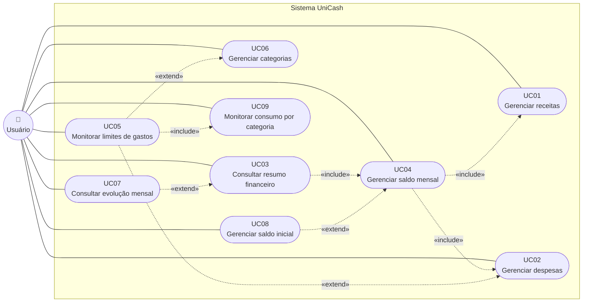

# Casos de Uso

## Visão geral

O diagrama a seguir apresenta o ator principal, os casos de uso do UniCash e os relacionamentos de inclusão e extensão entre eles.

## UC01 - Gerenciar receitas
 
- **Ator principal:** Usuário.
- **Valor:** manter o registro fiel das entradas de dinheiro, para que totais, saldo e indicadores reflitam a realidade.
- **Requisitos funcionais:** RF07, RF08 , RF09, RF10.
 
### Pré-condições
 
- A base local está disponível (RN06).
- O usuário abriu o aplicativo. A conexão só é necessária para sincronizar, não para operar localmente.
- Para editar ou excluir, existe ao menos uma receita registrada.
### Pós-condições
 
- **Sucesso:** a receita (com todas as suas ocorrências, quando há recorrência) fica gravada na base local; totais, saldo e indicadores refletem a alteração; sem conexão, o registro fica marcado como pendente de sincronização (RN06, RF62). Na exclusão, a receita deixa de aparecer e um marcador de exclusão é guardado para ser sincronizado (RN07).
- **Falha:** nenhum registro nem saldo é alterado (RN11, RNF05).
- **Consulta (B):** nenhum dado é alterado.
### Fluxo principal
 
1. O usuário acessa a área de receitas.
2. O sistema lista as receitas do mês corrente, da data mais recente para a mais antiga (RN12), mostrando data completa (dia, mês e ano), título e valor.
3. O usuário escolhe uma operação: **registrar** (A), **filtrar ou detalhar** (B), **editar** (C) ou **excluir** (D).
#### A - Registrar receita (RF07)
 
1. O usuário aciona "Nova receita".
2. O sistema apresenta o formulário com valor, data, título, descrição (opcional) e a opção de recorrência (RN19). Se o usuário indica recorrência, o sistema abre um formulário para informar o intervalo (um número) e a unidade (dias, meses ou anos) e, opcionalmente, a data de término (RN19).
3. O usuário preenche os campos e solicita o registro.
4. O sistema valida no aparelho, antes da gravação na base local: data, título e valor são obrigatórios (RN08); o valor respeita a RN09; título e descrição respeitam a RN10. Se houver recorrência, o intervalo deve ser maior que zero e a data de término, quando informada, deve ser igual ou posterior à data de início (RN19).
5. O sistema persiste a receita na base local e só então confirma o registro (RNF35). Se houver recorrência, as ocorrências são geradas conforme a periodicidade e cada uma é registrada individualmente (RN19).
6. O sistema recalcula totais, saldo e indicadores afetados.
7. Se houver conexão, o sistema sincroniza a receita com o servidor.
8. A nova receita aparece na lista.
#### B - Filtrar e detalhar (RF08)
 
1. O usuário informa uma data única ou um período.
2. O sistema valida o filtro (data inicial menor ou igual à final) e apresenta as receitas correspondentes (RN12).
3. O usuário seleciona uma receita e o sistema exibe todos os seus dados.
#### C - Editar receita (RF09)
 
1. O usuário seleciona a receita e aciona "Editar".
2. O sistema apresenta o formulário preenchido com os dados atuais.
3. O usuário altera um ou mais campos, qualquer um deles (RN20), inclusive a recorrência, e solicita o salvamento. Se a receita pertence a uma série recorrente, o sistema pergunta o alcance da alteração: só esta, esta e as próximas ou todas (FA08).
4. O sistema valida os dados (RN08, RN09, RN10) e, se houver recorrência, o intervalo e a data de término (RN19).
5. O sistema persiste a alteração localmente e recalcula todos os totais afetados, inclusive o mês de origem e o de destino quando a data muda de mês (RN07, RN12).
6. Se houver conexão, o sistema sincroniza a alteração.
7. O sistema confirma a edição.
#### D - Excluir receita (RF10)
 
1. O usuário seleciona a receita e aciona "Excluir".
2. Se a receita pertence a uma série recorrente, o sistema pergunta o alcance da exclusão: só esta, esta e as próximas ou todas (FA08). Em seguida, solicita confirmação explícita informando o alcance escolhido (RN11).
3. O usuário confirma.
4. O sistema exclui a receita e, na mesma operação, recalcula totais, saldo, indicadores e alertas (RN11).
5. Se houver conexão, o sistema sincroniza a exclusão.
6. O sistema informa que a receita foi excluída. A exclusão é definitiva (RN11).
### Fluxos alternativos
 
- **FA01 - Operação offline:** o sistema grava localmente, marca a alteração como pendente de sincronização e sincroniza quando a conexão voltar (RN06, RF62).
- **FA02 - Data futura:** o sistema aceita a data e contabiliza a receita no mês dessa data (RN12).
- **FA03 - Sem filtro:** o sistema mostra o mês corrente (RN12).
- **FA04 - Nenhum registro:** o sistema exibe "Nenhum registro" e sugere alterar o filtro.
- **FA05 - Cancelamento:** se o usuário desiste da edição ou não confirma a exclusão, nada é alterado.
- **FA06 - Edição que muda a data de mês:** o sistema recalcula o mês anterior e o novo mês (RN07, RN12).
- **FA07 - Receita recorrente:** o sistema gera as ocorrências conforme a periodicidade informada, respeitando a data de início e, quando informada, a de término; cada ocorrência entra individualmente nos totais, saldos e indicadores (RN19). Para recorrência sem data de término, o sistema gera as ocorrências até 12 meses à frente e completa a geração sempre que o aplicativo é aberto. Cada ocorrência tem identificador derivado da série e da data, de modo que a geração não duplica ocorrências, inclusive depois de restaurar os dados da nuvem (RN19, RNF26).
- **FA08 - Edição ou exclusão de receita recorrente:** o sistema pergunta o alcance da operação: **só esta** (altera ou exclui apenas a ocorrência selecionada), **esta e as próximas** (aplica a partir da ocorrência selecionada, inclusive) ou **todas** (aplica a toda a série). O sistema recalcula os totais, saldos e indicadores dos meses afetados na mesma operação (RN11, RN19). Cancelar a pergunta de alcance ou a confirmação não altera nada (FA05).
### Exceções
 
Cada exceção indica o passo em que ocorre e o ponto de retorno.
 
- **EX01 - Dados inválidos (A4 e C4):** o sistema não grava e mostra o motivo ao lado de cada campo inválido (RN08, RN09, RN10, RN19, RNF04, RNF14). **Retorno:** ao passo 3 do fluxo A ou C, com os dados digitados preservados. Mensagens:
  - data não informada: "Informe a data da receita."
  - título não informado ou só com espaços: "Informe o título da receita."
  - título com mais de 80 caracteres: "O título deve ter até 80 caracteres."
  - valor não informado: "Informe o valor da receita."
  - valor menor ou igual a zero ou com mais de duas casas decimais: "O valor deve ser maior que zero, com no máximo duas casas decimais."
  - valor acima do limite: "O valor máximo permitido é R$ 999.999.999,99."
  - descrição com mais de 255 caracteres: "A descrição deve ter até 255 caracteres."
  - intervalo da recorrência menor ou igual a zero: "O intervalo da recorrência deve ser maior que zero."
  - término anterior ao início: "A data de término deve ser igual ou posterior à data de início."
- **EX02 - Período inválido (B2):** a data inicial é posterior à final. O sistema não aplica o filtro e informa: "A data inicial deve ser anterior ou igual à data final." **Retorno:** ao passo 1 do fluxo B, com as datas digitadas preservadas.
- **EX03 - Falha na persistência local ou no recálculo (A5 e A6, C5, D4):** o sistema não confirma a operação, nenhum registro ou saldo permanece parcialmente alterado (RN11, RNF05) e informa: "Não foi possível salvar. Nenhuma alteração foi feita. Tente novamente." **Retorno:** ao passo 3 do fluxo A ou C, com os dados preservados; no fluxo D, à lista de receitas (passo 2 do fluxo principal).
- **EX04 - Falha na sincronização (A7, C6, D5):** a operação já está concluída na base local. O registro permanece pendente de sincronização e é reenviado quando houver conexão. **Retorno:** o fluxo segue normalmente no passo seguinte (A8, C7 ou D6).
- **EX05 - Conflito de sincronização (depois de A7, C6 ou D5):** aplica-se a RN07; em edição contra exclusão, a exclusão prevalece. **Retorno:** ao concluir a sincronização, a lista de receitas é atualizada (passo 2 do fluxo principal).
- **EX06 - Receita inexistente ou já excluída (B3, C1, D1):** o sistema informa: "Esta receita não está mais disponível." **Retorno:** à lista de receitas atualizada (passo 2 do fluxo principal).
- **EX07 - Acesso a receita de outro usuário (B3, C1, D1):** o sistema nega o acesso (RNF03) e informa: "Você não tem acesso a esta receita." **Retorno:** à lista de receitas (passo 2 do fluxo principal).
- **EX08 - Falha na leitura local (passo 2 do fluxo principal, B2, B3 e C2):** o sistema informa: "Não foi possível carregar as receitas. Tente novamente." e oferece a ação "Tentar novamente". **Retorno:** ao passo 1 do fluxo principal, ao tentar novamente.
### Requisitos e regras associados
 
- **Funcionais:** RF07, RF08, RF09, RF10. Relacionados: RF11, RF34, RF39 (recálculo), RF59, RF62.
- **Não funcionais específicos:** RNF03, RNF04, RNF05, RNF07, RNF08 , RNF14, RNF26 e RNF35, RNF27, RNF33, RNF36, RNF38.
- **Regras de negócio:** RN06, RN07, RN08, RN09, RN10, RN11, RN12, RN13, RN19, RN20.
----

## UC02 - Gerenciar despesas
 
- **Ator principal:** Usuário.
- **Valor:** registrar e classificar os gastos, base de todos os totais, limites e alertas.
- **Requisitos funcionais:** RF15, RF16, RF17, RF18.
 
### Pré-condições
 
- A base local está disponível (RN06).
- As categorias padrão existem: Casa, Alimentação, Mobilidade, Estudos, Saúde, Lazer e Reserva financeira (RN13). As categorias são gerenciadas no UC06.
- Para editar ou excluir uma despesa, existe ao menos uma despesa registrada.
### Pós-condições
 
- **Sucesso:** a despesa (com todas as ocorrências, quando há recorrência) fica gravada na base local; saldo, totais, limites, indicadores e alertas refletem a alteração; sem conexão, o registro fica pendente de sincronização (RN06, RF62). Na exclusão, um marcador de exclusão é guardado para ser sincronizado (RN07).
- **Falha:** nenhum registro, saldo, limite ou alerta é alterado (RN11, RNF05).
- **Consulta (B):** nenhum dado é alterado.
### Fluxo principal
 
1. O usuário acessa a área de despesas.
2. O sistema lista as despesas do mês corrente, da mais recente para a mais antiga (RN12), em tabela com data, título, valor e categoria.
3. O usuário escolhe uma operação: **registrar** (A), **filtrar ou detalhar** (B), **editar** (C) ou **excluir** (D).
#### A - Registrar despesa (RF15)
 
1. O usuário aciona "Nova despesa".
2. O sistema apresenta o formulário com valor, data, título, descrição (opcional), categoria (opcional) e classificações opcionais (fixa ou variável, essencial ou não essencial, RN13) e a opção de recorrência. Se o usuário indica recorrência, o sistema abre um formulário para informar o intervalo (um número) e a unidade (dias, meses ou anos) e, opcionalmente, a data de término (RN19).
3. O usuário preenche os campos e solicita o registro.
4. O sistema valida no aparelho, antes da gravação na base local (RN08, RN09, RN10) e, se houver recorrência, o intervalo (maior que zero) e a data de término (igual ou posterior ao início, RN19).
5. O sistema persiste a despesa localmente e só então confirma (RNF35). Se houver recorrência, as ocorrências são geradas conforme a periodicidade e cada uma é registrada individualmente (RN19).
6. O sistema recalcula totais, saldo, indicadores de limite e alertas afetados (UC04, UC05 e UC09).
7. Se houver conexão, o sistema sincroniza a despesa.
8. A nova despesa aparece na lista.
#### B - Filtrar e detalhar (RF16)
 
1. O usuário filtra por data única, período e/ou categoria.
2. O sistema valida o filtro e mostra os resultados ordenados (RN12).
3. O usuário seleciona uma despesa e o sistema exibe seus detalhes.
#### C - Editar despesa (RF17)
 
1. O usuário seleciona a despesa e aciona "Editar".
2. O sistema apresenta o formulário preenchido; o usuário altera os campos, qualquer um deles (RN20), e salva. Se a despesa pertence a uma série recorrente, o sistema pergunta o alcance da alteração: só esta, esta e as próximas ou todas (FA08).
3. O sistema valida no cliente e, na sincronização, nas Security Rules (RN08, RN09, RN10; RNF04) e, se houver recorrência, o intervalo (maior que zero) e a data de término (igual ou posterior ao início, RN19); persiste localmente e recalcula saldo, totais, limites e alertas dos meses e categorias de origem e destino (RN07, RN12).
4. Se houver conexão, sincroniza; o sistema confirma a edição.
#### D - Excluir despesa (RF18)
 
1. O usuário seleciona a despesa e aciona "Excluir".
2. Se a despesa pertence a uma série recorrente, o sistema pergunta o alcance da exclusão: só esta, esta e as próximas ou todas (FA08). Em seguida, solicita confirmação explícita informando o alcance escolhido (RN11); o usuário confirma.
3. O sistema exclui e recalcula saldo, totais, indicadores e alertas na mesma operação (RN11).
4. Se houver conexão, sincroniza; o sistema informa a exclusão, que é definitiva.
### Fluxos alternativos
 
- **FA01 - Sem categoria:** a despesa é registrada como "Sem categoria" e fica fora dos limites por categoria (RN13).
- **FA02 - Operação offline:** grava localmente e fica pendente de sincronização (RN06).
- **FA03 - Data futura:** contabilizada no mês da própria data (RN12).
- **FA04 - Filtro por categoria sem resultados:** o sistema exibe "Nenhum registro" e sugere alterar o filtro.
- **FA05 - Cancelamento:** edição descartada ou exclusão não confirmada não alteram nada.
- **FA06 - Mudança de categoria na edição:** o sistema recalcula o consumo da categoria antiga e da nova.
- **FA07 - Despesa recorrente:** o sistema gera as ocorrências conforme a periodicidade informada, respeitando a data de início e, quando informada, a de término; cada ocorrência entra individualmente nos totais, saldos, limites e alertas (RN19). Para recorrência sem data de término, o sistema gera as ocorrências até 12 meses à frente e completa a geração sempre que o aplicativo é aberto; o identificador de cada ocorrência é derivado da série e da data, para não duplicar ocorrências, inclusive depois de restaurar os dados da nuvem (RN19, RNF26).
- **FA08 - Edição ou exclusão de despesa recorrente:** o sistema pergunta o alcance da operação: **só esta**, **esta e as próximas** (a partir da ocorrência selecionada, inclusive) ou **todas** (toda a série). O sistema recalcula saldo, totais, indicadores, limites e alertas dos meses e categorias afetados na mesma operação (RN11, RN19). Cancelar a pergunta de alcance ou a confirmação não altera nada (FA05).
### Exceções
 
Cada exceção indica o passo em que ocorre e o ponto de retorno.
 
- **EX01 - Dados inválidos (A4 e C3):** o sistema não grava e mostra o motivo ao lado de cada campo inválido (RN08, RN09, RN10, RN19, RNF04, RNF14). **Retorno:** ao passo 3 do fluxo A ou ao passo 2 do fluxo C, com os dados digitados preservados. Mensagens:
  - data não informada: "Informe a data da despesa."
  - título não informado ou só com espaços: "Informe o título da despesa."
  - título com mais de 80 caracteres: "O título deve ter até 80 caracteres."
  - valor não informado: "Informe o valor da despesa."
  - valor menor ou igual a zero ou com mais de duas casas decimais: "O valor deve ser maior que zero, com no máximo duas casas decimais."
  - valor acima do limite: "O valor máximo permitido é R$ 999.999.999,99."
  - descrição com mais de 255 caracteres: "A descrição deve ter até 255 caracteres."
  - intervalo da recorrência menor ou igual a zero: "O intervalo da recorrência deve ser maior que zero."
  - término anterior ao início: "A data de término deve ser igual ou posterior à data de início."
- **EX02 - Falha na gravação ou no recálculo (A5 e A6, C3, D3):** nenhuma alteração parcial permanece, nem na despesa, nem em saldo, indicadores ou alertas (RN11, RNF05). O sistema informa: "Não foi possível salvar. Nenhuma alteração foi feita. Tente novamente." **Retorno:** ao formulário, com os dados preservados; no fluxo D, à lista.
- **EX03 - Falha na sincronização (A7, C4, D4):** a operação já está concluída localmente e o registro permanece pendente de sincronização. **Retorno:** o fluxo segue no passo seguinte.
- **EX04 - Conflito de sincronização:** aplica-se a RN07; a exclusão prevalece sobre a edição. **Retorno:** ao concluir a sincronização, a lista é atualizada.
- **EX05 - Despesa inexistente ou já excluída (B3, C1, D1):** o sistema informa: "Esta despesa não está mais disponível." **Retorno:** à lista atualizada (passo 2 do fluxo principal).
- **EX06 - Acesso a dados de outro usuário (B3, C1, D1):** o sistema nega (RNF03) e informa: "Você não tem acesso a esta despesa." **Retorno:** à lista (passo 2 do fluxo principal).
- **EX07 - Período inválido (B2):** o sistema não aplica o filtro e informa: "A data inicial deve ser anterior ou igual à data final." **Retorno:** ao passo 1 do fluxo B, com as datas preservadas.
- **EX08 - Despesa registrada em outro dispositivo com categoria já excluída:** na sincronização a despesa é mantida e passa a constar como "Sem categoria" (RN07, RN13). **Retorno:** ao concluir a sincronização, a lista é atualizada.
- **EX09 - Falha na leitura local (passo 2 do fluxo principal, B2, B3 e C2):** o sistema informa: "Não foi possível carregar as despesas. Tente novamente." e oferece a ação "Tentar novamente". **Retorno:** ao passo 1 do fluxo principal, ao tentar novamente.
### Requisitos e regras associados
 
- **Funcionais:** RF15, RF16, RF17, RF18. Relacionados: RF19 (UC06), RF34, RF37, RF38, RF39, RF59, RF62.
- **Não funcionais específicos:** RNF03, RNF04, RNF05, RNF08, RNF14, RNF26, RNF27, RNF33, RNF35, RNF36, RNF38.
- **Regras de negócio:** RN06, RN07, RN08, RN09, RN10, RN11, RN12, RN13, RN19, RN20.
---

## UC03 - Consultar resumo financeiro
 
- **Ator principal:** Usuário.
- **Valor:** dar uma visão rápida de quanto entrou e saiu em cada dia e mês.
- **Requisitos funcionais:** RF11, RF40.
 
### Pré-condições
 
- A base local está disponível (RN06).
- O usuário abriu o aplicativo.
### Pós-condições
 
- **Consulta:** nenhum dado é alterado; a tela apresenta os totais do mês selecionado.
### Fluxo principal
 
1. O usuário abre o aplicativo ou acessa o resumo financeiro.
2. O sistema assume o mês corrente como período padrão (RN12).
3. O sistema calcula, a partir dos lançamentos da base local, o total de receitas por dia e do mês (RF11); o saldo (UC04), o total de despesas e o progresso das metas do período (RF40).
4. O sistema apresenta o saldo, o total de receitas, o total de despesas e o progresso das metas do período selecionado (RF40) e o total de receitas de cada dia que tem lançamento (RF11).
5. O usuário seleciona outro mês pelo seletor.
6. O sistema recalcula e apresenta os valores do mês escolhido.
### Fluxos alternativos
 
- **FA01 - Mês sem receitas:** o sistema apresenta total igual a zero.
- **FA02 - Sem nenhum lançamento:** o sistema exibe estado vazio com atalho para o tutorial (RF55).
- **FA03 - Consulta offline:** o sistema calcula com os lançamentos locais (RN06).
- **FA04 - Mês futuro:** o sistema inclui lançamentos de data futura no mês correspondente (RN12).
- **FA05 - Lançamento alterado ou excluído:** o resumo é recalculado ao reabrir ou voltar à tela (UC01, UC02).
### Exceções
 
Cada exceção indica o passo em que ocorre e o ponto de retorno.
 
- **EX01 - Falha na leitura ou no cálculo (passos 3 e 6):** o sistema informa: "Não foi possível calcular os totais. Tente novamente." e oferece a ação "Tentar novamente". **Retorno:** ao passo 2 do fluxo principal, ao tentar novamente.
### Requisitos e regras associados
 
- **Funcionais:** RF11, RF40. Relacionados: RF07, RF12, RF15, RF34, RF41, RF42, RF55, RF68 (UC07).
- **Não funcionais específicos:** RNF07, RNF08, RNF20, RNF29, RNF33, RNF34, RNF38.
- **Regras de negócio:** RN06, RN07, RN09, RN12.
---

## UC04 - Gerenciar saldo mensal
 
- **Ator principal:** Usuário.
- **Valor:** saber quanto dinheiro sobra em cada mês.
- **Requisitos funcionais:** RF34, RF35 (exibição do saldo anterior).
 
### Pré-condições
 
- O usuário abriu a área de resumo.
- Para o saldo do mês: existem lançamentos e/ou um saldo inicial (UC08).
### Fluxo principal
 
1. O usuário acessa o resumo financeiro.
2. O sistema identifica o mês de referência (mês corrente por padrão).
3. O sistema obtém o **saldo anterior** (RN16): o saldo do mês anterior (RN15) ou, no mês do saldo inicial, o valor informado; sem dado disponível, o sistema informa que não há dados.
4. O sistema soma as receitas e as despesas do mês.
5. O sistema calcula o saldo do mês: total de receitas − total de despesas (RN15); o saldo anterior não entra nesse cálculo.
6. O sistema apresenta o saldo do mês, o saldo anterior como referência (RF35) e o indicador de cor com texto (RN17, RNF38).
7. O sistema verifica se o saldo passou de maior ou igual a zero para negativo e, se sim, emite o alerta de saldo negativo (RN18).
### Fluxos alternativos
 
- **FA01 - Mês sem lançamentos:** o saldo do mês é R$ 0,00 e o saldo anterior continua exibido como referência (RN15).
- **FA02 - Mês anterior ao mês de referência do saldo inicial:** o sistema informa que não há dados de saldo anterior e ignora lançamentos anteriores àquele mês (RN16).
- **FA03 - Sem saldo inicial e sem mês anterior com dados:** o sistema informa que não há dados de saldo anterior (RN16).
- **FA04 - Consulta offline:** o saldo é calculado localmente (RN06).
- **FA05 - Lançamento criado, editado ou excluído:** o saldo é recalculado (UC01, UC02).
- **FA06 - Saldo volta a zero ou positivo e fica negativo de novo:** um novo alerta é emitido (RN18).
- **FA07 - Mês sem receitas:** o indicador de cor é preto (RN17).
- **FA08 - Preferências de notificação:** o alerta de saldo negativo permanece sempre ativo, pois o RF58 não o prevê, até validação (RN18).
### Exceções
 
- **EX01 - Falha de cálculo:** o sistema informa que não foi possível calcular o saldo.
- **EX02 - Dados inconsistentes:** o sistema recalcula a partir dos lançamentos e do saldo inicial (RN07).
- **EX03 - Falha ao emitir o alerta:** o sistema trata a falha sem corromper saldo nem lançamentos.
### Requisitos e regras associados
 
- **Funcionais:** RF34, RF35. Relacionados: RF07, RF15, RF11, RF17, RF18.
- **Não funcionais específicos:** RNF07, RNF08, RNF29, RNF38.
- **Regras de negócio:** RN06, RN07, RN15, RN16, RN17, RN18.
---

## UC05 - Monitorar limites de gastos
 
**Ator principal:** Usuário (o sistema dispara os alertas).
**Valor:** o usuário é avisado antes e depois de estourar o limite de uma categoria ou de uma meta de gasto.
**Requisitos funcionais:** RF37, RF38.
 
### Pré-condições
 
- Existe uma categoria com limite definido (UC06), própria ou padrão (RN13, RN14), ou uma meta de gasto com valor alvo (RF12, definida fora deste UC).
- Para limite percentual, existe renda mensal no mês consultado (RN14).
### Fluxo principal
 
1. O usuário registra, edita ou exclui uma despesa ou uma categoria (UC02, UC06), altera um limite ou muda a renda do mês.
2. O sistema calcula o consumo do limite de cada categoria com limite e de cada meta de gasto (gasto acumulado do mês ÷ limite efetivo, RN14), conforme o UC09.
3. O sistema verifica os alertas (RN03):
   - gasto que atinge 80% do limite da categoria ou do valor alvo da meta: alerta de aproximação (RF37);
   - gasto que supera 100% do limite da categoria ou do valor alvo da meta: alerta de ultrapassagem (RF38).
4. Se o tipo de alerta estiver ativado nas preferências (RF58), o sistema apresenta a notificação com apenas os valores envolvidos (gasto, limite e categoria ou meta), sem termos de julgamento, e registra a emissão no período.
### Fluxos alternativos
 
- **FA01 - Categoria sem limite:** o sistema não emite alerta (RN14).
- **FA02 - Despesas "Sem categoria":** ficam fora do cálculo de limites por categoria (RN13).
- **FA03 - Limite percentual:** o limite efetivo é o percentual da renda do mês (RN14).
- **FA04 - Alerta já emitido no período:** o sistema não repete (RN03).
- **FA05 - Salto direto de abaixo de 80% para acima de 100%:** o sistema emite apenas um alerta, o de ultrapassagem (RN03).
- **FA06 - Alertas desativados em RF58:** o consumo continua sendo calculado (UC09); apenas a notificação deixa de ser exibida.
- **FA07 - Novo período:** o consumo é recalculado para o novo período e os alertas voltam a poder ser emitidos (RN03).
- **FA08 - Offline:** cálculo e alertas funcionam com os dados locais (RN06).
- **FA09 - Categoria editada ou excluída:** os alertas são recalculados na mesma operação (RN13, RN14); se a categoria foi excluída, seus alertas deixam de existir e as despesas passam a "Sem categoria", fora do cálculo de limites (RN13).
### Exceções
 
- **EX01 - Limite efetivo igual a zero** (limite percentual em mês sem receitas): o consumo não pode ser calculado, o alerta não é avaliado e as regras de negócio não definem o comportamento (RN14; ver pontos para validação).
- **EX02 - Falha no cálculo do consumo:** o alerta não é avaliado (UC09, EX02).
- **EX03 - Falha ao emitir o alerta:** o sistema trata a falha sem corromper lançamentos nem saldo, e não registra a emissão para poder tentar de novo.
- **EX04 - Acesso a dados de outro usuário:** o sistema nega (RNF03).
### Requisitos e regras associados
 
- **Funcionais:** RF37, RF38. Relacionados: RF39 (UC09), RF19 (UC06), RF12, RF15, RF58, RF34.
- **Não funcionais específicos:** RNF07, RNF08, RNF29, RNF38.
- **Regras de negócio:** RN03, RN06, RN07, RN13, RN14.
---

## UC06 - Gerenciar categorias
 
- **Ator principal:** Usuário.
- **Valor:** organizar os gastos em categorias, próprias ou padrão, e definir os limites que alimentam os indicadores e os alertas.
- **Requisitos funcionais:** RF19, RF65, RF66, RF67.
 
### Pré-condições
 
- A base local está disponível (RN06).
- As categorias padrão existem: Casa, Alimentação, Mobilidade, Estudos, Saúde, Lazer e Reserva financeira (RN13).
- Para renomear ou excluir uma categoria, existe ao menos uma categoria própria. As padrão não podem ser renomeadas nem excluídas, mas permitem definir limite (RN13, RN14).
### Pós-condições
 
- **Sucesso:** a categoria fica gravada na base local; indicadores e alertas de limite refletem a alteração; sem conexão, o registro fica pendente de sincronização (RN06, RF62). Na exclusão, um marcador de exclusão é guardado para ser sincronizado (RN07) e as despesas da categoria passam a "Sem categoria" (RN13).
- **Falha:** nenhuma categoria, despesa, limite ou alerta é alterado (RN11, RNF05).
- **Consulta (A):** nenhum dado é alterado.
### Fluxo principal
 
1. O usuário acessa a lista de categorias.
2. O sistema exibe as categorias padrão e próprias, identificando as padrão e mostrando o limite de gasto de cada uma, quando definido (RF65).
3. O usuário escolhe uma operação: **abrir uma categoria** (A), **criar** (B), **editar** (C) ou **excluir uma categoria própria** (D).
#### A - Abrir categoria (RF65)
 
1. O usuário seleciona uma categoria para ver os lançamentos classificados nela.
2. O sistema exibe a consulta de despesas já filtrada por essa categoria (UC02, fluxo B).
#### B - Criar categoria própria (RF19)
 
1. O usuário aciona "Nova categoria" e informa o nome e, opcionalmente, um limite de gasto (valor em R$ ou percentual da renda mensal, RN14).
2. O sistema valida o nome (único por usuário, sem diferenciar maiúsculas e minúsculas, com 1 a 30 caracteres, RN13) e, se informado, o limite: em R$, conforme a RN09; em percentual, maior que 0% e até 100%, com até duas casas decimais (RN14). Em seguida, persiste e confirma. A faixa do percentual é proposta e está pendente de validação com a cliente.
3. Se houver conexão, o sistema sincroniza a categoria.
#### C - Editar categoria (RF66)
 
1. O usuário seleciona uma categoria e altera o limite; em categoria própria, também o nome. Em categoria padrão, só o limite pode ser alterado (RN13, RN14).
2. O sistema valida o nome, se alterado (único por usuário, sem diferenciar maiúsculas e minúsculas, com 1 a 30 caracteres, RN13), e o limite, nas mesmas condições do passo B2, e persiste a alteração.
3. O sistema recalcula, na mesma operação, os indicadores de consumo e os alertas de limite afetados (RN14, UC05 e UC09).
4. Se houver conexão, o sistema sincroniza a categoria.
5. O sistema confirma a edição.
#### D - Excluir categoria própria (RF67)
 
1. O usuário seleciona uma categoria própria e aciona "Excluir".
2. O sistema solicita confirmação explícita (RN11) e informa que as despesas da categoria serão mantidas como "Sem categoria" e que o histórico da categoria (limite e alertas) será perdido (RN13).
3. O usuário confirma.
4. O sistema exclui a categoria com todo o seu histórico (limite, indicadores e alertas); as despesas associadas não são excluídas e passam a constar como "Sem categoria" (RN13).
5. O sistema recalcula, na mesma operação, os indicadores e alertas dependentes (RN13, RN14).
6. Se houver conexão, sincroniza; o sistema informa a exclusão, que é definitiva (RN11).
### Fluxos alternativos
 
- **FA01 - Operação offline:** grava localmente e fica pendente de sincronização (RN06).
- **FA02 - Categoria sem lançamentos:** o sistema mostra a categoria com zero lançamentos e a consulta filtrada exibe "Nenhum registro".
- **FA03 - Exclusão de categoria com lançamentos:** as despesas continuam registradas e passam a aparecer como "Sem categoria", fora dos limites por categoria (RN13).
- **FA04 - Categoria sem limite:** a edição ou exclusão não gera recálculo de indicadores nem de alertas.
- **FA05 - Cancelamento de edição ou de exclusão de categoria:** nada é alterado.
### Exceções
 
Cada exceção indica o passo em que ocorre e o ponto de retorno.
 
- **EX01 - Nome de categoria duplicado (B2 e C2):** o sistema rejeita e informa: "Já existe uma categoria com este nome." **Retorno:** ao passo 1 do fluxo B ou C, com os dados preservados.
- **EX02 - Categoria padrão (C1 e D1):** as ações de renomear e excluir não aparecem nas categorias padrão (RN13, RF66, RF67); se acionadas por outro meio, o sistema informa: "Categorias padrão não podem ser renomeadas nem excluídas." Só o limite pode ser alterado (RN13, RN14). **Retorno:** à lista de categorias (passo 2 do fluxo principal).
- **EX03 - Limite inválido (B2 e C2):** o sistema rejeita e informa o motivo (RN09, RN14, RNF14). Mensagens: "O limite deve ser maior que zero, com no máximo duas casas decimais."; "O valor máximo permitido é R$ 999.999.999,99."; "O percentual deve ser maior que 0% e até 100%." **Retorno:** ao passo 1 do fluxo B ou C, com os dados preservados.
- **EX04 - Falha na gravação ou no recálculo (B2, C2 e C3, D4 e D5):** nenhuma alteração parcial permanece, nem na categoria, nem nas despesas, nem em indicadores ou alertas (RN11, RNF05). O sistema informa: "Não foi possível salvar. Nenhuma alteração foi feita. Tente novamente." **Retorno:** ao formulário, com os dados preservados; no fluxo D, à lista de categorias.
- **EX05 - Falha na sincronização (B3, C4, D6):** a operação já está concluída localmente e o registro permanece pendente de sincronização. **Retorno:** o fluxo segue no passo seguinte.
- **EX06 - Categoria inexistente ou já excluída (A1, C1 e D1):** o sistema informa: "Esta categoria não está mais disponível." **Retorno:** à lista de categorias atualizada (passo 2 do fluxo principal).
- **EX07 - Nome de categoria inválido (B2 e C2):** o sistema rejeita e informa: "Informe o nome da categoria." ou "O nome da categoria deve ter até 30 caracteres." (RN13). **Retorno:** ao passo 1 do fluxo B ou C, com os dados preservados.
- **EX08 - Conflito de sincronização:** aplica-se a RN07; a exclusão prevalece sobre a edição. **Retorno:** ao concluir a sincronização, a lista de categorias é atualizada.
- **EX09 - Acesso a dados de outro usuário (A1, C1 e D1):** o sistema nega (RNF03) e informa: "Você não tem acesso a esta categoria." **Retorno:** à lista de categorias (passo 2 do fluxo principal).
- **EX10 - Falha na leitura local (passo 2 do fluxo principal):** o sistema informa: "Não foi possível carregar as categorias. Tente novamente." e oferece a ação "Tentar novamente". **Retorno:** ao passo 1 do fluxo principal, ao tentar novamente.
### Requisitos e regras associados
 
- **Funcionais:** RF19, RF65, RF66, RF67. Relacionados: RF15, RF16, RF37, RF38, RF39, RF59, RF62.
- **Não funcionais específicos:** RNF03, RNF04, RNF05, RNF14, RNF35, RNF36.
- **Regras de negócio:** RN06, RN07, RN09, RN11, RN13, RN14.
---

## UC07 - Consultar evolução mensal
 
- **Ator principal:** Usuário.
- **Valor:** dar uma visão rápida de como os meses se comparam, em receitas e despesas.
- **Requisitos funcionais:** RF68.
 
### Pré-condições
 
- A base local está disponível (RN06).
- O usuário abriu o aplicativo.
### Pós-condições
 
- **Consulta:** nenhum dado é alterado; a tela apresenta o gráfico do mês selecionado.
### Fluxo principal
 
1. O usuário acessa a evolução mensal, na tela do resumo financeiro (UC03).
2. O sistema assume o mês corrente como mês selecionado (RN12).
3. O sistema calcula, a partir dos lançamentos da base local, o total de receitas e o total de despesas de cada mês do gráfico (RF68).
4. O sistema apresenta o gráfico de barras de evolução mensal, com o total de receitas e o total de despesas de cada mês (RF68), limitado a 6 meses (RN12): o mês selecionado e os 5 anteriores. As barras de receita e despesa seguem a paleta (RNF38).
5. O usuário seleciona outro mês, pelo seletor ou tocando em uma barra do gráfico.
6. O sistema atualiza o mês selecionado, que é o mesmo do resumo (UC03), e recalcula o gráfico. Se o mês estava fora da janela do gráfico, a janela se desloca para terminar nele (FA05).
### Fluxos alternativos
 
- **FA01 - Mês sem receitas ou sem despesas:** a barra correspondente mostra valor igual a zero.
- **FA02 - Sem nenhum lançamento:** o sistema exibe estado vazio com atalho para o tutorial (RF55).
- **FA03 - Consulta offline:** o sistema calcula com os lançamentos locais (RN06).
- **FA04 - Mês futuro:** o sistema inclui lançamentos de data futura no mês correspondente (RN12).
- **FA05 - Mês fora da janela do gráfico:** ao escolher no seletor um mês fora dos 6 exibidos, o gráfico passa a mostrar esse mês e os 5 anteriores.
- **FA06 - Lançamento alterado ou excluído:** o gráfico é recalculado ao reabrir ou voltar à tela (UC01, UC02).
### Exceções
 
Cada exceção indica o passo em que ocorre e o ponto de retorno.
 
- **EX01 - Falha na leitura ou no cálculo (passos 3 e 6):** o sistema informa: "Não foi possível carregar a evolução mensal. Tente novamente." e oferece a ação "Tentar novamente". **Retorno:** ao passo 2 do fluxo principal, ao tentar novamente.
### Requisitos e regras associados
 
- **Funcionais:** RF68. Relacionados: RF07, RF15, RF11 (UC03), RF55.
- **Não funcionais específicos:** RNF07, RNF08, RNF20, RNF34, RNF38.
- **Regras de negócio:** RN06, RN07, RN12.
---

## UC08 - Gerenciar saldo inicial
 
- **Ator principal:** Usuário.
- **Valor:** corrigir o ponto de partida do cálculo do saldo.
- **Requisitos funcionais:** RF35 (definição do saldo inicial).
 
### Pré-condições
 
- O usuário abriu a área de configurações financeiras.
### Fluxo principal
 
1. O usuário acessa "Saldo inicial".
2. O sistema mostra o saldo inicial atual, se existir.
3. O usuário informa o valor, que pode ser negativo, e o mês de referência.
4. O sistema valida o valor e o mês de referência (RN16).
5. O sistema persiste o saldo inicial localmente, recalcula os saldos dos meses seguintes (RN16) e confirma.
6. Se houver conexão, sincroniza.
### Fluxos alternativos
 
- **FA01 - Saldo inicial negativo:** o sistema aceita (RN16).
- **FA02 - Alteração do saldo inicial:** substitui o valor anterior e recalcula os meses seguintes (RN16).
- **FA03 - Operação offline:** grava localmente e fica pendente de sincronização (RN06).
### Exceções
 
- **EX01 - Valor ou mês de referência inválido:** o sistema rejeita e informa o motivo (RNF14).
- **EX02 - Falha ao salvar o saldo inicial:** o sistema não confirma e nenhum saldo fica parcialmente atualizado (RNF05).
### Requisitos e regras associados
 
- **Funcionais:** RF35. Relacionados: RF34 (UC04), RF11.
- **Não funcionais específicos:** RNF05, RNF14, RNF35.
- **Regras de negócio:** RN06, RN07, RN16.
---

## UC09 - Monitorar consumo por categoria
 
**Ator principal:** Usuário.
**Valor:** o usuário enxerga quanto já gastou de cada limite.
**Requisitos funcionais:** RF39.
 
### Pré-condições
 
- Existe uma categoria com limite definido (UC06), própria ou padrão (RN13, RN14), ou uma meta de gasto com valor alvo (RF12, definida fora deste UC).
- Para limite percentual, existe renda mensal no mês consultado (RN14).
### Fluxo principal
 
1. O usuário acessa o resumo ou a lista de categorias, ou registra, edita ou exclui uma despesa ou uma categoria (UC02, UC06), altera um limite ou muda a renda do mês.
2. O sistema calcula o gasto acumulado do mês de cada categoria com limite e de cada meta de gasto.
3. O sistema determina o **limite efetivo**: o valor em R$ ou o percentual aplicado sobre a renda mensal (RN14).
4. O sistema calcula o consumo do limite (gasto ÷ limite efetivo).
5. O sistema atualiza o indicador visual da categoria conforme as faixas (RN02) (RF39) (RNF38).
6. O usuário consulta os indicadores no resumo e na lista de categorias e escolhe o período a visualizar.
### Fluxos alternativos
 
- **FA01 - Categoria sem limite:** o sistema não exibe indicador (RN14).
- **FA02 - Categoria sem despesas:** com limite definido, o indicador mostra consumo zero (verde).
- **FA03 - Despesas "Sem categoria":** ficam fora do cálculo de limites por categoria (RN13).
- **FA04 - Limite percentual:** o limite efetivo é o percentual da renda do mês (RN14).
- **FA05 - Exclusão ou edição reduz o consumo:** o indicador é atualizado (RN07).
- **FA06 - Novo período:** o consumo é recalculado para o novo período (RN14).
- **FA07 - Offline:** o cálculo funciona com os dados locais (RN06).
- **FA08 - Categoria editada ou excluída:** os indicadores são recalculados na mesma operação (RN13, RN14); se a categoria foi excluída, seu limite e indicador deixam de existir e as despesas passam a "Sem categoria", fora do cálculo de limites (RN13).
### Exceções
 
- **EX01 - Limite efetivo igual a zero** (limite percentual em mês sem receitas): o consumo não pode ser calculado e as regras de negócio não definem o comportamento (RN14; ver pontos para validação).
- **EX02 - Falha no cálculo:** o sistema informa que o indicador não pôde ser atualizado.
- **EX03 - Acesso a dados de outro usuário:** o sistema nega (RNF03).
### Requisitos e regras associados
 
- **Funcionais:** RF39. Relacionados: RF19 (UC06), RF12, RF15, RF34, RF37 e RF38 (UC05).
- **Não funcionais específicos:** RNF07, RNF08, RNF29, RNF38. A exigência de não depender apenas da cor segue a mesma linha do RNF33, mesmo que a tela não conste na lista de telas principais dele.
- **Regras de negócio:** RN02, RN06, RN07, RN13, RN14.

## Histórico de versões

| Versão | Data | Descrição | Autor |
|---|---|---|---|
| 1.0 | 27/10/2026 | Adiciona UC01 | Natan França |
| 1.1 | 27/10/2026 | Atualiza UC01 | Natan França |
| 1.2 | 27/10/2026 | Remove texto redundante | Natan França |
| 1.3 | 27/10/2026 | Adiciona UC02 | Natan França |
| 1.4 | 27/10/2026 | Adiciona UC03 | Natan França |
| 1.5 | 27/10/2026 | Adiciona UC04 | Natan França |
| 1.6 | 27/10/2026 | Altera símbolo do UC04 | Natan França |
| 1.7 | 27/10/2026 | Adiciona UC05 | Natan França |
| 1.8 | 28/10/2026 | Atualiza os casos de uso com o RNF38 | Natan França |
| 1.9 | 31/10/2026 | Ajusta RNFs à arquitetura com Firebase e app móvel | Bruno Duarte |
| 1.10 | 31/10/2026 | Adiciona mais detalhes aos casos de usos 1-5 | Natan França |
| 1.11 | 31/10/2026 | Adiciona consulta rápida de requisitos e plugins de navegação | Bruno Duarte |
| 1.12 | 01/11/2026 | Adiciona mais detalhes ao uc02 | Natan França |
| 1.13 | 01/11/2026 | Adiciona mais detalhes ao uc03 | Natan França |
| 1.14 | 03/11/2026 | Inclui o histórico de versões | Bruno Duarte |
| 1.15 | 07/11/2026 | Ajusta a validação dos UC01 e UC02 à gravação local e retira o RNF06, fundido ao RNF35 (issue #21) | Dante Scarpati |