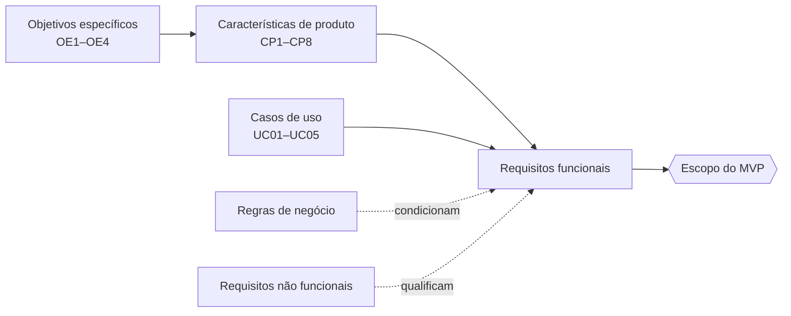

# Rastreabilidade 3D

O grafo mostra as relações registradas entre características de produto, casos de uso, requisitos funcionais, requisitos não funcionais e regras de negócio. Ele é gerado automaticamente a cada publicação, a partir das tabelas de requisitos e dos casos de uso, e por isso acompanha a versão vigente da documentação.

!!! info "Como usar"
    - **Arrastar** gira o grafo; **rolar** aproxima ou afasta; **clicar** em um nó centraliza e mostra seus detalhes; **duplo clique** abre a página do item.
    - Use a busca para localizar um código e os filtros para esconder tipos.
    - O modo 2D é mais leve e funciona melhor em celulares.

  

    <input type="search" class="md-input grafo-busca" placeholder="Localizar (ex.: RF37)" aria-label="Localizar item no grafo">
    

    <label class="grafo-opcao"><input type="checkbox" class="grafo-mvp"> Somente RFs do MVP</label>
    <button type="button" class="md-button grafo-modo">Mudar para 2D</button>
  

  

  <aside class="grafo-detalhe" aria-live="polite">Clique em um nó para ver os detalhes.</aside>

## Visão geral da cadeia de rastreabilidade

