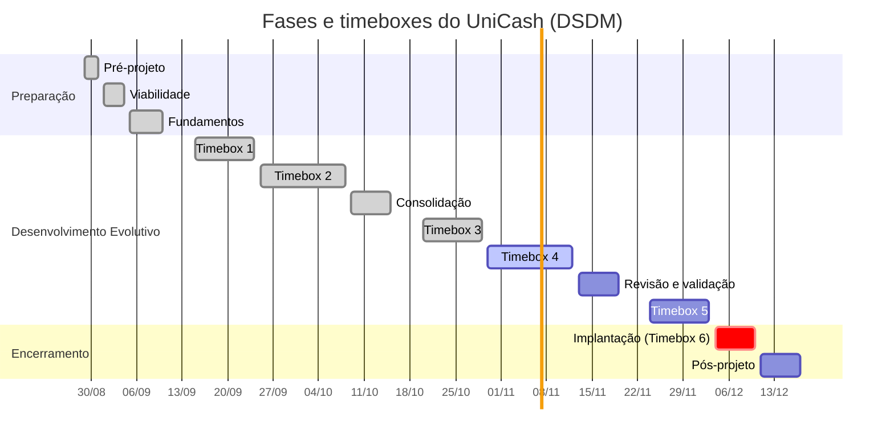

# Cronograma e Entregas

O desenvolvimento do UniCash será conduzido como um projeto de software, seguindo uma abordagem iterativa e incremental baseada no DSDM. O cronograma organiza as fases do projeto, os ciclos de desenvolvimento, as atividades de Engenharia de Requisitos e os principais produtos, mantendo prazo e escopo sob acompanhamento contínuo.

O planejamento considera prazo e equipe como restrições fixas. O escopo é ajustado por meio da priorização MoSCoW, enquanto os ciclos são orientados pelo Backlog do Produto e pelos resultados das validações. Cada timebox busca produzir um incremento utilizável ou um resultado de Engenharia de Requisitos necessário para o ciclo seguinte.

## Linha do tempo

## Desenvolvimento e Entregas

O desenvolvimento do UniCash é organizado em etapas de Engenharia de Requisitos e timeboxes de aproximadamente duas semanas, contemplando tanto as atividades já realizadas quanto as previstas para a evolução do produto. Em cada ciclo, os itens selecionados do Backlog do Produto são refinados, preparados para desenvolvimento, implementados e validados conforme a necessidade.

As consolidações previstas no calendário da disciplina são tratadas como marcos de acompanhamento e entrega, não constituindo novas fases do DSDM. Os intervalos entre os ciclos correspondem à organização do calendário da disciplina e não representam novas fases do projeto. Os períodos de 11/09/2026 a 14/09/2026, 16/10/2026 a 19/10/2026 e 20/11/2026 a 23/11/2026 correspondem a esses intervalos de organização do calendário.

| Período | Etapa | Escopo / CPs | Atividades de ER e desenvolvimento | Validação, responsável e evidência |
| --- | --- | --- | --- | --- |
| 29/08/2026 – 31/08/2026 | Pré-projeto | Contexto do cliente e do negócio; identificação do problema e oportunidade. | Entrevistas e descoberta inicial; identificação da cliente, stakeholders e necessidades; análise de efetividade da ideia; elaboração das representações iniciais do problema e da solução. | Responsáveis: equipe de Engenharia de Requisitos. Cliente: Leinad Santos França. Evidências: proposta inicial, contexto do negócio, problema identificado e representações iniciais. |
| 01/09/2026 – 04/09/2026 | Viabilidade | Escopo preliminar e condições para desenvolvimento do MVP. | Entrevistas com a cliente e com a equipe; análise de riscos; análise de custo/benefício; definição do escopo preliminar; declaração inicial dos requisitos. | Responsáveis: equipe de Engenharia de Requisitos. Cliente: Leinad Santos França. Evidências: análise de viabilidade, riscos, custo/benefício e requisitos iniciais. |
| 05/09/2026 – 10/09/2026 | Fundamentos | CP1 a CP6 como base para a definição e estruturação do produto. | Elicitação e descoberta; investigação do problema; elaboração do business case; definição da arquitetura inicial; declaração inicial dos requisitos; estruturação do Backlog do Produto. | Responsáveis: Leonardo Ramiro Alves de Oliveira na elicitação e requisitos; Bruno Bernardes Duarte na prototipação; equipe nas demais atividades. Evidências: business case, arquitetura inicial, requisitos e Backlog do Produto. |
| 15/09/2026 – 24/09/2026 | Desenvolvimento Evolutivo — Timebox 1 | CP1 — Gestão de movimentações financeiras; CP5 — Gestão da identidade do usuário. | Workshop facilitado de elicitação e descoberta; formulários de coleta; análise e consenso; refinamento dos requisitos; critérios de aceitação; organização do Backlog; acompanhamento do fluxo no Kanban. | Responsável pela ER: Leonardo Ramiro Alves de Oliveira. Prototipação: Bruno Bernardes Duarte. Validação: Leinad Santos França. Evidências: requisitos refinados, critérios de aceitação, itens do Backlog e registro no Kanban. |
| 25/09/2026 – 08/10/2026 | Desenvolvimento Evolutivo — Timebox 2 | CP1 — Gestão de movimentações financeiras; CP2 — Organização e análise dos gastos; CP3 — Planejamento financeiro pessoal; CP4 — Visualização da situação financeira. | Workshop facilitado; declaração dos requisitos; priorização MoSCoW; definição e revisão do MVP; DoR e DoD; protótipos e wireframes; preparação dos itens para desenvolvimento. | Responsável pela ER: Leonardo Ramiro Alves de Oliveira. Prototipação: Bruno Bernardes Duarte. Validação: Leinad Santos França, Maria Vitória e Alana França. Evidências: Backlog priorizado, protótipos, critérios de aceitação e itens preparados para desenvolvimento. |
| 09/10/2026 – 15/10/2026 | Consolidação e preparação para o desenvolvimento | CP1, CP2, CP3, CP4 e CP5, conforme o escopo definido para o MVP. | Organização e atualização: revisão do Backlog; verificação dos requisitos preparados; revisão da priorização MoSCoW; definição dos próximos itens; preparação dos ciclos de desenvolvimento. | Responsáveis: Leonardo Ramiro Alves de Oliveira na ER e equipe no desenvolvimento. Validação: Leinad Santos França. Evidências: Backlog atualizado, requisitos revisados, prioridades registradas e itens preparados. |
| 20/10/2026 – 29/10/2026 | Desenvolvimento Evolutivo — Timebox 3 | CP1 — Gestão de movimentações financeiras; CP5 — Gestão da identidade do usuário. | Desenvolvimento do primeiro incremento; testes automatizados; integração contínua; revisão por pull request; atualização do Kanban; demonstração do incremento; coleta de feedback; revisão dos requisitos. | Responsáveis: equipe de desenvolvimento, com Leonardo Ramiro Alves de Oliveira na ER e Bruno Bernardes Duarte na prototipação quando necessária. Validação: Leinad Santos França, Maria Vitória e Alana França. Evidências: incremento, testes, PRs, demonstração e feedback. |
| 30/10/2026 – 12/11/2026 | Desenvolvimento Evolutivo — Timebox 4 | CP1 — Gestão de movimentações financeiras; CP2 — Organização e análise dos gastos; CP3 — Planejamento financeiro pessoal; CP4 — Visualização da situação financeira. | Formulários de coleta para refinamento; protótipos evolutivos; desenvolvimento; testes automatizados; integração contínua; revisão por pull request; verificação e validação; atualização do Backlog; repriorização MoSCoW. | Responsáveis: equipe de desenvolvimento; Leonardo Ramiro Alves de Oliveira na ER; Bruno Bernardes Duarte na prototipação. Validação: Leinad Santos França, Maria Vitória e Alana França. Evidências: incremento validado, testes, protótipos, PRs e feedback. |
| 13/11/2026 – 19/11/2026 | Revisão e validação do incremento | CP1, CP2, CP3, CP4 e CP5 — revisão dos itens do MVP já desenvolvidos e dos próximos itens do Backlog. | Verificação e Validação; revisão dos requisitos; demonstração do incremento; atualização do Backlog; repriorização MoSCoW; análise do desenvolvimento e organização; análise de gargalos no fluxo Kanban. | Responsáveis: equipe e Leonardo Ramiro Alves de Oliveira na ER. Validação: Leinad Santos França, Maria Vitória e Alana França. Evidências: resultados de validação, feedbacks, Backlog atualizado, decisões de prioridade e registro de gargalos. |
| 24/11/2026 – 03/12/2026 | Desenvolvimento Evolutivo — Timebox 5 | CP1 — Gestão de movimentações financeiras; CP2 — Organização e análise dos gastos; CP3 — Planejamento financeiro pessoal; CP4 — Visualização da situação financeira; CP5 — Gestão da identidade do usuário; CP6 — Suporte ao uso e operação, conforme os itens priorizados para o MVP. | Desenvolvimento dos itens restantes; integração dos incrementos; testes automatizados; correção de pendências; integração contínua; revisão por pull request; validação; preparação de versão potencialmente implantável. | Responsáveis: equipe de desenvolvimento e Leonardo Ramiro Alves de Oliveira na ER. Validação: Leinad Santos França, Maria Vitória e Alana França. Evidências: versão potencialmente implantável, testes, PRs, resultados de validação e Backlog atualizado. |
| 04/12/2026 – 10/12/2026 | Implantação — Timebox 6 | MVP definido no Backlog do Produto e requisitos priorizados por MoSCoW. | Verificação e Validação final; testes de aceitação; validação de que os requisitos priorizados foram entregues no MVP; correção de pendências; revisão da documentação; disponibilização do produto. | Responsáveis: equipe de desenvolvimento e ER. Validação final: Leinad Santos França, Maria Vitória e Alana França. Evidências: MVP aceito, testes de aceitação, documentação revisada e produto disponibilizado. |
| 11/12/2026 – 17/12/2026 | Pós-projeto | Novos incrementos identificados a partir dos resultados e feedbacks obtidos após a implantação. | Investigação de novos incrementos; identificação de novos requisitos; priorização MoSCoW e mapeamento de valor; discussões em grupo; análise de causas; identificação de melhorias para o processo. | Responsáveis: equipe. Participação da cliente e dos usuários conforme necessidade. Evidências: novos requisitos identificados, Backlog de evolução, prioridades definidas e registro das melhorias do processo. |

## Controle do fluxo

O Kanban será utilizado para visualizar o fluxo de trabalho, identificar gargalos e acompanhar o trabalho em andamento durante os timeboxes. Será adotado limite de WIP de 3 itens simultâneos na etapa de desenvolvimento, com possibilidade de revisão durante as retrospectivas caso sejam identificados gargalos recorrentes.

As revisões de timebox e as validações serão realizadas com a cliente conforme os objetivos de cada ciclo. Os usuários finais considerados para validação são estudantes universitários e representantes de famílias, representados por Maria Vitória e Alana França. As práticas de testes automatizados, integração contínua e revisão por pull request serão mantidas durante os ciclos de desenvolvimento.
