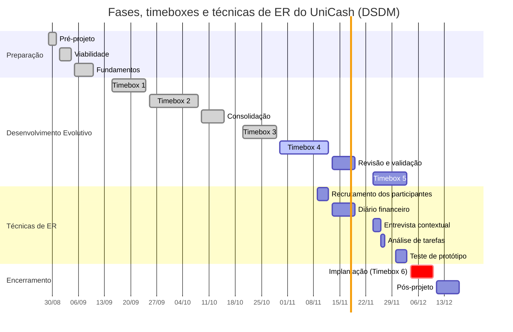

# Cronograma e Entregas

O desenvolvimento do UniCash é conduzido como um projeto de software, seguindo uma abordagem iterativa e incremental baseada no DSDM. O cronograma organiza as fases do projeto, os timeboxes, as atividades de Engenharia de Requisitos e os principais produtos, e separa o que foi previsto do que tem evidência de execução.

O planejamento considera prazo e equipe como restrições fixas. O escopo é ajustado por meio da priorização MoSCoW, e os timeboxes são orientados pelo Backlog do Produto e pelos resultados das validações.

## Cadência adotada

A estratégia prevê timeboxes de até duas semanas ([seção 4.1](estrategia.md)). Na prática, os timeboxes têm de 7 a 14 dias, ajustados ao calendário da disciplina: o Timebox 1 teve 10 dias, o 2 teve 14, o 3 teve 10 e o 4 tem 14; o 5 terá 10 e a Implantação (Timebox 6), 7.

A Consolidação (09/10/2026 a 15/10/2026) e a Revisão e validação (13/11/2026 a 19/11/2026) não são timeboxes nem novas fases do DSDM: são marcos de entrega e revisão do calendário da disciplina. Os períodos de 11/09/2026 a 14/09/2026, 16/10/2026 a 19/10/2026 e 20/11/2026 a 23/11/2026 são intervalos do calendário.

O fechamento de cada timebox é demonstrado por três registros:

1. **Ata da revisão do timebox**, com a cliente, registrando o que foi demonstrado e o resultado de cada item do checklist estruturado avaliado;
2. **Atualização da tabela de situação** desta página, com período realizado, evidências e pendências;
3. **Destino das pendências**, transferidas ao timebox seguinte ou retiradas por repriorização MoSCoW registrada no [Registro de decisões](decisoes.md).

Os Timeboxes 1 a 3 não têm ata de revisão; essa ausência consta nas pendências de cada um.

## Linha do tempo

## Situação das etapas

| Situação | Significado |
|---|---|
| **Concluída** | Encerrada, com evidência registrada para as atividades previstas. |
| **Concluída com pendências** | Encerrada, mas parte das atividades previstas não tem evidência ou foi deslocada para outra etapa. |
| **Em andamento** | Período em curso. |
| **Prevista** | Planejada, ainda sem execução. |

A coluna **Evidências registradas** cita apenas o que pode ser conferido: atas, decisões, issues do [Kanban](https://github.com/orgs/mdsreq-fga-unb/projects/123/views/6) e commits da documentação. O que estava previsto e não tem registro aparece em **Pendências**. A situação das issues corresponde à exportação do Kanban de 08/11/2026.

| Período previsto | Período realizado | Etapa | Situação | Evidências registradas | Pendências |
| --- | --- | --- | --- | --- | --- |
| 29/08/2026 a 31/08/2026 | 29/08/2026 a 31/08/2026 | Pré-projeto | Concluída | Entrevista com a cliente ([R01](atas/posts/r01.md)); investigação do problema, registrada na reunião de diagnóstico e na matéria do G1 de 31/08/2026 ([seção 5.6](engenharia_de_requisitos.md#56-registro-das-decisoes-e-evidencias-de-execucao)); criação do repositório (31/08/2026); Rich Picture, Diagrama de Ishikawa e stakeholders ([Cenário](cenario.md), seções 1.3 a 1.6). | Nenhuma registrada. |
| 01/09/2026 a 04/09/2026 | 01/09/2026 a 04/09/2026 | Viabilidade | Concluída com pendências | Perguntas à cliente em reunião em 01/09/2026, com gravação no Teams ([seção 5.6](engenharia_de_requisitos.md#56-registro-das-decisoes-e-evidencias-de-execucao)); adoção do DSDM e do Kanban e formulário de conhecimentos técnicos ([R02](atas/posts/r02.md), [D04](decisoes.md#d04)); fronteiras de escopo ([Solução](solucao.md), seção 2.6). | Lista de riscos, registrada só em 14/11/2026 ([Riscos do projeto](riscos.md)). A declaração inicial dos requisitos ocorreu em 22/09/2026, no Timebox 1. |
| 05/09/2026 a 10/09/2026 | 06/09/2026 a 08/09/2026 | Fundamentos | Concluída com pendências | Documentação da Entrega 1 e publicação automática do site (commits de 06/09/2026 a 08/09/2026). | Business case sem registro. A arquitetura foi definida em 29/10/2026 e 30/10/2026 ([D18](decisoes.md#d18), [D19](decisoes.md#d19)), o backlog de requisitos foi criado em 05/10/2026 ([D14](decisoes.md#d14)) e a priorização ocorreu no Timebox 2. |
| 15/09/2026 a 24/09/2026 | 17/09/2026 a 24/09/2026 | Timebox 1 | Concluída com pendências | Workshop com a cliente ([R03](atas/posts/r03.md), [D05](decisoes.md#d05)); levantamento dos requisitos ([#9](https://github.com/mdsreq-fga-unb/REQ-2026.2-T02-UniCash/issues/9), 18/09/2026 a 23/09/2026); primeira versão dos requisitos em 22/09/2026 ([R04](atas/posts/r04.md), [D06](decisoes.md#d06)); lições aprendidas ([#8](https://github.com/mdsreq-fga-unb/REQ-2026.2-T02-UniCash/issues/8), concluída em 24/09/2026) e revisão da intervenção social ([#3](https://github.com/mdsreq-fga-unb/REQ-2026.2-T02-UniCash/issues/3), concluída em 27/09/2026). | Critérios de aceitação não produzidos, depois substituídos pelo checklist estruturado; prototipação sem registro no período; ata de revisão do timebox. |
| 25/09/2026 a 08/10/2026 | 25/09/2026 a 08/10/2026 | Timebox 2 | Concluída com pendências | Priorização com a cliente e a representante ([R05](atas/posts/r05.md), [D08](decisoes.md#d08)); avaliação cruzada dos requisitos do grupo CyberSetor ([#11](https://github.com/mdsreq-fga-unb/REQ-2026.2-T02-UniCash/issues/11), concluída em 28/09/2026) e tabela de feedback do grupo CyberSetor, com decisão e justificativa por requisito ([Requisitos Funcionais](requisitos_funcionais.md#feedback-do-grupo-cybersetor)); correções da avaliação cruzada e do professor em 28/09/2026 e 29/09/2026 ([D07](decisoes.md#d07)); estratégia ([#4](https://github.com/mdsreq-fga-unb/REQ-2026.2-T02-UniCash/issues/4), concluída em 30/09/2026); reunião de equipe ([R06](atas/posts/r06.md)); validação do MVP ([R07](atas/posts/r07.md), [D09](decisoes.md#d09) a [D12](decisoes.md#d12)); cenário ([#1](https://github.com/mdsreq-fga-unb/REQ-2026.2-T02-UniCash/issues/1), concluída em 05/10/2026); adoção de casos de uso ([R08](atas/posts/r08.md), [D13](decisoes.md#d13), [D14](decisoes.md#d14)); [Escopo do MVP](mvp.md) de 29/09/2026 a 08/10/2026. | Wireframes sem ata de validação; checklist estruturado não produzido; ata de revisão do timebox. |
| 09/10/2026 a 15/10/2026 | 09/10/2026 a 13/10/2026 | Consolidação | Concluída | [DoR e DoD](dor_dod.md) e feedback do grupo CyberSetor em 10/10/2026; processo de ER ([#5](https://github.com/mdsreq-fga-unb/REQ-2026.2-T02-UniCash/issues/5)) e solução proposta ([#2](https://github.com/mdsreq-fga-unb/REQ-2026.2-T02-UniCash/issues/2)), concluídas em 12/10/2026; cronograma ([#6](https://github.com/mdsreq-fga-unb/REQ-2026.2-T02-UniCash/issues/6)), interação ([#7](https://github.com/mdsreq-fga-unb/REQ-2026.2-T02-UniCash/issues/7)) e priorização ([#10](https://github.com/mdsreq-fga-unb/REQ-2026.2-T02-UniCash/issues/10)), concluídas em 13/10/2026; entrega da Unidade II em 13/10/2026. | Nenhuma registrada. |
| 20/10/2026 a 29/10/2026 | 21/10/2026 a 29/10/2026 | Timebox 3 | Concluída com pendências | Issues de correção da Unidade 2 ([#16](https://github.com/mdsreq-fga-unb/REQ-2026.2-T02-UniCash/issues/16) a [#27](https://github.com/mdsreq-fga-unb/REQ-2026.2-T02-UniCash/issues/27)) abertas em 21/10/2026; ajustes do DoR e do DoD em 23/10/2026; RN09 a RN20 em 26/10/2026 e 27/10/2026; RF65 a RF67 ([D16](decisoes.md#d16)); [UC01 a UC05](casos_de_uso.md) em 27/10/2026 e suas issues ([#28](https://github.com/mdsreq-fga-unb/REQ-2026.2-T02-UniCash/issues/28) a [#32](https://github.com/mdsreq-fga-unb/REQ-2026.2-T02-UniCash/issues/32)) em 28/10/2026; ajuste de requisitos ([#13](https://github.com/mdsreq-fga-unb/REQ-2026.2-T02-UniCash/issues/13), concluída em 28/10/2026); paleta ([D17](decisoes.md#d17)); stack ([D18](decisoes.md#d18)) em 29/10/2026. | O timebox foi usado em ER e decisões de arquitetura: incremento funcional, testes, demonstração e feedback previstos sem registro; ata de revisão do timebox. |
| 30/10/2026 a 12/11/2026 | 30/10/2026 em diante | Timebox 4 | Em andamento | Firebase ([D19](decisoes.md#d19)); ambiente Expo Go e EAS com CI e CD ([#33](https://github.com/mdsreq-fga-unb/REQ-2026.2-T02-UniCash/issues/33)), atualização da stack ([#34](https://github.com/mdsreq-fga-unb/REQ-2026.2-T02-UniCash/issues/34)), arquivos de comunidade ([#35](https://github.com/mdsreq-fga-unb/REQ-2026.2-T02-UniCash/issues/35)) e configuração do GitHub Project ([#36](https://github.com/mdsreq-fga-unb/REQ-2026.2-T02-UniCash/issues/36)), concluídas em 31/10/2026; detalhamento dos UC01 a UC03 em 31/10/2026 e 01/11/2026; [checklists de DoR](evidencias_dor.md); Registro de decisões em 03/11/2026; repaginação do site ([#12](https://github.com/mdsreq-fga-unb/REQ-2026.2-T02-UniCash/issues/12), concluída em 04/11/2026); matriz de rastreabilidade em 04/11/2026; UC06 a UC09 e suas issues ([#43](https://github.com/mdsreq-fga-unb/REQ-2026.2-T02-UniCash/issues/43) a [#46](https://github.com/mdsreq-fga-unb/REQ-2026.2-T02-UniCash/issues/46)) em 04/11/2026; [D20](decisoes.md#d20) em 05/11/2026; revisão dos RNFs ([D21](decisoes.md#d21), [#21](https://github.com/mdsreq-fga-unb/REQ-2026.2-T02-UniCash/issues/21)). | UC01 ([#28](https://github.com/mdsreq-fga-unb/REQ-2026.2-T02-UniCash/issues/28)) em andamento e UC02 ([#29](https://github.com/mdsreq-fga-unb/REQ-2026.2-T02-UniCash/issues/29)) pronto para iniciar, ambos no marco Timebox 4; checklist estruturado dos casos de uso; comunicação das [D18](decisoes.md#d18) a [D21](decisoes.md#d21) à cliente; inclusão no catálogo do RF68, citado no UC07; issues da Unidade 2 ainda abertas. |
| 13/11/2026 a 19/11/2026 | Não iniciada | Revisão e validação | Prevista | Não se aplica. | Revisão do incremento do Timebox 4; estimativa de esforço dos RF59 e RF61 a RF64, sem valor no campo Estimate do Kanban; repriorização MoSCoW do escopo dos Timeboxes 5 e 6. |
| 24/11/2026 a 03/12/2026 | Não iniciada | Timebox 5 | Prevista | Não se aplica. | Não se aplica. |
| 04/12/2026 a 10/12/2026 | Não iniciada | Implantação (Timebox 6) | Prevista | Não se aplica. | Não se aplica. |
| 11/12/2026 a 17/12/2026 | Não iniciada | Pós-projeto | Prevista | Não se aplica. | Não se aplica. |

## Planejamento e fechamento dos timeboxes

A tabela de situação mostra o que tem evidência em cada etapa. Esta seção registra, para cada timebox, o que foi planejado na abertura (objetivo, itens selecionados e responsáveis) e o que foi decidido no fechamento (resultado, pendências e seu destino, ajustes de escopo).

Os Timeboxes 1 a 3 não tiveram reunião de planejamento nem de revisão registrada. A abertura e o fechamento deles foram **reconstruídos em 14/11/2026** a partir das atas, das issues do Kanban, dos responsáveis atribuídos e do Registro de decisões. Esses registros não substituem a ata de revisão com a cliente, que continua pendente. O Timebox 4 é o primeiro com o escopo definido por marco no Kanban.

| Timebox | Objetivo | Itens selecionados e responsáveis | Resultado no fechamento | Pendências e destino | Ajuste de escopo |
| --- | --- | --- | --- | --- | --- |
| Timebox 1 (17/09 a 24/09) | Levantar a primeira versão dos requisitos com a cliente | Workshop com a cliente ([R03](atas/posts/r03.md)); levantamento dos requisitos [#9](https://github.com/mdsreq-fga-unb/REQ-2026.2-T02-UniCash/issues/9) (Erick e Natan); lições aprendidas [#8](https://github.com/mdsreq-fga-unb/REQ-2026.2-T02-UniCash/issues/8) e revisão da intervenção social [#3](https://github.com/mdsreq-fga-unb/REQ-2026.2-T02-UniCash/issues/3) (Erick) | Primeira versão dos requisitos em 22/09 ([R04](atas/posts/r04.md), [D06](decisoes.md#d06)); [#9](https://github.com/mdsreq-fga-unb/REQ-2026.2-T02-UniCash/issues/9) e [#8](https://github.com/mdsreq-fga-unb/REQ-2026.2-T02-UniCash/issues/8) concluídas; [#3](https://github.com/mdsreq-fga-unb/REQ-2026.2-T02-UniCash/issues/3) concluída em 27/09, já no Timebox 2 | Critérios de aceitação: substituídos pelo checklist estruturado. Prototipação: passou ao Timebox 2. Ata de revisão: não feita | Ampliação: importação de extratos, grupos e gamificação entram como diferenciais ([D05](decisoes.md#d05)) |
| Timebox 2 (25/09 a 08/10) | Priorizar os requisitos e validar o MVP com a cliente | Priorização [#10](https://github.com/mdsreq-fga-unb/REQ-2026.2-T02-UniCash/issues/10) (sem responsável); avaliação cruzada [#11](https://github.com/mdsreq-fga-unb/REQ-2026.2-T02-UniCash/issues/11) (Erick e Natan); estratégia [#4](https://github.com/mdsreq-fga-unb/REQ-2026.2-T02-UniCash/issues/4) (Caio); cenário [#1](https://github.com/mdsreq-fga-unb/REQ-2026.2-T02-UniCash/issues/1) (Natan); Escopo do MVP (Natan) | Priorização por valor × esforço e MoSCoW ([D08](decisoes.md#d08)); MVP validado ([R07](atas/posts/r07.md)); casos de uso adotados ([D13](decisoes.md#d13)); todas as issues selecionadas concluídas | Wireframes sem ata de validação e checklist estruturado: passaram ao Timebox 3 e seguem sem registro. Ata de revisão: não feita | Redução: grupos e automação de relatórios saem do MVP ([D09](decisoes.md#d09)); funcionamento sem internet entra ([D10](decisoes.md#d10)) |
| Timebox 3 (21/10 a 29/10) | Corrigir a Unidade 2 e detalhar o MVP em casos de uso | Issues de correção [#16](https://github.com/mdsreq-fga-unb/REQ-2026.2-T02-UniCash/issues/16) a [#27](https://github.com/mdsreq-fga-unb/REQ-2026.2-T02-UniCash/issues/27) (responsáveis na tabela de participação); UC01 a UC05 [#28](https://github.com/mdsreq-fga-unb/REQ-2026.2-T02-UniCash/issues/28) a [#32](https://github.com/mdsreq-fga-unb/REQ-2026.2-T02-UniCash/issues/32) (Natan, Evellyn, Dante); ajuste de requisitos [#13](https://github.com/mdsreq-fga-unb/REQ-2026.2-T02-UniCash/issues/13) (Erick) | RN09 a RN20, RF65 a RF67 ([D16](decisoes.md#d16)), UC01 a UC05 escritos, paleta ([D17](decisoes.md#d17)) e stack ([D18](decisoes.md#d18)); [#13](https://github.com/mdsreq-fga-unb/REQ-2026.2-T02-UniCash/issues/13) concluída | Issues da Unidade 2: passaram ao Timebox 4 e parte segue aberta. Incremento de software, testes e demonstração: passaram ao Timebox 4. Ata de revisão: não feita | Arquitetura definida como aplicativo móvel com base local ([D18](decisoes.md#d18)) |
| Timebox 4 (30/10 a 12/11) | Base local, uso sem conta e cadastro de receitas e despesas (CP1, CP5) | Ambiente, CI e Kanban [#33](https://github.com/mdsreq-fga-unb/REQ-2026.2-T02-UniCash/issues/33) a [#36](https://github.com/mdsreq-fga-unb/REQ-2026.2-T02-UniCash/issues/36) (Bruno); UC01 [#28](https://github.com/mdsreq-fga-unb/REQ-2026.2-T02-UniCash/issues/28) (Natan); UC02 [#29](https://github.com/mdsreq-fga-unb/REQ-2026.2-T02-UniCash/issues/29) (Evellyn) | Ambiente Expo Go e EAS com CI e CD em 31/10; Firebase no ambiente ([PR #47](https://github.com/mdsreq-fga-unb/REQ-2026.2-T02-UniCash/pull/47)); UC01 implementado, com testes automatizados, e integrado à branch `develop` em 09/11 ([PR #48](https://github.com/mdsreq-fga-unb/REQ-2026.2-T02-UniCash/pull/48)); regras de limites, retenção, uso offline e gamificação validadas com a cliente ([D22](decisoes.md#d22)) | UC02 [#29](https://github.com/mdsreq-fga-unb/REQ-2026.2-T02-UniCash/issues/29): sem pull request, passa ao Timebox 5. Issue [#28](https://github.com/mdsreq-fga-unb/REQ-2026.2-T02-UniCash/issues/28) ainda aberta apesar do PR integrado: fechar após a demonstração. Demonstração do UC01 à cliente e ata de revisão: pendentes, a fazer na Revisão e validação (13/11 a 19/11) | Retirada da importação, dos comprovantes e do backup por arquivo ([D23](decisoes.md#d23)); arquitetura local-first com conta opcional ([D20](decisoes.md#d20)) |

A partir do Timebox 5, a abertura e o fechamento passam a ser registrados no momento em que ocorrem, numa ata de planejamento e numa ata de revisão, seguindo os três registros descritos em [Cadência adotada](#cadencia-adotada).

## Escopo por timebox

O escopo do Timebox 4 corresponde ao marco "Timebox 4" do Kanban. O dos timeboxes seguintes é uma proposta de replanejamento, a confirmar na repriorização de 13/11/2026 a 19/11/2026. Ela parte do recorte do [Escopo do MVP](mvp.md), das responsabilidades já atribuídas no [backlog de casos de uso](https://github.com/orgs/mdsreq-fga-unb/projects/130) e da [D20](decisoes.md#d20): a base local é pré-requisito de todas as funcionalidades e por isso vem primeiro, enquanto conta, sincronização e backup dependem de estimativa ainda não feita.

| Timebox | CPs | RFs | Casos de uso e issues | Responsáveis | Situação do escopo |
| --- | --- | --- | --- | --- | --- |
| Timebox 4 | CP1, CP5 | Base local e uso sem conta (RF61, RNF34, RNF35, RN06); RF07 a RF10; RF15 a RF18; RF32 e RF33 | UC01 ([#28](https://github.com/mdsreq-fga-unb/REQ-2026.2-T02-UniCash/issues/28)), UC02 ([#29](https://github.com/mdsreq-fga-unb/REQ-2026.2-T02-UniCash/issues/29)); ambiente e CI ([#33](https://github.com/mdsreq-fga-unb/REQ-2026.2-T02-UniCash/issues/33) a [#36](https://github.com/mdsreq-fga-unb/REQ-2026.2-T02-UniCash/issues/36)) | Natan (UC01), Evellyn (UC02), Bruno (ambiente) | Em andamento; o que não for concluído até 12/11/2026 passa ao Timebox 5 |
| Timebox 5 | CP2, CP3, CP4, CP6, CP8 | RF11, RF40 (UC03); RF19 e RF65 a RF67, se validados (UC06); RF34 (UC04); RF37, RF38 (UC05); RF35 (UC08); RF39 (UC09); RF68 (UC07), após inclusão no catálogo; metas (RF12 a RF14, RF20, RF36); RF41, RF42, RF55; gamificação (RF44 a RF46) | UC03 ([#30](https://github.com/mdsreq-fga-unb/REQ-2026.2-T02-UniCash/issues/30)), UC06 ([#43](https://github.com/mdsreq-fga-unb/REQ-2026.2-T02-UniCash/issues/43)), UC04 ([#31](https://github.com/mdsreq-fga-unb/REQ-2026.2-T02-UniCash/issues/31)), UC05 ([#32](https://github.com/mdsreq-fga-unb/REQ-2026.2-T02-UniCash/issues/32)), UC07 ([#44](https://github.com/mdsreq-fga-unb/REQ-2026.2-T02-UniCash/issues/44)), UC08 ([#45](https://github.com/mdsreq-fga-unb/REQ-2026.2-T02-UniCash/issues/45)), UC09 ([#46](https://github.com/mdsreq-fga-unb/REQ-2026.2-T02-UniCash/issues/46)); casos de uso de metas, gamificação e tutorial a escrever | Dante (UC03), Leonardo (UC06); demais a atribuir | Proposta; capacidade a confirmar, com cortes na ordem MoSCoW |
| A decidir na repriorização | CP5 | Conta (RF01 a RF06, RF31) e sincronização (RF59, RF62) | A escrever | A atribuir | A [D20](decisoes.md#d20) tornou a conta opcional. Com a retirada do backup por arquivo (RF63, RF64) pela [D23](decisoes.md#d23), a sincronização com conta é a única forma de recuperar os dados em outro aparelho (RNF40); quem usa o app sem conta não tem recuperação (risco R01 em [Riscos do projeto](riscos.md)) |
| Implantação (Timebox 6) | Recorte final do MVP | Sem novos RFs | Todos os casos de uso do recorte | Equipe | Verificação final com o checklist estruturado e correção de pendências |
| Após o MVP | CP1, CP2, CP6, CP7 | Grupos (CP7); importação de extratos e comprovantes (RF21, RF47 a RF50, RF60) e backup por arquivo (RF63, RF64), retirados do escopo atual; categorias próprias (RF65 a RF67), se não forem validadas | Não se aplica | Não se aplica | Fora do MVP ([D09](decisoes.md#d09), [D23](decisoes.md#d23)) |

## Técnicas de ER previstas no processo

As técnicas abaixo constam da [seção 5.1](engenharia_de_requisitos.md), ainda não foram executadas e não têm issue no Kanban. Os períodos são propostos e dependem do recrutamento pela cliente e pelas representantes; se não houver participantes suficientes, o corte é registrado no Registro de decisões. Cada técnica deve ganhar uma issue com responsável antes do início.

| Técnica | Período previsto | Participantes | Responsáveis | Situação |
| --- | --- | --- | --- | --- |
| Recrutamento dos participantes | 09/11/2026 a 12/11/2026 | Cliente e representantes dos segmentos | Leonardo | Prevista |
| Diário financeiro | 13/11/2026 a 19/11/2026 | Cinco estudantes e três representantes de famílias, durante sete dias | Leonardo | Prevista |
| Entrevista contextual | 24/11/2026 a 26/11/2026 | Dois estudantes e um representante de família, escolhidos entre os participantes do diário | Leonardo e Bruno | Prevista |
| Análise de tarefas | 26/11/2026 a 27/11/2026 | Equipe | Bruno | Prevista |
| Teste de protótipo com tarefas | 30/11/2026 a 03/12/2026 | Cinco estudantes e três representantes de famílias | Bruno, na condução, e Leonardo, na observação | Prevista |
| Questionário | A definir na repriorização de 13/11/2026 a 19/11/2026 | Estudantes e famílias recrutados pelas representantes dos segmentos | Leonardo | Não aplicada |

Até 13/11/2026, nenhuma das datas do diário financeiro, da entrevista contextual e da análise de tarefas foi reprogramada. O questionário não foi aplicado como instrumento estruturado: as perguntas à cliente foram feitas em reunião em 01/09/2026, com gravação no Teams (ver [seção 5.6](engenharia_de_requisitos.md#56-registro-das-decisoes-e-evidencias-de-execucao)).

## Participação registrada dos integrantes

A tabela reúne o que pode ser conferido: responsáveis pelas issues no Kanban, commits no repositório da documentação (sem contar merges) e participação nas atas. O número de commits mede apenas a documentação e não substitui a avaliação do conteúdo.

| Integrante | Issues sob responsabilidade | Commits na documentação | Atividades de ER com registro |
| --- | --- | --- | --- |
| **Bruno Bernardes Duarte** | Concluídas: [#5](https://github.com/mdsreq-fga-unb/REQ-2026.2-T02-UniCash/issues/5), [#33](https://github.com/mdsreq-fga-unb/REQ-2026.2-T02-UniCash/issues/33), [#34](https://github.com/mdsreq-fga-unb/REQ-2026.2-T02-UniCash/issues/34), [#35](https://github.com/mdsreq-fga-unb/REQ-2026.2-T02-UniCash/issues/35), [#36](https://github.com/mdsreq-fga-unb/REQ-2026.2-T02-UniCash/issues/36). Abertas: [#16](https://github.com/mdsreq-fga-unb/REQ-2026.2-T02-UniCash/issues/16), [#17](https://github.com/mdsreq-fga-unb/REQ-2026.2-T02-UniCash/issues/17), [#27](https://github.com/mdsreq-fga-unb/REQ-2026.2-T02-UniCash/issues/27) | 19, de 10/10/2026 a 03/11/2026 | Perguntas e transcrição da [R01](atas/posts/r01.md); formulário de conhecimentos ([R02](atas/posts/r02.md)); participação em [R08](atas/posts/r08.md); reestruturação do processo de ER; stack e sincronização ([D18](decisoes.md#d18), [D19](decisoes.md#d19)); Registro de decisões e colunas de origem e situação dos requisitos. |
| **Caio Pacheco Santos** | Concluída: [#4](https://github.com/mdsreq-fga-unb/REQ-2026.2-T02-UniCash/issues/4) | 5, de 28/09/2026 a 27/10/2026 | Comparativo de processos ([R02](atas/posts/r02.md)); participação em [R06](atas/posts/r06.md) e [R08](atas/posts/r08.md); correção dos requisitos; papéis do DSDM; correção do cálculo do MVP. |
| **Dante Fernandes Scarpati** | Concluída: [#2](https://github.com/mdsreq-fga-unb/REQ-2026.2-T02-UniCash/issues/2). Abertas: [#21](https://github.com/mdsreq-fga-unb/REQ-2026.2-T02-UniCash/issues/21), [#26](https://github.com/mdsreq-fga-unb/REQ-2026.2-T02-UniCash/issues/26), [#30](https://github.com/mdsreq-fga-unb/REQ-2026.2-T02-UniCash/issues/30) | 11, de 22/09/2026 a 13/10/2026 | Pesquisa de mercado ([R05](atas/posts/r05.md)); participação em [R02](atas/posts/r02.md), [R06](atas/posts/r06.md), [R07](atas/posts/r07.md) e [R08](atas/posts/r08.md); relação CP/RF e revisão da Visão do Produto; análise de soluções existentes; requisitos e regras de negócio da Unidade II. |
| **Erick Alves dos Santos** | Concluídas: [#3](https://github.com/mdsreq-fga-unb/REQ-2026.2-T02-UniCash/issues/3), [#7](https://github.com/mdsreq-fga-unb/REQ-2026.2-T02-UniCash/issues/7), [#8](https://github.com/mdsreq-fga-unb/REQ-2026.2-T02-UniCash/issues/8), [#9](https://github.com/mdsreq-fga-unb/REQ-2026.2-T02-UniCash/issues/9), [#11](https://github.com/mdsreq-fga-unb/REQ-2026.2-T02-UniCash/issues/11), [#13](https://github.com/mdsreq-fga-unb/REQ-2026.2-T02-UniCash/issues/13). Abertas: [#18](https://github.com/mdsreq-fga-unb/REQ-2026.2-T02-UniCash/issues/18), [#19](https://github.com/mdsreq-fga-unb/REQ-2026.2-T02-UniCash/issues/19), [#24](https://github.com/mdsreq-fga-unb/REQ-2026.2-T02-UniCash/issues/24) | 19, de 24/09/2026 a 04/11/2026 | Levantamento dos requisitos e avaliação cruzada (com Natan); participação em [R02](atas/posts/r02.md), [R06](atas/posts/r06.md) e [R08](atas/posts/r08.md); intervenção social e lições aprendidas; ajuste dos requisitos pelo feedback; matriz de rastreabilidade e gráfico de priorização. |
| **Evellyn de Sousa Rocha** | Concluída: [#12](https://github.com/mdsreq-fga-unb/REQ-2026.2-T02-UniCash/issues/12). Abertas: [#27](https://github.com/mdsreq-fga-unb/REQ-2026.2-T02-UniCash/issues/27), [#29](https://github.com/mdsreq-fga-unb/REQ-2026.2-T02-UniCash/issues/29) | 6, de 22/09/2026 a 12/10/2026 | Participação em [R05](atas/posts/r05.md); primeira versão dos requisitos funcionais e não funcionais; interação com a cliente; estratégia; repaginação do site. |
| **Leonardo Ramiro Alves de Oliveira** | Concluída: [#6](https://github.com/mdsreq-fga-unb/REQ-2026.2-T02-UniCash/issues/6). Abertas: [#20](https://github.com/mdsreq-fga-unb/REQ-2026.2-T02-UniCash/issues/20), [#43](https://github.com/mdsreq-fga-unb/REQ-2026.2-T02-UniCash/issues/43) | 5, de 09/10/2026 a 12/10/2026 | Participação em [R05](atas/posts/r05.md), [R06](atas/posts/r06.md) e [R07](atas/posts/r07.md); atualização do cronograma; alinhamento das fases do DSDM na estratégia. |
| **Natan José França** | Concluídas: [#1](https://github.com/mdsreq-fga-unb/REQ-2026.2-T02-UniCash/issues/1), [#9](https://github.com/mdsreq-fga-unb/REQ-2026.2-T02-UniCash/issues/9), [#11](https://github.com/mdsreq-fga-unb/REQ-2026.2-T02-UniCash/issues/11). Abertas: [#22](https://github.com/mdsreq-fga-unb/REQ-2026.2-T02-UniCash/issues/22), [#23](https://github.com/mdsreq-fga-unb/REQ-2026.2-T02-UniCash/issues/23), [#25](https://github.com/mdsreq-fga-unb/REQ-2026.2-T02-UniCash/issues/25), [#28](https://github.com/mdsreq-fga-unb/REQ-2026.2-T02-UniCash/issues/28) | 55, de 06/09/2026 a 05/11/2026 | Condução de [R01](atas/posts/r01.md), [R05](atas/posts/r05.md) e [R07](atas/posts/r07.md); participação em [R02](atas/posts/r02.md) e [R08](atas/posts/r08.md); documentação da Entrega 1; Escopo do MVP; DoR e DoD; regras de negócio; RF65 a RF67; UC01 a UC09; paleta de cores. |

A issue de priorização ([#10](https://github.com/mdsreq-fga-unb/REQ-2026.2-T02-UniCash/issues/10)) foi concluída sem responsável atribuído. Para que a execução das próximas atividades seja verificável, cada atividade de ER deve ter uma issue com responsável no Kanban, e a linha do histórico de versões deve citar essa issue.

## Controle do fluxo

O Kanban é utilizado para visualizar o fluxo de trabalho, identificar gargalos e acompanhar o trabalho em andamento durante os timeboxes. O limite de WIP é de 3 itens simultâneos na coluna *In progress*, com possibilidade de revisão nas retrospectivas caso sejam identificados gargalos recorrentes.

!!! tip "Acompanhe no GitHub Projects"
    - [Kanban do timebox](https://github.com/orgs/mdsreq-fga-unb/projects/123/views/6){ target="_blank" rel="noopener" }: fluxo de trabalho atual e limite de WIP.
    - [Backlog do Produto (MoSCoW)](https://github.com/orgs/mdsreq-fga-unb/projects/123/views/7){ target="_blank" rel="noopener" }: itens priorizados para o MVP e os próximos timeboxes.
    - [Backlog de casos de uso](https://github.com/orgs/mdsreq-fga-unb/projects/130){ target="_blank" rel="noopener" }: casos de uso e checklists estruturados por CP.

    Os quadros ficam na organização `mdsreq-fga-unb` e só aparecem para quem é membro dela.

### Situação do quadro em 14/11/2026

Como os quadros só aparecem para membros da organização, a situação do [Kanban do timebox](https://github.com/orgs/mdsreq-fga-unb/projects/123/views/6) é registrada aqui a cada fechamento. Os dados abaixo foram exportados do GitHub Project em 14/11/2026.

| Coluna | Itens | Issues |
| --- | --- | --- |
| Backlog | 2 | — |
| Ready | 3 | [#20](https://github.com/mdsreq-fga-unb/REQ-2026.2-T02-UniCash/issues/20) (Leonardo), [#24](https://github.com/mdsreq-fga-unb/REQ-2026.2-T02-UniCash/issues/24) (Erick), [#27](https://github.com/mdsreq-fga-unb/REQ-2026.2-T02-UniCash/issues/27) (Bruno e Evellyn) |
| In progress | **4** | [#16](https://github.com/mdsreq-fga-unb/REQ-2026.2-T02-UniCash/issues/16) e [#17](https://github.com/mdsreq-fga-unb/REQ-2026.2-T02-UniCash/issues/17) (Bruno), [#18](https://github.com/mdsreq-fga-unb/REQ-2026.2-T02-UniCash/issues/18) (Erick), [#23](https://github.com/mdsreq-fga-unb/REQ-2026.2-T02-UniCash/issues/23) (Natan) |
| In review | 2 | [#22](https://github.com/mdsreq-fga-unb/REQ-2026.2-T02-UniCash/issues/22) e [#25](https://github.com/mdsreq-fga-unb/REQ-2026.2-T02-UniCash/issues/25) (Natan) |
| Done | 20 | — |

**WIP observado:** a coluna *In progress* tem 4 itens, acima do limite de 3. Os quatro são issues de correção da Unidade 2, abertas em 21/10/2026 e ainda abertas três semanas depois.

**Gargalo identificado:** as correções da Unidade 2 ocupam o fluxo desde o Timebox 3 e competem com os casos de uso do MVP. Natan acumula um item em andamento e dois em revisão, e os itens em revisão não têm revisor atribuído.

**Decisão a tomar na Revisão e validação (13/11 a 19/11):** voltar a respeitar o limite de WIP, concluindo ou devolvendo a *Ready* um dos itens em andamento antes de puxar novos, e atribuir revisores aos itens em *In review*. A decisão tomada deve ser registrada no [Registro de decisões](decisoes.md).

As revisões de timebox e as validações serão realizadas com a cliente conforme os objetivos de cada ciclo. Os usuários finais considerados para validação são estudantes universitários e representantes de famílias, representados por Maria Vitória e Alana França. As práticas de testes automatizados, integração contínua e revisão por pull request serão mantidas durante os ciclos de desenvolvimento.

## Evidências de construção

A [seção 4.1](estrategia.md#41-estrategia-priorizada) compromete a equipe com testes automatizados, integração contínua e revisão obrigatória por *pull request*. A publicação do site não comprova essas práticas; a tabela abaixo registra o que já tem evidência no repositório do aplicativo em 14/11/2026.

| Prática | Evidência | Situação |
| --- | --- | --- |
| Testes automatizados | O UC01 foi integrado com testes de unidade, serviço, telas e regras do Firestore, configurados com Jest em `mobile/` ([PR #48](https://github.com/mdsreq-fga-unb/REQ-2026.2-T02-UniCash/pull/48)) | **Parcial:** há testes do UC01. Faltam os testes das regras de saldo, orçamento e metas, que dependem do UC04, UC05 e UC08 (Timebox 5) |
| Integração contínua | O workflow `mobile-ci.yml` executa lint, verificação de tipos e `expo-doctor` a cada pull request ([PR #33](https://github.com/mdsreq-fga-unb/REQ-2026.2-T02-UniCash/pull/33)). O [PR #50](https://github.com/mdsreq-fga-unb/REQ-2026.2-T02-UniCash/pull/50) inclui os testes e as Security Rules no pipeline | **Parcial:** os testes ainda não rodam no pipeline da `develop`. O PR #50 está aberto, com a verificação de testes falhando |
| Entrega contínua | O EAS Build gera o APK a cada versão publicada ([PR #33](https://github.com/mdsreq-fga-unb/REQ-2026.2-T02-UniCash/pull/33)) | Configurada; ainda sem versão publicada do aplicativo |
| Revisão por pull request | Os PRs [#33](https://github.com/mdsreq-fga-unb/REQ-2026.2-T02-UniCash/pull/33), [#34](https://github.com/mdsreq-fga-unb/REQ-2026.2-T02-UniCash/pull/34) e [#35](https://github.com/mdsreq-fga-unb/REQ-2026.2-T02-UniCash/pull/35) tiveram revisão registrada. Os PRs [#47](https://github.com/mdsreq-fga-unb/REQ-2026.2-T02-UniCash/pull/47) e [#48](https://github.com/mdsreq-fga-unb/REQ-2026.2-T02-UniCash/pull/48), do aplicativo, e os PRs de documentação de 31/10 a 03/11 foram integrados sem revisão | **Não cumprida de forma consistente:** falta exigir revisão aprovada e CI verde na proteção das branches `develop` e `main` |

## Histórico de versões

| Versão | Data | Descrição | Autor |
|---|---|---|---|
| 1.0 | 06/09/2026 | Adiciona documentação para entrega 1 | Natan França |
| 1.1 | 09/10/2026 | Cronograma atualizado da issue #6 | Leonardo Ramiro |
| 1.2 | 10/10/2026 | Explicita metodos de declaração de requisitos | Natan França |
| 1.3 | 12/10/2026 | Atualiza cronograma conforme feedback | Leonardo Ramiro |
| 1.4 | 12/10/2026 | Ajusta validações do cronograma | Leonardo Ramiro |
| 1.5 | 31/10/2026 | Adiciona consulta rápida de requisitos e plugins de navegação | Bruno Duarte |
| 1.6 | 31/10/2026 | Adiciona links para o Kanban e os backlogs no GitHub Projects | Bruno Duarte |
| 1.7 | 03/11/2026 | Inclui o histórico de versões | Bruno Duarte |
| 1.8 | 09/11/2026 | Separa previsão e evidência (issue #26): inclui a cadência adotada, a situação, o período realizado e as pendências de cada etapa com base nas atas, no Kanban e no histórico de commits, o escopo de RFs por timebox, os períodos das técnicas de ER e a participação registrada dos integrantes | Dante Scarpati |
| 1.9 | 13/11/2026 | Atualiza a situação do Pré-projeto, da Viabilidade e do Timebox 2 conforme as evidências da issue #18, registra as perguntas à cliente em reunião de 01/09/2026 e a situação do questionário e informa que as datas das técnicas de ER não foram reprogramadas | Erick Alves |
| 1.10 | 14/11/2026 | Registra o planejamento e o fechamento dos Timeboxes 1 a 4, a situação do Kanban com o WIP observado, as evidências de construção e o vínculo com os riscos; alinha o escopo de backup e importação à D23 (issue #17) | Bruno Duarte |
