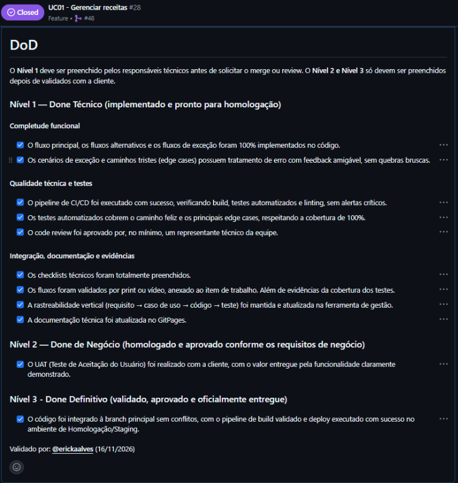

# Evidências da Definition of Done

Esta página reúne as evidências de aplicação da **Definition of Done (DoD)**
nos itens concluídos. Os critérios normativos permanecem em
[Definition of Ready e Definition of Done](dor_dod.md); esta página contém
somente os registros visuais e a identificação dos itens validados.

As capturas foram registradas nos itens do backlog do GitHub e mostram o
checklist do DoD preenchido e validado pela equipe.

## UC01 — Gerenciar receitas

**Item no backlog:** [#28](https://github.com/mdsreq-fga-unb/REQ-2026.2-T02-UniCash/issues/28)

*Figura 1 — Checklist de DoD preenchido para a UC01. Validação registrada em
16/11/2026.*

