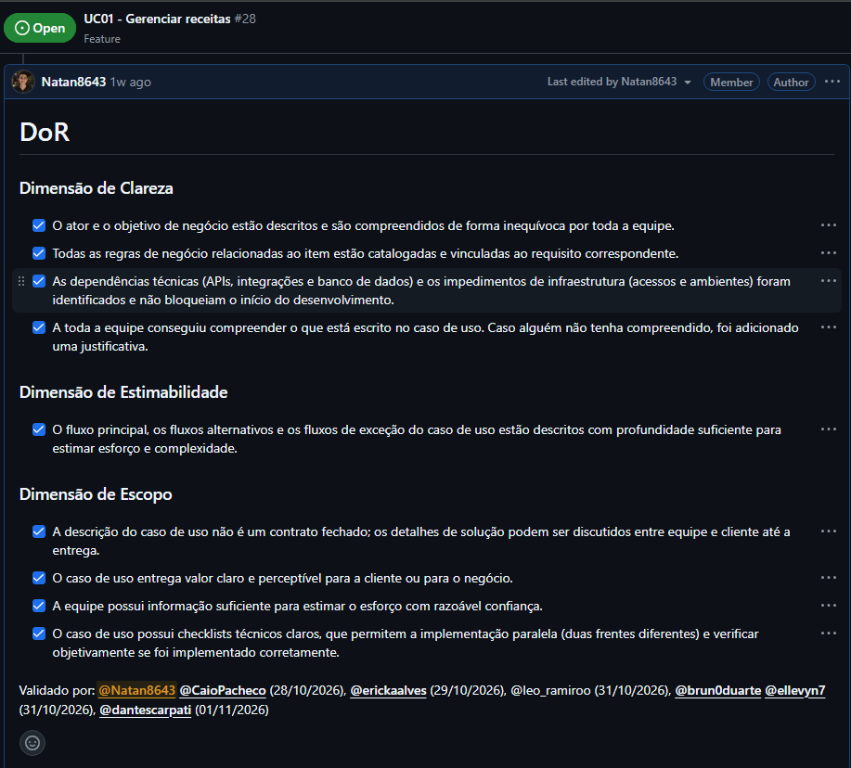
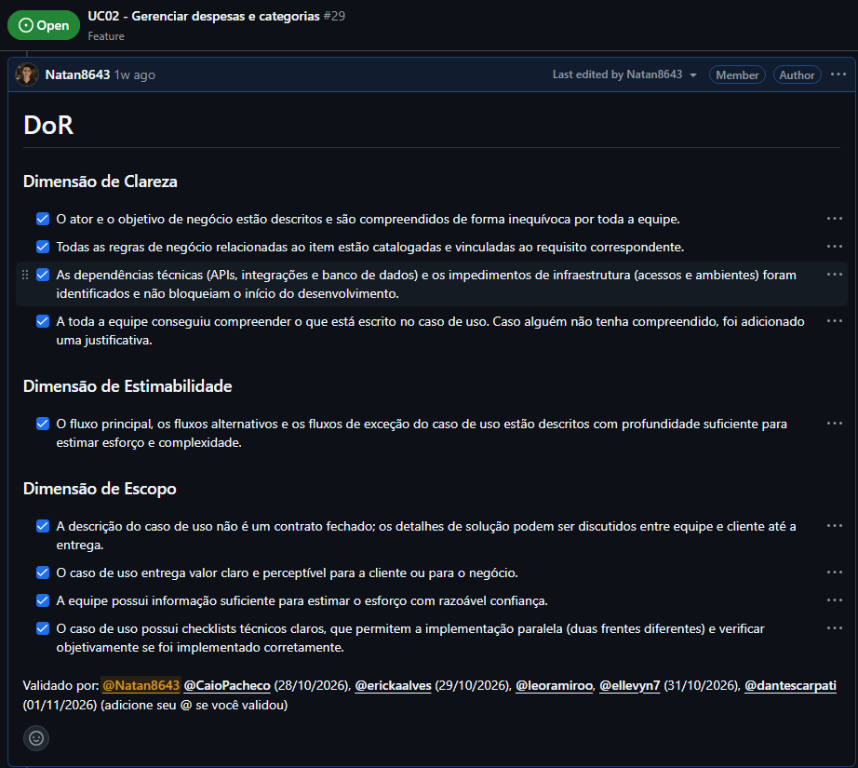
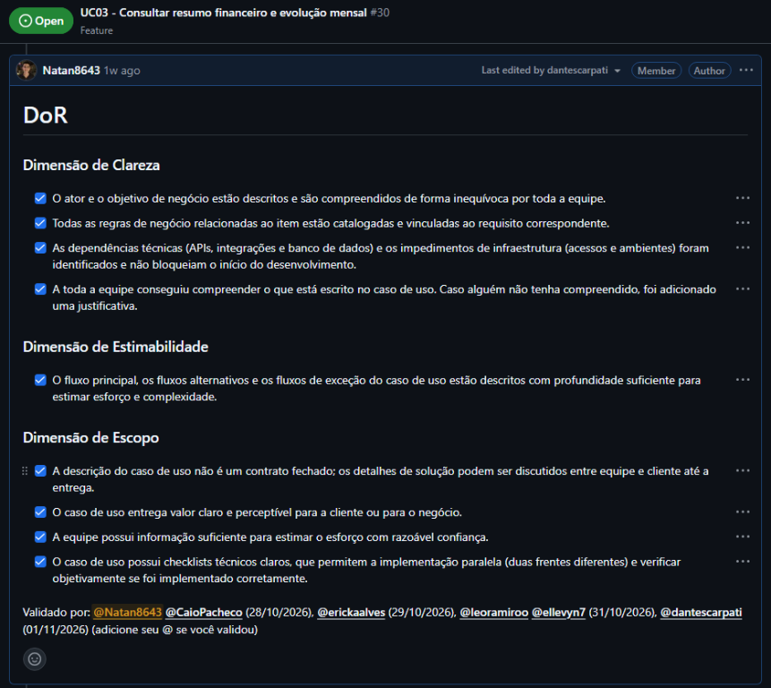

# Evidências da Definition of Ready

Esta página reúne as evidências de aplicação da **Definition of Ready (DoR)**
nos itens preparados para desenvolvimento. Os critérios normativos permanecem
em [Definition of Ready e Definition of Done](dor_dod.md); esta página contém
somente os registros visuais e a identificação dos itens validados.

As capturas foram registradas nos itens do backlog do GitHub e mostram o
checklist do DoR preenchido e validado pela equipe.

## UC01 — Gerenciar receitas

**Item no backlog:** [#28](https://github.com/mdsreq-fga-unb/REQ-2026.2-T02-UniCash/issues/28)

*Figura 1 — Checklist de DoR preenchido para a UC01. Validações registradas
entre 28/10/2026 e 01/11/2026.*

## UC02 — Gerenciar despesas e categorias

**Item no backlog:** [#29](https://github.com/mdsreq-fga-unb/REQ-2026.2-T02-UniCash/issues/29)

*Figura 2 — Checklist de DoR preenchido para a UC02. Validações registradas
entre 28/10/2026 e 01/11/2026.*

## UC03 — Consultar resumo financeiro e evolução mensal

**Item no backlog:** [#30](https://github.com/mdsreq-fga-unb/REQ-2026.2-T02-UniCash/issues/30)

*Figura 3 — Checklist de DoR preenchido para a UC03. Validações registradas
entre 28/10/2026 e 01/11/2026.*

## Relação com o cronograma

Estas evidências correspondem à preparação dos itens para desenvolvimento e
estão associadas ao **Timebox 4 (30/10/2026–12/11/2026)** no
[cronograma e entregas](cronograma.md).
