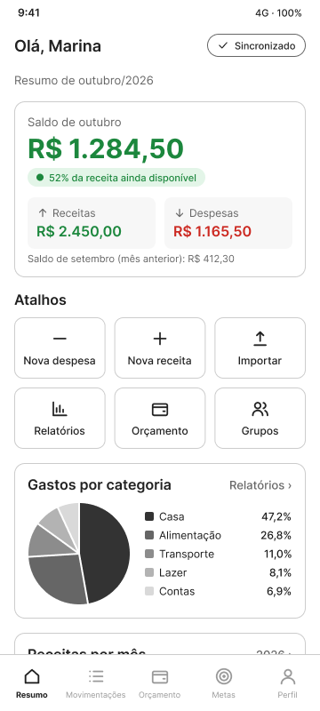
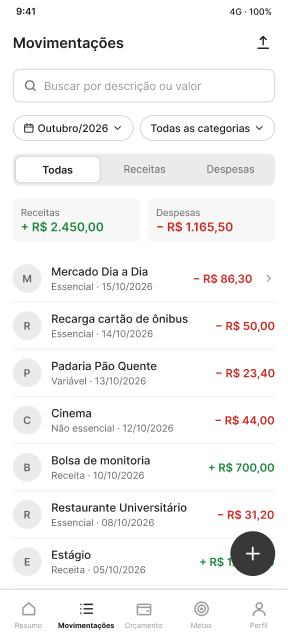
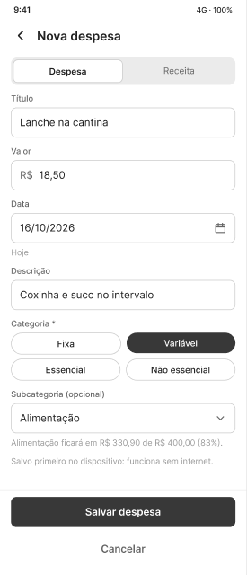
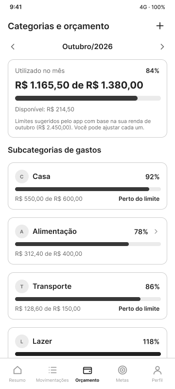
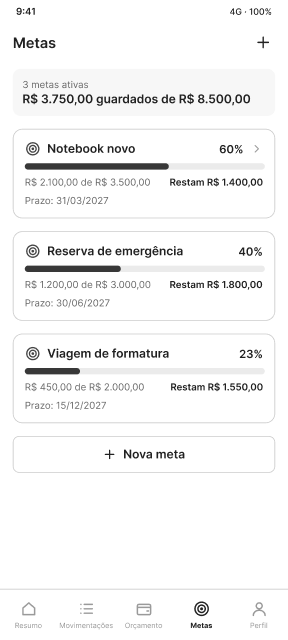
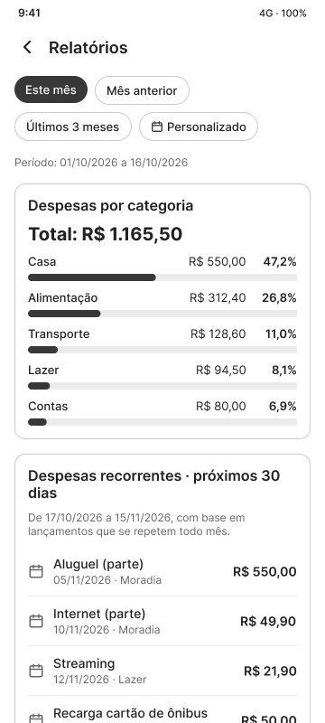
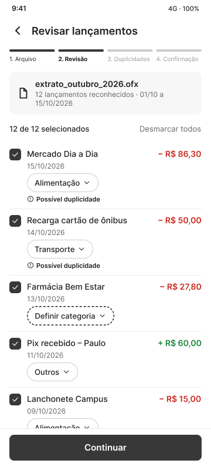

<section class="ld-hero">
  

    Gratuito · Código aberto · Funciona sem internet
    <h1 class="ld-anima">Seu dinheiro organizado, do xerox à formatura.</h1>
    
O UniCash ajuda estudantes universitários e famílias a registrar receitas e despesas, acompanhar limites por categoria e guardar dinheiro para metas, com os dados guardados no próprio celular.

    

      <a class="ld-botao ld-botao--primario" href="inicio/">Ver a documentação do projeto →</a>
      <a class="ld-botao ld-botao--secundario" href="#telas">Conhecer o app</a>
    

    <ul class="ld-numeros ld-anima" aria-label="O projeto em números">
      <li><strong data-contar="66">66</strong>requisitos funcionais</li>
      <li><strong data-contar="36">36</strong>no MVP</li>
      <li><strong data-contar="8">8</strong>reuniões registradas em ata</li>
    </ul>
  

  

    

      

        
<strong>Metas</strong>+

        
<small>3 metas ativas</small><b>R$ 3.750 de R$ 8.500</b>

        

<b>Notebook novo</b>60%
<i style="--p:60%"></i><small>Faltam R$ 1.400,00</small>

        

<b>Reserva de emergência</b>40%
<i style="--p:40%"></i><small>Faltam R$ 1.800,00</small>

        

<b>Viagem de formatura</b>23%
<i style="--p:23%"></i><small>Faltam R$ 1.550,00</small>

      

    

    

      

        
<strong>Olá, Marina</strong>✓ Sincronizado

        

          <small>Saldo de outubro</small>
          <b class="ld-saldo" data-dinheiro="1284.50">R$ 1.284,50</b>
          ● 52% da receita ainda disponível
          

            
<small>↑ Receitas</small><b class="ld-verde">R$ 2.450,00</b>

            
<small>↓ Despesas</small><b class="ld-vermelho">R$ 1.165,50</b>

          

        

        

          <small>Gastos por categoria</small>
          

            
            <ul><li><i style="background:#082F49"></i>Casa 47%</li><li><i style="background:#0E7490"></i>Alimentação 27%</li><li><i style="background:#22C55E"></i>Transporte 11%</li><li><i style="background:#BAE6FD"></i>Lazer 8%</li></ul>
          

        

        <nav class="ld-abas">ResumoMovim.OrçamentoMetas</nav>
      

    

  

</section>

<section class="ld-secao" id="recursos">
  <header class="ld-cabecalho ld-revela">
    Por que o UniCash
    <h2>Feito para quem administra pouco dinheiro com muito cuidado</h2>
    
As necessidades vieram de conversas com a cliente e com representantes de estudantes e famílias.

  </header>
  

    <article class="ld-recurso ld-revela">⚡<h3>Registro em poucos toques</h3>
Lance uma despesa de xerox ou um lanche na cantina em segundos, com categoria e data já sugeridas.
</article>
    <article class="ld-recurso ld-revela">🚦<h3>Limites em semáforo</h3>
Cada categoria mostra verde, amarelo, laranja ou vermelho conforme o gasto se aproxima do limite definido.
</article>
    <article class="ld-recurso ld-revela">🎯<h3>Metas que dá para ver</h3>
Acompanhe quanto falta para o notebook, a reserva de emergência ou a viagem de formatura.
</article>
    <article class="ld-recurso ld-revela">📴<h3>Funciona sem internet</h3>
Os dados ficam no aparelho. A conta só é necessária para sincronizar entre dispositivos.
</article>
    <article class="ld-recurso ld-revela">🔒<h3>Privacidade de verdade</h3>
Sem venda de dados, sem pedir dados bancários e com o código aberto para qualquer pessoa conferir.
</article>
    <article class="ld-recurso ld-revela">🏆<h3>Conquistas pelo hábito</h3>
Selos e pontos para quem mantém as contas no verde e registra com constância.
</article>
  

</section>

<section class="ld-secao ld-secao--telas" id="telas">
  <header class="ld-cabecalho ld-revela">
    O app
    <h2>Telas do protótipo</h2>
    
As telas abaixo seguem o wireframe navegável validado com as clientes, já com a paleta Tesouraria Teal definida no RNF38.

  </header>
  

    <figure class="ld-revela">
      

        

          
<strong>Movimentações</strong>⇪

          
🔍 Buscar por descrição ou valor

          
TodasReceitasDespesas

          <ul class="ld-lista">
            <li><i>M</i>
<b>Mercado Dia a Dia</b><small>Essencial · 15/10</small>
<em class="ld-vermelho">− R$ 86,30</em></li>
            <li><i>R</i>
<b>Recarga do ônibus</b><small>Essencial · 14/10</small>
<em class="ld-vermelho">− R$ 50,00</em></li>
            <li><i>B</i>
<b>Bolsa de monitoria</b><small>Receita · 10/10</small>
<em class="ld-verde">+ R$ 700,00</em></li>
            <li><i>R</i>
<b>Restaurante Universitário</b><small>Essencial · 08/10</small>
<em class="ld-vermelho">− R$ 31,20</em></li>
            <li><i>E</i>
<b>Estágio</b><small>Receita · 05/10</small>
<em class="ld-verde">+ R$ 1.200,00</em></li>
          </ul>
          +
        

      

      <figcaption>Movimentações com filtros por período e categoria</figcaption>
    </figure>
    <figure class="ld-revela">
      

        

          
<strong>‹ Nova despesa</strong>

          
DespesaReceita

          <label class="ld-campo"><small>Título</small>Lanche na cantina</label>
          <label class="ld-campo"><small>Valor</small>R$ 18,50</label>
          <label class="ld-campo"><small>Data</small>16/10/2026 · Hoje</label>
          
FixaVariávelEssencialNão essencial

          <small class="ld-aviso">Alimentação ficará em 83% do limite. Salvo primeiro no dispositivo: funciona sem internet.</small>
          Salvar despesa
        

      

      <figcaption>Registro com aviso de limite antes de salvar</figcaption>
    </figure>
    <figure class="ld-revela">
      

        

          
<strong>Orçamento</strong>+

          <ul class="ld-orcamento">
            <li>
<b>Alimentação</b>83%
<i class="laranja" style="--p:83%"></i><small>R$ 330,90 de R$ 400,00</small></li>
            <li>
<b>Transporte</b>45%
<i class="verde" style="--p:45%"></i><small>R$ 90,00 de R$ 200,00</small></li>
            <li>
<b>Lazer</b>96%
<i class="vermelho" style="--p:96%"></i><small>R$ 96,00 de R$ 100,00</small></li>
            <li>
<b>Moradia</b>62%
<i class="amarelo" style="--p:62%"></i><small>R$ 310,00 de R$ 500,00</small></li>
          </ul>
          
⚠ Lazer passou de 90% do limite deste mês.

        

      

      <figcaption>Limites por categoria com indicador em semáforo</figcaption>
    </figure>
  

  

    
Ver os wireframes originais (baixa fidelidade, Figma)

    

      
      
      
      
      
      
      
    

    
<a href="https://www.figma.com/design/FCpcvcFIixiiutEYruNAJe/" target="_blank" rel="noopener">Abrir o wireframe navegável no Figma ↗</a>

  

</section>

<section class="ld-secao" id="video">
  <header class="ld-cabecalho ld-revela">
    Em vídeo
    <h2>O UniCash em 20 segundos</h2>
  </header>
  

    <video controls playsinline preload="metadata" poster="videos/unicash-lancamento-capa.jpg" aria-label="Vídeo de lançamento do UniCash">
      <source src="videos/unicash-lancamento.mp4" type="video/mp4">
      Seu navegador não reproduz vídeos. <a href="videos/unicash-lancamento.mp4">Baixe o vídeo</a>.
    </video>
  

  
Quer a apresentação completa da visão do produto? <a href="https://www.youtube.com/watch?v=3qLZkL-_ePc" target="_blank" rel="noopener">Assista no YouTube ↗</a>

</section>

<section class="ld-final ld-revela">
  <h2>Quer ver como o projeto está sendo construído?</h2>
  
A documentação reúne o problema, os requisitos, o MVP, os casos de uso, as atas das reuniões e o processo de engenharia.

  <a class="ld-botao ld-botao--primario" href="inicio/">Ir para a documentação →</a>
</section>

